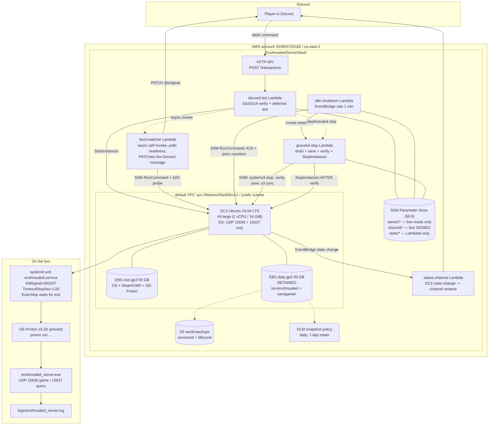

# ARCHITECTURE — enshroudedproj

An on-demand, mostly-off **Enshrouded** dedicated server in the user's own AWS account.
Discord `/enshrouded start` boots it; it detects when nobody is playing, makes the game
write a clean world save, and only then stops the EC2 instance.

Adapted from the working reference implementation at `C:\Users\Dave\github\uoprivateserver`
(ServUO on AWS). Where the reference's approach still works, we copy it deliberately rather
than reinvent. Where Enshrouded differs — UDP transport, no RCON, no console commands,
RAM-hungry, Windows-only binary — this document says so and solves it explicitly.

**Status: design only. No implementation exists yet.**

---

## 0. Evidence policy (read this before trusting any number below)

Every factual claim about Enshrouded is labelled:

- **VERIFIED (source)** — confirmed against a cited source during research.
- **ASSUMED — needs validation** — plausible, commonly repeated, or inferred, but *not*
  confirmed. Treated as a design risk and assigned to a spike work package.

Keen Games' own config documentation (`enshrouded.zendesk.com`) returns HTTP 403 to
automated fetches, so most Enshrouded facts here come from secondary hosting-provider
documentation and community tooling. That is a weaker class of evidence than AWS docs and
is marked accordingly.

A third label is used where a claim comes from a source that could not be re-fetched:

- **REPORTED, UNCONFIRMED** — a source said it, but the URL did not resolve on re-check, or
  a second reviewer could not reproduce the lookup. Weaker than ASSUMED, because we cannot
  even re-read the original.

**The single biggest unverified thing in this design is how to count players on a UDP game
server.** WP-07 exists purely to settle it empirically before the idle-shutdown logic is
finalised. Do not implement WP-09 or WP-10 before WP-07 reports. §5.6 specifies what
happens to this architecture under each way WP-07 could come back.

---

## 0.1 Decisions locked by the user (do not re-litigate)

| Decision | Choice | Where it lands |
| --- | --- | --- |
| **OS** | **Ubuntu 24.04 LTS + GE-Proton** running the Windows binary. **Reverses this document's earlier Windows Server recommendation** — see §6.1 for the reversal and its reasoning. | §6.1, §4, §5, §7, §10 |
| AWS account | **Same account as the UO server** (`334953720182`). A separate account was considered and declined. | §6.2 guardrails become the *only* line of defence, and are therefore mandatory. |
| Region | **`us-east-2`** | Throughout. |
| Instance type | **`r6i.large`** (2 vCPU / 16 GiB, ~$23.6/mo on Linux) | §6.4, §9 |
| Idle threshold | **10 minutes** of zero players | §3.2, §5 |
| Discord app | **A new application, separate from the UO bot** | §11 |

---

## 1. Invariants (violating any of these is a bug, not a trade-off)

1. **Stack names are namespaced `Enshrouded*`.** The target AWS account (`334953720182`,
   `us-east-2`) *already* contains a live, working ServUO deployment in generic-named
   stacks: `InfrastructureStack`, `AdminUiStack`, `GithubOidcStack`. A CDK app in this repo
   that uses CDK's default stack names would adopt, mutate, or destroy a working game
   server. Every stack sets `stackName` explicitly; `cdk deploy` always names stacks; never
   `--all`. A unit test asserts it.
2. **The Enshrouded CI identity cannot touch the UO stacks.** Because this project shares
   an account with a live game server (a locked decision — §0.1), the §6.2 guardrails are
   **mandatory, not recommended**:
   **(a)** a separate CDK bootstrap qualifier `enshrd1` / toolkit stack
   `CDKToolkitEnshrouded` — **human prerequisite**, §6.2.1 step 2;
   **(b)** the `EnshroudedUoGuardrail` `Deny` policy, attached to **both** the CloudFormation
   execution role **and** the CDK deploy role — **human prerequisite**, §6.2.1 steps 1 and 3.
   It must not be put on the OIDC role, which never performs the actions in question
   (§6.2.1a);
   **(c)** a CI step that fails any `cdk diff` touching a stack not matching
   `Enshrouded*` — **WP-02**;
   **(d)** importing the pre-existing OIDC provider and prefixing every IAM role name —
   **WP-02**, enforced by a synth test in **WP-01**;
   **(e)** the §6.2.2 simulation checks pass, in **both** directions — the denies deny and
   the allows still allow — **human prerequisite, before the first deploy**.
   Shipping without all five is shipping without a safety net. See §6.2.4 for what an
   escape would destroy.
3. **The stop path must send `SIGINT` — not `SIGTERM` — to `enshrouded_server.exe`, and
   must then WAIT for the process to exit.** systemd's default first signal is `SIGTERM`
   and its `TimeoutStopSec` default is 90 s; the signal is wrong and the wait is the part
   every known implementation gets subtly wrong. See §4.
4. **The GE-Proton version is pinned and checksummed, and the pin tracks the GAME
   version.** An unpinned translation layer is the principal risk the user accepted in
   choosing Linux (§6.1); it must never float. But pinning guards against drift, **not
   against being pinned to the wrong thing** — a Proton version correct for one Enshrouded
   release can be wrong for the next, which is exactly what the 1.0 release did to our
   `10-26` pin (§6.1.3a). **Every significant game release is a trigger to re-check the
   pin against the reference project's.** See §6.1.3.
5. **A measurement failure never stops the instance.** If player detection is indeterminate,
   the box stays up and an alarm fires. Billing a few extra dollars is recoverable; a
   corrupted world is not. A hard max-uptime cap bounds the downside.
6. **`StopInstances` is called only after a verified save.** Never as the first action.
7. **Admin access is SSM Session Manager only.** No SSH, no RDP, no management port open.
   Only UDP 15636/15637 inbound.
8. **Deploys happen only via merge-to-main GitHub Actions with GitHub OIDC.** Never local
   `cdk deploy`. PRs run read-only `cdk diff`. **The CI quality gates are advisory, not
   enforcing** — see §11.1; nothing in GitHub currently *blocks* a merge.
9. **Secrets live in SSM SecureString.** Never in git, never in CI variables, never in a
   CDK context value.
10. **Every resource is tagged** `project=enshroudedproj`, `repo=<owner>/enshroudedproj`.
11. **Maintenance mode gates idle-shutdown.** Any long operation (deploy, game update,
    restore) sets it; idle-shutdown skips entirely while it is `true`. Carried over from the
    reference as a hard requirement.

---

## 2. Component diagram



ASCII fallback of the critical path:

```
Discord ──POST──> API GW ──> discord-bot λ ──(defer in <3s)──> Discord
                                 │
                                 ├── ec2:StartInstances
                                 └── async self-invoke ──> boot-watcher λ
                                                             │ poll: EC2 running?
                                                             │ poll: SSM ping Online?
                                                             │ poll: unit active + /proc/net/udp has 15637?
                                                             │ poll: A2S_INFO on EIP:15637 answers?
                                                             └── PATCH @original "ready, join at <ip>:15636"

EventBridge (1 min) ──> idle-shutdown λ ──SSM RunCommand──> box
                            │                                 ├─ A2S_INFO loopback:15637 -> players
                            │                                 ├─ /proc/net/snmp Udp InDatagrams delta -> rate
                            │                                 └─ /proc/<pid>/stat + VmRSS delta -> activity
                            │ zero for 10 consecutive min
                            └──invoke──> graceful-stop λ
                                            1. set run-state=stopping
                                            2. re-check players (abort if >0)
                                            3. SSM: systemctl stop enshrouded  (SIGINT -> save -> wait for exit)
                                            4. SSM: verify save mtime > t0, exit not SIGKILL(137)
                                            5. SSM: aws s3 sync savegame/ -> S3
                                            6. ec2:StopInstances        <-- ONLY if 3,4,5 all succeeded
                                            on any failure: do NOT stop, set maintenance, alarm -> Discord
```

---

## 3. Flow narratives

### 3.1 Flow A — `/enshrouded start` → playable

1. A user runs `/enshrouded start` in Discord. Discord POSTs the interaction to the HTTP API
   Gateway route `/interactions`.
2. `discord-bot` Lambda verifies the Ed25519 signature over
   `X-Signature-Timestamp || rawBody` using the application's public key. Invalid → `401`
   (Discord requires a 401, not a 400, or it will refuse to register the endpoint). `PING`
   (type 1) → `{"type":1}`.
3. The handler immediately returns a **deferred** response (`{"type":5}`) — Discord's ack
   deadline is 3 s and the real work regularly exceeds it. *(Reference-verified: the UO
   project measured 3.5–4 s for `StartInstances` + a Discord REST call alone.)*
4. Before returning, it asynchronously self-invokes itself (or the `boot-watcher` Lambda —
   same pattern as the reference's `finishStartUo`) with the interaction token.
5. The async invocation checks instance state. If already `running`, it jumps to step 9. If
   `stopping`, it replies "shutting down, try again in a minute" and exits (do not race a
   drain). Otherwise it sets `run-state=starting` and calls `ec2:StartInstances`.
6. It PATCHes the original reply: *"Booting the world — about 3 minutes. I'll edit this
   message when it's ready."*
7. **Readiness gate 1:** poll `ec2:DescribeInstances` until `running`, then
   `ssm:DescribeInstanceInformation` until `PingStatus=Online`. SSM agent registration is
   what makes every later on-box check possible, so this gate comes first.
8. On first SSM contact, the box's boot path has already run, driven by systemd ordering:
   the data volume is mounted at `/srv/enshrouded`, `enshrouded-update.service`
   (`Type=oneshot`, `Before=enshrouded.service`) has optionally run
   `steamcmd +@sSteamCmdForcePlatformType windows +app_update 2278520`,
   `enshrouded_server.json` has been rendered from the template + SSM SecureStrings, and
   `enshrouded.service` has started. No scheduled-task equivalent is needed — systemd
   dependency ordering replaces it, which is one of the small wins of the Linux move.
9. **Readiness gate 2 — ONE definition of on-box "ready", used by every component.**
   `SSM RunCommand` polls `systemctl is-active enshrouded` **and** the socket check
   borrowed verbatim from the reference container (§6.1.2): the query port appearing in
   `/proc/net/udp`, matched as an uppercase-hex local port. PATCH the message with coarse
   progress ("world loading…").

   **`[Session] 'HostOnline' (up)!` is now VERIFIED**, observed at 00:00:03,670 followed by
   `finished transition from 'Lobby' to 'Host_Online'`. The socket predicate **remains the
   gate** (PID-free, no log parsing, §6.1.2), but the string is now a confirmed source for
   human-facing progress text rather than a REPORTED one.

   **This resolves a divergence the WP-06 review caught:** WP-06 implemented readiness as
   unit-active + process + UDP 15637 bound, while this section previously also leaned on
   the `[Session] 'HostOnline' (up)!` log line, leaving WP-06 and WP-12 with two different
   definitions of ready. **The socket predicate wins and is the only gate.** It is
   unambiguous, PID-free (so it is immune to the Wine process-topology problem, §6.1.2),
   and does not depend on a log string we have never verified — two conflicting "ready"
   strings are in circulation (WP-07 (f)). **The log line may be surfaced as human-facing
   progress text but must never gate anything.** WP-12 adopts WP-06's predicate rather
   than the reverse.

   Known limitation, and the reason gate 3 exists: a bound socket proves the process is
   *listening*, not that the world has finished loading. If WP-07 finds a gap between
   "socket bound" and "actually joinable", gate 3 covers it — which is exactly why gate 3
   and not gate 2 is authoritative.
10. **Readiness gate 3 (authoritative):** the Lambda sends an `A2S_INFO` datagram from
    itself to `<public-ip>:15637` over the internet. This is the only check that proves the
    *player-visible* path works end-to-end — security group, host firewall, and the
    process's actual bind. A green gate 2 with a red gate 3 means a firewall or bind
    problem, and the message says exactly that.
11. PATCH the original reply with the join info: server name, `"<public-ip>:15636"`, and
    "Enshrouded → Play → Servers → Add Server". **The password is never posted here** —
    `/enshrouded password` replies ephemerally (`flags: 64`) instead.
12. `boot-watcher` gives up after 8 minutes, PATCHes a failure message naming the gate that
    did not go green, and raises a CloudWatch alarm. It does **not** stop the instance (a
    human may want to debug it) — but the max-uptime cap in §5.5 still applies.

Total expected cold start: **ASSUMED ~2–3 min** (EC2 Linux boot ~30–60 s + SSM
registration + Proton prefix init + game world load). Linux boots materially faster than
Windows Server, so the Linux decision improves this user-visible number as a side effect.
Needs measurement in WP-07 (i). Note Proton may initialise a Wine prefix on *first* run,
making the very first boot substantially slower than steady state — the prefix lives on
the retained data volume so this is a one-time cost, but WP-07 should record both numbers.

### 3.2 Flow B — idle → save → stop

1. EventBridge invokes `idle-shutdown` every **1 minute**.
2. **Gate: maintenance mode.** If `/enshroudedproj/maintenance-mode == "true"`, log and
   return. Nothing else runs. *(Carried over from the reference verbatim — a deploy that
   outlives the idle threshold must not get its own box stopped from under it.)*
3. **Gate: instance state.** `DescribeInstances`. If not `running`, **reset the last-active
   timestamp to now** and return. *(Reference-verified race fix: without this, a fresh boot
   inherits a stale timestamp — potentially hours old from stack-deploy time — and the very
   first check after boot concludes "idle for hours" and stops the box before anyone can
   join.)*
4. **Gate: launch grace.** Compute minutes since `instance.LaunchTime`. If less than
   `LAUNCH_GRACE_MINUTES` (15 — must exceed worst-case boot + world load *and* the
   10-minute idle threshold, so a fresh boot can never be stopped by an inherited clock),
   reset last-active and return. *(Reference-verified
   belt-and-braces: the state reset in step 3 only fires if this Lambda's schedule happens
   to catch the instance mid-stop. A fast stop→start cycle can leave a stale timestamp.
   `LaunchTime` is written atomically by EC2 itself and cannot be raced the same way.)*
5. **Measure.** One `SSM SendCommand` (`AWS-RunShellScript`) runs all three probes on
   the box and prints a single JSON line. See §5 for the exact commands. Returns
   `{players, a2sOk, udpRate, cpuPerSec, wsDeltaMb}`.
6. **Classify.** Let `M1` = A2S player count, `M2` = UDP datagram rate, `M3` = game-process
   CPU/working-set activity (§5.4). Exactly which of these is authoritative is set by
   WP-07's findings (§5.6); the shape of the rule does not change:
   - any *enabled and trusted* mechanism says "someone is here" → **ACTIVE**
   - all enabled mechanisms agree "nobody is here" → **IDLE**
   - the authoritative mechanism failed but a secondary one says "someone is here" →
     **ACTIVE**
   - the authoritative mechanism failed and no secondary says "someone is here" →
     **INDETERMINATE**
   - SSM command failed / timed out → **INDETERMINATE**

   Disagreement always resolves toward **ACTIVE**, and every disagreement emits a metric so
   the thresholds can be retuned from a month of real data rather than re-guessed.
7. **ACTIVE** → write last-active = now, return.
   **INDETERMINATE** → write last-active = now (i.e. stay up), increment a
   `DetectionIndeterminate` CloudWatch metric, return. An alarm on 5 of these in 10 minutes
   pages the ops channel.
   **IDLE** → fall through.
8. Read last-active. If `now - lastActive < 10 min`, log and return.
9. Threshold crossed. Set `/enshroudedproj/run-state = "stopping"` (idempotence guard: if it
   is already `stopping`, return — a drain is in flight) and invoke `graceful-stop`
   asynchronously. `idle-shutdown` exits here; it never calls `StopInstances` itself.
10. `graceful-stop` posts "nobody's around — saving and shutting down" to the Discord status
    channel, then **re-runs the player probe once more** (a player could have joined in the
    last ~10 s). If ACTIVE: clear `run-state`, write last-active = now, abort the drain.
11. `graceful-stop` sends one SSM script (`AWS-RunShellScript`) that records
    `t0=$(date +%s)` and runs `systemctl stop enshrouded.service`, which blocks until the
    unit is fully stopped or `TimeoutStopSec` expires. The unit sends **`SIGINT`** — not
    `SIGTERM` — to the game process and waits for it to exit. See §4.
12. **Save verification**, in the same script, all three of:
    a. **The unit has stopped — accept `inactive` OR `failed`.** **VERIFIED 2026-10-19:**
       after a clean SIGINT exit `ActiveState` is **`failed`, not `inactive`**, because the
       main process (the Proton launcher) exits non-zero and `Restart=no` leaves the unit
       in a failed state. Accept `inactive` and `failed`; reject `active`, `activating`,
       `deactivating` and `reloading`.

       **Requiring `inactive` would reintroduce the exact wedge that dropping the
       `Result=success` gate removed — same root cause, different field.** This is now the
       third instance of one pattern, so state it as a rule:

       > **On this stack a clean shutdown looks like a failure to systemd. No systemd
       > success-shaped field may ever be used as the gate** — not `Result`, not
       > `ActiveState`, and not `systemctl stop`'s own exit code. The only admissible
       > evidence is: the process is gone, it was not SIGKILLed, the stop did not time out,
       > and the savegame state is consistent (check b).
    b. **The save check, corrected 2026-10-19 — compare BEFORE and AFTER, not just
       "did a file appear".** **VERIFIED:** `savegame/` is **empty on a running server**
       ~30 s after start; the world is deserialised into memory and nothing is written
       until the first autosave (~10 min) or shutdown. The original rule — "a file with
       mtime > `t0` must exist" — therefore fails on a legitimate short session, refuses
       `StopInstances`, and sets maintenance mode. **That is the wedge failure mode, and
       the very first idle shutdown after a fresh provision would hit it**, since
       `savegame/` is empty at that point by definition. Not an exotic case.

       The check must ask *"did we lose anything?"*, not *"did a file appear?"*. Snapshot
       the directory listing **before** issuing the stop, then:

       | before | after | verdict |
       | --- | --- | --- |
       | non-empty | a file has mtime > `t0` | **PASS** |
       | non-empty | nothing newer than `t0` | **FAIL** — a world existed on disk and the clean shutdown did not write. This is the case the gate exists for. |
       | **empty** | still empty | **PASS**, emit a `SaveSkippedEmptyWorld` metric. There was no world on disk to lose. |
       | empty | a file appeared | **PASS** |

       The S3 sync (step 13) is then a natural no-op in the empty case.

       **The remaining blind spot, stated rather than hidden:** "empty before, empty after"
       is only *provably* safe if nothing happened. A player could join a brand-new world,
       build for nine minutes, and a failed shutdown-save would lose that while this rule
       passes. Narrow it with the signal we already have — `graceful-stop` knows whether
       `last-active` was ever updated after `LaunchTime`, i.e. whether any player connected
       this boot. **If a player connected and `savegame/` is still empty after a clean
       stop, that is a FAIL.** If no player ever connected, passing is correct.

       **CORRECTED AGAIN 2026-10-19 — the "newer than `t0`" test is wrong, and the
       measurement that broke it also makes the gate safer.** **VERIFIED:** `world0.ksd`
       (87,760 B) is written **on player disconnect**, not only at shutdown — the log shows
       `[save2] Server sent final client save` / `Received final savegame ack`. So a save
       appears for reasons other than our stop.

       Why that breaks the rule: the drain only runs after **10 minutes of zero players**,
       so by then the last player's state was already flushed at *their* disconnect. A
       clean shutdown may legitimately write **nothing**, because nothing has changed. The
       "a file must be newer than `t0`" test would then fail a perfectly good stop — the
       wedge again, now on the *normal* path rather than an edge case.

       **The question the gate should ask is not "did a save happen during our stop?" but
       "is the on-disk save at least as new as the last thing that could have changed the
       world?"** We already hold that timestamp: `last-active`, the parameter whose
       10-minute staleness triggered the drain.

       | condition | verdict |
       | --- | --- |
       | a `savegame/` file has mtime > `t0` | **PASS** — a shutdown save was written |
       | newest `savegame/` mtime ≥ `last-active` | **PASS** — nothing could be unflushed; the disconnect save already covered it |
       | `savegame/` non-empty but newest mtime < `last-active` | **FAIL** — a player was present *after* the last save and nothing flushed. This is the real data-loss signature and the case the gate exists for. |
       | `savegame/` empty, and **`player-seen-boot` does not match this boot** | **PASS**, `SaveSkippedEmptyWorld` metric |
       | `savegame/` empty, and **`player-seen-boot` matches this boot** | **FAIL** |

       **CORRECTED 2026-10-19 (third revision) — the discriminator, not the rows.** The
       rows are right; the way "did a player connect this boot" was to be determined was
       wrong. It specified comparing `last-active` against `LaunchTime`, which **WP-10's
       own launch-grace race fix makes almost always true**: the grace branch writes
       `last-active = now` for the first 15 minutes precisely so a fresh boot cannot
       inherit a stale timestamp. So on a session nobody joins, the discriminator claimed a
       player had connected, the table landed on FAIL, and maintenance mode was set —
       **wedging the server on the single most common path there is: started, nobody
       showed up.** WP-09 implementing the table literally rather than quietly "fixing" it
       is what surfaced this, and that was the right call.

       **Root cause, stated as a rule because this is the second time it has happened:**
       `last-active` was being asked to carry two different facts — *"when did we last
       observe activity"* (its real job, written for clock-reset reasons) and *"did a human
       ever connect this boot"*. **A parameter written for one purpose must never be read
       as evidence of another.** The first such overload produced the `Result=success`
       trap; this is the same mistake in a different field.

       **Ruling: option (c), an explicit fact — with one refinement.** A boolean flag
       cleared on the not-running reset would reintroduce the very race the UO fix exists
       for: a stop→start cycle faster than the 1-minute schedule leaves the flag stale
       `true` from the previous boot, and the next empty session wedges exactly as before.

       So **`/enshroudedproj/state/player-seen-boot` stores the `LaunchTime` it pertains
       to**, not a boolean:

       - **Written** (to the current `LaunchTime`, as epoch ms) the first time a probe
         *affirmatively* detects a player.
       - **Read** as "a player connected this boot" **iff its value equals the instance's
         current `LaunchTime`.** Any other value, or absent, means no.
       - **Never explicitly cleared.** A stale value from a previous boot simply fails to
         match, so there is nothing to race.

       This reuses the one timestamp that **cannot** be raced — `LaunchTime` is written
       atomically by EC2 itself — which is the same property the original race fix leans
       on. Applying the hard-won trick to the new flag rather than inventing a second
       mechanism is the point.

       **Only the EXACT signals may set it** — `(a2sOk and players > 0)` or
       `(logOk and mCount > 0)` — never `udpRate`/`cpuRate`. Those are heuristics that can
       trip on a port scan or background load, and a false `true` here is a wedge. A false
       `false` is not reachable in practice: if a player connected they also disconnected
       before the drain (it only runs after 10 idle minutes), and a disconnect writes a
       save (§3.2 step 12b), so `savegame/` would not be empty. The empty-plus-seen
       combination therefore genuinely means "a disconnect happened and no save was
       written", which is exactly the data-loss signature this row exists to catch.

       Use **file mtimes and the SSM parameter**, both wall-clock. **Never a log
       timestamp** — those are uptime-relative (§5.6).

       **WP-07 (g5) — partly answered, and the branch stays.** A never-saved world *did*
       get a file, but at **disconnect**, not at stop. So the empty→empty branch remains
       reachable: a session nobody joins never disconnects anyone and so never saves.
       **But that branch is now VERIFIED safe rather than assumed safe** — we know saves
       fire on disconnect, and in that branch there were no disconnects because there were
       no connections. The "no player connected this boot" condition I attached as a
       hedge turns out to be exactly the right discriminator. Keep it; it is no longer
       fail-open reasoning.
    c. The unit's exit status does **not** indicate a truncated stop. Read
       `systemctl show enshrouded -p Result -p ExecMainCode -p ExecMainStatus` and fail
       **only** on the two signatures that unambiguously mean the save was cut short:
       `Result=timeout`, or `ExecMainCode=killed` with `ExecMainStatus=9` (SIGKILL).

       **`ExecMainCode` has two spellings and both must be handled.** `systemctl show`
       prints it **numerically** (the `si_code`: 1 = exited, **2 = killed**, 3 = dumped)
       while `systemctl status` prints the **word**. Treat `2`/`9` and `killed`/`9` as the
       same rejection signature. **ASSUMED — confirm against the live drain**; defensive
       handling of both costs nothing and the failure mode of getting it wrong is missing a
       real SIGKILL.

    **Do NOT gate on `Result=success`.** A clean SIGINT shutdown under Proton may well
    exit non-zero — if the game exits 130, systemd reports `Result=exit-code`, and if Wine
    lets the signal kill the process outright it reports `Result=signal`. Treating either
    as failure would set maintenance mode on **every normal idle shutdown**, which means
    the server auto-stops exactly once and then never again: 24/7 billing plus a human
    clearing the flag daily. That is not a safe failure direction, it is a guaranteed
    wedge on the happy path.

    **Check (b) is the real evidence.** A fresh `savegame/` mtime proves a save happened
    and is independent of whatever exit code Proton happens to surface. (a) and (c) are
    guards against the two specific ways we know a save gets truncated, not a general
    health assertion.

    **WP-05 was right not to add `SuccessExitStatus=130`** — we do not yet know that 130
    is the value, and hard-coding a guess would mask real failures. **WP-07 (g) must
    record the actual `Result` / `ExecMainCode` / `ExecMainStatus` triple from a
    known-good stop**, and WP-09 may then add it as a positive assertion alongside (b).
    The script exits non-zero and prints which check failed otherwise.
13. **Backup.** Still in the same script, with the process confirmed dead (no open file
    handles): `aws s3 sync /srv/enshrouded/savegame/ s3://<bucket>/savegame/`. `--delete`
    is deliberately **omitted** so S3 never loses a copy the box dropped; bucket
    versioning covers the rest.
14. **Only if steps 11–13 all reported Success**, `graceful-stop` calls
    `ec2:StopInstances`, clears `run-state`, and posts "saved and stopped".
15. **On any failure**, `graceful-stop` does **not** stop the instance. It sets
    `maintenance-mode = "true"` (so `idle-shutdown` stops retrying into the same failure),
    raises the `SaveVerificationFailed` alarm, and posts a loud message to the Discord ops
    channel naming the failed check. A human clears maintenance mode after looking.

---

## 4. Graceful save + shutdown (the highest-risk subsystem)

### 4.1 What we know

- **VERIFIED** ([gameserverkings](https://www.gameserverkings.com/knowledge-base/enshrouded/backing-up-and-restoring-your-world/)):
  Enshrouded keeps **ten numbered rolling copies** of the world, writing a new one roughly
  **every 10 minutes** and **one on a clean shutdown**, overwriting the oldest. There is a
  `-index` file that records which numbered copy is live, and *the live copy is very often
  not the unnumbered base file*. Any backup or restore must copy the entire `<worldid>*`
  glob including `-index`, not just the base file.
- **VERIFIED** (same source): a **Kill writes nothing on the way out**; a graceful **Stop**
  writes the shutdown save. An unclean stop therefore loses up to ~10 minutes of play and
  risks a torn/corrupt snapshot (open file handles).
- **VERIFIED by reading the source** (`container/entrypoint.sh` in
  [jsknnr/enshrouded-server](https://github.com/jsknnr/enshrouded-server), the fix that
  closed [issue #65](https://github.com/jsknnr/enshrouded-server/issues/65)): the handler
  is registered as `trap shutdown TERM`, and `shutdown()` runs
  **`pkill -2 -f '[e]nshrouded_server.exe'`**. `-2` is **SIGINT**. The container traps
  `SIGTERM` from Docker and *translates* it into **`SIGINT` delivered to the game process*
  — so the signal the binary is believed to honour is the interrupt, not the terminate.
- **VERIFIED by reading the same source: the container *does* wait for the game to exit,
  but only as long as Docker lets it.** The handler itself returns immediately, but the
  script's main body is a liveness loop —
  `while awk '{print $2}' /proc/net/udp | grep -q ":$QUERY_PORT_HEX$"; do sleep 3; done` —
  so the trap fires during a `sleep`, `pkill -2` delivers SIGINT, the handler returns, and
  the loop resumes until the game releases its UDP port, i.e. until the process actually
  exits. The wait is implicit and port-based rather than PID-based, but it is a real wait.
  **The limitation is that it is bounded by `docker stop`'s 10-second default grace
  period**, after which Docker SIGKILLs the container regardless of how far the save has
  got. See §4.1.1.
- **VERIFIED** ([systemd.kill(5)](https://www.freedesktop.org/software/systemd/man/latest/systemd.kill.html)):
  systemd's first signal defaults to **`SIGTERM`** and is overridden by `KillSignal=`;
  `TimeoutStopSec=` defaults to **90 s**; after that timeout systemd repeats the
  termination with **`SIGKILL`** (or `FinalKillSignal=`) unless `SendSIGKILL=no`.
  `KillMode=control-group` (the default) sends the signal to **every** process in the
  unit's cgroup, not only the main one.
- **VERIFIED:** Enshrouded has **no RCON** and **no documented manual-save console command**.
  (Several hosting articles mention a "/save" button — that is the hosting panel's own
  wrapper around a stop, not a game command. Treat "there is a manual save" as **false**
  unless WP-07 finds otherwise.)

#### 4.1.1 The honest reading of the evidence — it is weaker than it looks

It is tempting to treat jsknnr#65 as proof that SIGINT saves cleanly. **It is not quite
that.** What is established is that *the maintainer believed SIGINT was the right signal,
shipped it, and wired up a real wait for the process to exit*.

Precisely what the container does (verified at SHA `16bd0ab`):

```bash
shutdown() {
    echo "$(timestamp) INFO: Received SIGTERM, shutting down gracefully"
    pkill -2 -f '[e]nshrouded_server.exe' || true
}
trap shutdown TERM
# ... main body:
while awk '{print $2}' /proc/net/udp | grep -q ":$QUERY_PORT_HEX$"; do
    sleep 3
done
exit 0
```

The handler returns immediately, but the script does **not** then exit: the trap fires
during a `sleep 3`, SIGINT goes to the game, the handler returns, and the liveness loop
resumes until the game releases its UDP port. So the container waits for the process to
genuinely exit — implicitly, via port presence rather than on a PID.

**The gap is the bound on that wait.** `docker stop` sends SIGTERM and then SIGKILLs the
container after a **10-second default grace period**, regardless of how far the save has
got. So the evidence still cannot distinguish "SIGINT triggered a save that completed"
from "a save that Docker truncated" — and the original issue's complaint was precisely
about a ten-second timeout. An operator passing `docker stop -t 60` or setting
`stop_grace_period` would get the complete save, but that is not the default and we cannot
know what the issue reporters ran.

This cuts both ways, and both belong on the record:

- It **weakens** the claim that SIGINT-saves-cleanly is VERIFIED. The honest label is
  **ASSUMED, with strong circumstantial support**: a widely-used image chose this signal
  deliberately, waits for the process to exit, and has drawn no follow-up issue reporting
  "graceful shutdown still corrupts worlds".
- It **still favours systemd over reusing the container** — but not for the reason one
  might reach for first. The advantage is *not* that systemd waits and the container does
  not; both wait. It is that **`TimeoutStopSec=120` is explicit, generous, and
  detectable**: it is declared in the unit, it is six times longer than a world save
  should ever need, and `systemctl show -p Result` reports unambiguously when it was hit.
  Docker's 10-second grace is the opposite on all three counts — implicit, far too short
  for a world save, and **silent when it truncates one**. A silent truncation is exactly
  the failure this project cannot tolerate, because §3.2 step 12 has to be able to *detect*
  a bad stop in order to refuse `StopInstances`.

Worth stating plainly: the earlier Windows-based version of this document treated
jsknnr#65 as solid evidence and rated `CTRL_C_EVENT` equivalence as the risky unknown. On
closer reading the base claim was always softer than that framing implied. **The save path
is the riskiest part of this project on either OS**, and WP-07 question (g) is its
load-bearing test — which must confirm the save *completes*, not merely that the process
exits.

### 4.2 The two things that must be right

**(1) The signal must be `SIGINT`, not `SIGTERM`.** systemd's default is `SIGTERM`. Every
scrap of evidence we have points at the *interrupt*. A unit left on the default would send
the wrong signal on every single idle shutdown — multiple times a week — and the game
would most likely be killed by the `TimeoutStopSec` SIGKILL having written nothing.
Silently, for weeks, until someone noticed the world rolling back.

**(2) The stop must WAIT for the process to exit.** This is the failure the reference
container still has (§4.1). systemd gets it right by construction: `systemctl stop` blocks
until the cgroup is empty or `TimeoutStopSec` expires, and its exit status plus
`systemctl show -p Result` says *which*. That is the difference between "we sent a signal
and hoped" and "we know the process exited on its own terms", and it is exactly what the
save-verification gate (§3.2 step 12) reads.

### 4.3 The unit file contract

`enshrouded.service`, written by `provision-host.sh`, asserted by a test that greps the
unit (WP-05):

| Directive | Value | Why |
| --- | --- | --- |
| `KillSignal` | `SIGINT` | The signal the binary is believed to honour. Overrides systemd's `SIGTERM` default. **Invariant §1.3.** |
| `ExecStop` | `stop-game.sh` — **added after WP-05 review; see §4.3.1** | Signals **only** `enshrouded_server.exe` and waits for it to exit. This, not `KillMode`, is now the save-critical mechanism. |
| `KillMode` | `control-group` (the default — set explicitly anyway) | Runs **only after `ExecStop` returns**, so by then the game has already saved and exited. Its job is now to reap whatever is left — the Proton launcher, `wineserver` — so no orphan survives to block the next start. With `mixed` or `process` an orphaned `wineserver` could linger. |
| `TimeoutStopSec` | `120` | The save window. Generous by design: a small world saves in seconds, but a 16-player world after a long session is the case that matters. Must stay comfortably inside AWS's ~4-minute force-stop window (§4.4). |
| `FinalKillSignal` / `SendSIGKILL` | left at the default (SIGKILL enabled) | A deliberate reversal of the Windows design — see below. |
| `Restart` | `no` | Do not resurrect the server after a deliberate stop; it would fight the drain. |
| `Environment` | `WINEDEBUG=-all` | Borrowed from the reference container; suppresses a very noisy log. |
| `ExecStart` | `proton run <path>/enshrouded_server.exe` | §6.1.2. |
| `WorkingDirectory` | `/srv/enshrouded` | Keeps `./savegame` and `./logs` on the retained volume. |
| `User` | `enshrouded` (unprivileged) | Not root. The game needs no privilege. |

#### 4.3.1 `ExecStop` — the correction WP-05's review surfaced

**The problem.** `KillMode=control-group` signals *every* process in the cgroup
simultaneously. Under Proton that cgroup contains at least three things: the Python
`proton` launcher, **`wineserver`**, and `enshrouded_server.exe`. `wineserver` is Wine's
kernel — it implements the Windows object manager, scheduling and file-handle semantics
that the game's save is being performed *through*. Wine installs handlers for SIGINT and
friends that cause `wineserver` to shut down, and when it goes, its clients lose their
kernel mid-operation.

So the directive this document mandated **to make sure the signal reaches the game** could
itself be the thing that truncates the save.

**The tell that this is a real divergence, not a theoretical one.** The validated
reference implementation sends `pkill -2 -f '[e]nshrouded_server.exe'`. `-f` matches the
full command line — which matches the game process and the Proton launcher, but **not
`wineserver`, whose command line is just `wineserver`**. The one known-working recipe
therefore *excludes wineserver from the signal*, whether by design or by luck.
`KillMode=control-group` includes it. We were not replicating the validated recipe in the
one place it matters most.

**The fix — `ExecStop` first, `KillMode` as backstop.** systemd runs `ExecStop` to
completion *before* it applies `KillSignal`/`KillMode`. So:

```
ExecStop=/usr/local/lib/enshrouded/stop-game.sh
```

where `stop-game.sh` sends `SIGINT` to the exe alone and then **waits** for it to exit,
bounded well inside `TimeoutStopSec`:

```sh
pkill -INT -f '[e]nshrouded_server\.exe'
for _ in $(seq 1 110); do
  pgrep -f '[e]nshrouded_server\.exe' >/dev/null || exit 0
  sleep 1
done
exit 1
```

By the time systemd applies `KillMode=control-group`, the game has already flushed and
exited, and whatever then reaches `wineserver` is harmless. This keeps every property §4.2
demanded — right signal, real wait — while removing the race, and it makes our stop path
a faithful port of the implementation we have evidence for rather than a reinvention.

`TimeoutStopSec=120` now covers `ExecStop` **plus** the subsequent kill, which is why the
loop is bounded at 110 s rather than 120.

**Confirmed unaffected by the Proton 11-9 bump and the relative-path launch (§6.1.3a) —
with a caveat.** `stop-game.sh`'s `pkill -INT -f '[e]nshrouded_server\.exe'` pattern is
unanchored, so it matches a relative launch (`./enshrouded_server.exe`) exactly as it
matched an absolute one, and it still does **not** match `wineserver` (whose command line
is just `wineserver`). **The §4.3.1 contract holds.**

The caveat is about evidence, not logic: **Proton 11 changes the process tree.** `umu` is
now in play (requirement 4 exists precisely to route *around* `umu.exe`), so there may be
an additional process whose argv contains the exe path and which `pkill -f` would
therefore also signal — harmless for the signal, but it directly affects the **wait**
predicate flagged in WP-07 (g4). All of the process-topology reasoning in §5.4 and the
WP-07 (d2) / (g2) / (g4) observations were framed against **10-26** and must be **re-run
against 11-9**, not carried over. The contract is sound; its supporting measurements are
stale.

##### 4.3.2 Resolve the PID once, then signal and wait on THAT pid (2026-10-19 correction)

**VERIFIED on the running server:** `pgrep -f '[e]nshrouded_server\.exe'` matches **two**
processes —

```
8416 python3 .../GE-Proton11-9/proton run enshrouded_server.exe   <- launcher
8474 Z:\srv\enshrouded\enshrouded_server.exe                     <- the game
```

`wineserver` is still correctly excluded (its command line is just `wineserver`), so the
§4.3.1 invariant holds. But the pattern is now too broad for both halves of the job.

**The discriminator is `comm`, and it does work — just not the way it was tried.** The
kernel truncates `comm` to 15 characters, so it is **`enshrouded_serv`**, which is exactly
what the `ss` output shows (`("enshrouded_serv",pid=8474,…)`). The launcher's `comm` is
`python3`. So:

```sh
pgrep -x enshrouded_serv     # matches the game only — exact match on truncated comm
```

`pgrep -x enshrouded_server.exe` fails *because* of the truncation, not because `comm` is
unusable. This selector is better than any argv pattern: it does not depend on the
relative-vs-absolute path (§6.1.3a requirement 4 changed that), on `Z:` drive mapping, or
on Proton's argv shape.

**The structural fix matters more than the selector, because the current loop has a
dangerous failure direction.** `stop-game.sh` re-evaluates a pattern each iteration and
treats *no match* as "the game exited". If the pattern is ever wrong, "no match" means
"pattern broken", the script exits 0 **immediately**, systemd proceeds to `KillMode`, and
a mid-save game is SIGKILLed. **A pattern bug and a successful save are indistinguishable
to that loop**, and they fail in opposite directions.

**Required shape:**

1. **Resolve the game PID once, before signalling.** Require **exactly one** match from
   `pgrep -x enshrouded_serv`. Zero or two or more → **abort loudly without signalling
   anything**, and let the verification gate (§3.2 step 12) see a failed stop. Never guess.
2. **Signal that PID directly** — `kill -INT "$pid"` — not `pkill -f`. This also settles
   the "is signalling the Proton launcher harmful?" question by not doing it. Unknown
   remains unknown, and precision costs nothing. (The reference does signal both via
   `pkill -f` and is known to work, so this is not urgent — but there is no reason to
   inherit the broader blast radius.)
3. **Wait on that PID, not on a pattern** — `while [ -d /proc/$pid ]; do sleep 1; done`,
   bounded at 110 s. Waiting on a resolved PID is immune to pattern drift: the only way it
   reports "gone" is if the process is actually gone.
4. `KillMode=control-group` still reaps the launcher and `wineserver` afterwards, which is
   exactly its job (§4.3.1).

**Consequences for WP-05a's test suite**, which currently asserts the `pkill -f` pattern:
the assertions must move to the new shape — exactly-one-PID resolution, `kill -INT` on a
resolved PID, `/proc/$pid` wait. **The invariant being protected is unchanged and in fact
strengthened** (we now signal exactly one process and never `wineserver`), so the mutation
tests that reject signalling `wineserver` and a bare `pkill -2` should be kept and joined
by one that rejects *pattern-based waiting*.

This also resolves WP-07 (g4): the launcher does appear in the old predicate, as predicted,
so the headroom concern was real — and resolving the PID up front removes it entirely
rather than merely narrowing it.

**Honesty about this reasoning:** it is inference from how Wine and systemd are documented
to behave, **not an observation**. It could be wrong in either direction — `wineserver`
might tolerate SIGINT gracefully, or might already be excluded for some reason we have not
found. **WP-07 (g) must test both shapes and settle it** (§5.6 gate). Until then the
`ExecStop` form is the safer default, because it is the one that matches the working
reference.

**Note for the implementer:** `test/host-scripts.test.ts` currently asserts
`ExecStop must not be used: it would pre-empt the KillSignal path`, with a mutation test
to match. That assertion was **correct against the previous version of this contract** and
must now be inverted — `ExecStop` becomes required, and the mutation test should check that
*removing* it fails.

**Why `SendSIGKILL=no` is NOT used — a deliberate reversal.** The Windows version of this
document set `AppStopMethodSkip` to forbid `TerminateProcess` outright, reasoning that a
visibly hung stop beats a silent kill. On systemd the same instinct is worse than the
disease: a unit whose processes refuse to die never leaves `deactivating`, which wedges
the unit, blocks the next start, and leaves the box running with no clean way back short
of the hard instance stop we are trying to avoid. A better construction is available here
that was not available on Windows:

- `TimeoutStopSec=120` means SIGKILL can only arrive *after* a full two-minute save
  window, rather than 1.5 s into it as NSSM's defaults would have done.
- `systemctl show -p Result` makes a timeout **explicitly detectable**, and §3.2 step 12(c)
  treats `Result=timeout` or a 137 exit as a **failed verification** — which blocks
  `StopInstances` and raises the alarm.

The kill is retained as a true last resort, but it can never be silent. The safety
property is preserved; the wedge risk is removed.

### 4.4 The OS-shutdown path — the Linux move deletes an entire trap

On Windows this section documented a second, independent landmine: NSSM's timeouts govern
a *service stop* but not an *OS shutdown*, so an out-of-band `StopInstances` hit a separate
`WaitToKillServiceTimeout` registry value — **5000 ms by default** — and hard-killed the
game during shutdown no matter how NSSM was configured. Two different timeouts, in two
different places, both defaulting to far too short, and only one of them discoverable from
the service configuration.

**On systemd there is one timeout and it is the same one.** `ec2:StopInstances` sends an
ACPI power-button event; systemd runs its normal shutdown transaction, which stops
`enshrouded.service` using that unit's own `KillSignal` and `TimeoutStopSec`. The 120 s
budget therefore applies identically to our drain, the AWS console button, the CLI, and an
EC2 maintenance event. That is a real, non-cosmetic reduction in failure surface and one
of the better arguments for the OS change — it removes a whole class of "we configured the
service correctly and still lost the world" bug.

Two caveats that keep this honest:

- **ASSUMED — needs validation (WP-05/WP-07):** that nothing shortens the unit's timeout
  on the shutdown path. `DefaultTimeoutStopSec` in `system.conf` should not override an
  explicit per-unit `TimeoutStopSec`, but this deserves one real test: issue an
  out-of-band `StopInstances` and confirm a fresh `savegame/` mtime afterwards. Do not
  take it on faith merely because the unit file looks right.
- AWS force-stops an unresponsive instance after roughly **4 minutes**. 120 s of save plus
  the rest of the shutdown transaction fits, but raising `TimeoutStopSec` much beyond
  ~180 s would risk being cut off mid-save by AWS itself. It is not a free dial.

### 4.5 Why not snapshot-and-run, or just accept 10 minutes of loss?

Rejected. The 10-minute rolling autosave means a hard stop loses up to a full session's
worth of base-building if it lands badly, and the `-index`/rolling-copy scheme means a torn
write is a *corrupt world*, not just a stale one. The whole point of the drain is that we
control exactly when the stop happens, so there is no reason to take that risk.

---

## 5. UDP idle detection

### 5.1 Why the reference's approach cannot be reused

The UO project ran
`(Get-NetTCPConnection -LocalPort 2593 -State Established).Count`. Enshrouded is **UDP**
(**VERIFIED**: `gamePort` 15636/udp, `queryPort` 15637/udp). UDP is connectionless — the
kernel has no per-peer connection table, so there is nothing to count.

Things that specifically **do not work** and should not be attempted:

- `/proc/net/udp` (or `ss -u -a`) lists the *listening socket*, one row, regardless of how
  many players are connected. It is an excellent **readiness** check (§3.1 step 9) and
  useless as a **count**.
- Per-process UDP counters do not exist on Linux any more than on Windows.
  `/proc/net/snmp` and `nstat` are **system-wide**.

### 5.2 Candidate primary — A2S_INFO against the query port

**REPORTED, UNCONFIRMED:** that GameDig lists Enshrouded and maps it to the Valve (A2S)
protocol. A search result asserted this, but the `node-gamedig` games-list URL did **not**
resolve on re-check (404 for a second reviewer, 503 on a later attempt), so no line can be
quoted from a page that actually loads. **Do not treat this as evidence.** It is recorded
only as the reason A2S is the first thing WP-07 should try, not as a reason to believe it
works.

**ASSUMED — needs validation (WP-07):** that the query port answers A2S at all, and that
its response carries an *accurate, live* `players` byte. Many games answer A2S purely to be
listed and report `0`, a stale value, or a value that only updates on the master-server
heartbeat interval. **This is the assumption the whole cost-saving premise rests on.**
§5.6 specifies what happens if it is false.

**Exact packet.** A2S_INFO request:

```
FF FF FF FF 54 "Source Engine Query" 00
```

(0x54 = 'T'.) The response is one of:

- `FF FF FF FF 49` (`'I'`, S2A_INFO_SRC) — the answer. Layout after the 5-byte header:
  `byte protocol`, then four NUL-terminated strings `name`, `map`, `folder`, `game`, then
  `int16 appid`, then **`byte players`**, `byte max_players`, `byte bots`, `byte server_type`,
  `byte environment`, `byte visibility`, `byte vac`, `string version`, optional EDF block.
  `players` is the number we want.
- `FF FF FF FF 41` (`'A'`, S2C_CHALLENGE) + 4 challenge bytes — **since Valve's December 2020
  change, A2S_INFO is challenge-gated.** The client must resend the original request with
  the 4 challenge bytes appended and read the reply to *that*. Implementations that skip
  this silently see "no response" and conclude the server is empty. The A2S module must
  handle it; a unit test must cover it.

**Where the probe runs — both places, for different reasons:**

| Probe | Who runs it | Purpose |
| --- | --- | --- |
| Loopback: `127.0.0.1:15637` | On the box, via `SSM SendCommand` (`AWS-RunShellScript`) | Idle detection. Independent of the security group, the host firewall, and the public IP, so a firewall change can never make the server look empty and get it stopped under live players. |
| Internet: `<public-ip>:15637` | From the `boot-watcher` Lambda directly | Readiness gate 3. Proves the player-visible path works. Only used at startup, never for stop decisions. |

The on-box probe is a small Python 3 script (present on Ubuntu by default — no extra
runtime to install) using a `socket.SOCK_DGRAM` with a 2 s timeout and one challenge
retry, printing a single JSON line. `AWS-RunShellScript` truncates long output, so keep it
to one line. It lives in the repo as a file and is sent via SSM, never pasted as a string
literal inside the Lambda.

### 5.3 Candidate fallback — UDP datagram rate

This mechanism shares no code path, no protocol and no process with A2S. It observes the
kernel's packet counters.

> **Independence caveat — RESOLVED 2026-10-19, and the answer does not break M2.**
> The relay claim was **correct and I was wrong to dismiss it as SEO content.**
> **VERIFIED on the running server:** only UDP **15637** is bound; **15636 is not bound at
> all**, and the log shows `Server connected to Steam successfully`,
> `Initializing P2P api: NetworkingMessages` and a `Server SteamId`. Game traffic goes
> over Steam's P2P / datagram relay, not a direct game port.
>
> **M2 survives this, for a reason that was lucky rather than clever: M2 was never
> port-scoped.** §5.1 records that per-port and per-process UDP counters do not exist on
> Linux, so M2 reads `/proc/net/snmp` `Udp: InDatagrams` — a **system-wide, all-ports**
> counter. Player traffic still has to reach this instance's NIC as UDP datagrams,
> whatever port or relay carries it: the server is running the simulation, so it must be
> receiving player input. M2 counts those datagrams regardless of which port they land on.
>
> **So M1 and M2 ARE independent after all.** The shared premise was "traffic transits the
> instance's UDP ports". That premise is **false for 15636** and **true system-wide**, and
> M2 only ever depended on the system-wide reading. See §5.6 for the re-ruled decision
> table.
>
> **Two genuinely new risks the finding creates, neither fatal:**
> 1. **The idle floor may be much higher than estimated.** The server now holds a standing
>    Steam connection and relay keepalives even with zero players, so §5.3's "an empty
>    server receives only a few datagrams per second" is probably wrong. The *signal* is
>    intact; the *separation* may be worse. WP-07 (c) must measure the idle floor **with
>    Steam connected**, which it now will be by default.
> 2. **Relay traffic may not scale cleanly with player count.** Datagram rate should still
>    jump on join, but the shape is unknown. M2 remains a presence detector, not a counter
>    — which is all §3.2 step 6 ever asked of it.

```sh
a=$(awk '/^Udp:/{getline; print $1}' /proc/net/snmp)   # Udp InDatagrams, cumulative
sleep 10
b=$(awk '/^Udp:/{getline; print $1}' /proc/net/snmp)
echo $(( (b - a) / 10 ))                                # datagrams/sec
```

(10 seconds of sampling. `/proc/net/snmp` exposes a cumulative `Udp: InDatagrams` counter
on every Linux kernel — **VERIFIED** as standard Linux functionality, though the specific
rates below are not. `nstat -z Udp*` is an equivalent, slightly friendlier reader if
`iproute2` is present. Note the counter is cumulative and 32-bit on some kernels, so the
script must tolerate wraparound by discarding a negative delta rather than reporting a
nonsense rate.)

Rationale: the box runs nothing but the game. An **empty** Enshrouded server receives only
sporadic A2S queries from Steam master servers and server browsers — on the order of a few
datagrams per second. A server with even **one** connected player receives a continuous
client-to-server input stream at the game's tick rate, which should be one to two orders of
magnitude higher.

**ASSUMED — needs validation (WP-07):** the actual idle floor and the per-player rate.
WP-07 measures both and sets `UDP_RATE_THRESHOLD` from data, not from a guess. Pick the
threshold at the geometric mean of (observed idle p99) and (observed 1-player p01), and
record both numbers in the findings doc so the choice is auditable.

Known weakness, stated honestly: a server being *port-scanned* or *spammed* by a browser
crawler looks active. That only ever errs toward keeping the box up, bounded by the
max-uptime cap — the safe direction.

### 5.4 Candidate hedge — game-process activity (M3)

Added specifically because M1 and M2 may share a broken premise (§5.3 caveat). M3 observes
the **game process itself**, so it holds regardless of *how* player traffic arrives — over
the open UDP port, over a Steam relay, or over anything else Keen ships next year. That is
the property the other two cannot guarantee.

Two cheap signals, sampled in the same SSM call as M1 and M2:

```sh
pid=$(pgrep -f '[e]nshrouded_server.exe' | head -1)
# fields 14+15 of /proc/<pid>/stat are utime+stime in clock ticks (getconf CLK_TCK, = 100)
t0=$(awk '{print $14+$15}' /proc/$pid/stat); sleep 10
t1=$(awk '{print $14+$15}' /proc/$pid/stat)
cpu_per_sec=$(echo "scale=3; ($t1 - $t0) / 100 / 10" | bc)
rss_mb=$(( $(awk '/VmRSS/{print $2}' /proc/$pid/status) / 1024 ))
```

- **CPU rate.** An empty Enshrouded server still ticks the world, so this is a *ratio*
  signal, not a presence signal: the question is whether the busy/idle ratio is wide enough
  to threshold reliably. WP-07 measures the distribution at 0, 1 and 2 players.
- **Resident set (`VmRSS`).** **VERIFIED** (multiple hosting sources, consistent): the
  process uses ~4.4 GB resident with nobody connected and roughly **+100 MB per player**.
  If that holds on a real box, RSS is a *direct, quantised read of the player count* —
  `round((rss - baseline) / 100 MB)` — that cannot be spoofed by a port scanner and does
  not care about the transport.
- **ASSUMED — needs validation (WP-07):** that the per-player allocation is prompt on join
  and actually *released* on leave. If memory is pooled and never returned, this degrades
  to a high-water mark and is useless for detecting **departure**, which is the direction
  we need. WP-07 must test the leave case explicitly, not just the join case.

> **New risk introduced by the Linux/Proton decision — M3 is the mechanism most exposed to
> it.** M3 reads Linux process accounting for a *Windows* binary executing under Proton,
> and neither number is guaranteed to mean what it does for a native process:
>
> - **Which PID?** The process tree is `systemd → proton (python/shell) → wine/wineserver
>   → enshrouded_server.exe`. `pgrep -f '[e]nshrouded_server.exe'` is how the reference
>   container finds it and should work, but Wine may present several matching processes
>   (the loader, the wineserver, the program), and picking the wrong one yields a flat,
>   useless signal. WP-07 must record the actual process tree and pin the selection rule.
> - **Is `VmRSS` meaningful?** Wine maps the Windows heap through its own allocator.
>   Linux RSS should still track real resident pages, but the clean "+100 MB per player"
>   quantisation observed by Windows hosts may be smeared by Wine's mapping behaviour, and
>   `wineserver` may hold some of it in a *different* process than the game.
> - **CPU attribution.** Wine threads may be charged to the loader or wineserver rather
>   than to the `.exe`, so summing one PID's `utime+stime` could undercount badly.
>
> **Mitigation:** WP-07 measures M3 **cgroup-wide** as well as per-PID —
> `/sys/fs/cgroup/system.slice/enshrouded.service/{cpu.stat,memory.current}` aggregates the
> whole unit regardless of how Wine splits the work, and is immune to every attribution
> question above. If the per-PID numbers disagree with the cgroup numbers, **use the
> cgroup**. This is a genuine advantage of running under systemd rather than loose
> processes, and it was not available in the Windows design.

A third, coarser variant kept in reserve: **save-file mtime churn**. The world autosaves on
a ~10-minute rolling cycle (§4.1). **ASSUMED — needs validation:** that an idle server with
no players eventually stops rewriting the save, or writes a byte-identical one. If true,
"no `savegame/` content change across two autosave cycles" is a slow but extremely robust
idle signal, immune to every transport question. Its ~20-minute resolution is too coarse to
be primary but is perfectly adequate as a last-resort mechanism (§5.6).

### 5.4a A fourth candidate the transport finding opened up (M4)

Now that we know the server uses Steam **NetworkingMessages** rather than a listening game
port, a more direct signal may exist: **does the game hold a socket or file descriptor per
connected peer?**

```sh
pid=$(pgrep -x enshrouded_serv)
ls /proc/$pid/fd | wc -l          # fd count
ss -u -a -p | grep -c "pid=$pid"  # udp sockets owned by the game
```

If either number moves by a fixed amount per joining player, that is a **direct, exact
player count** — better than all three existing mechanisms, immune to transport questions,
and requiring no protocol parsing. The observed `ss` output already shows the game holding
`fd=98` on the query socket, so fds are at least enumerable.

**DEAD — measured 2026-10-19.** fd count was **113 with one player and 113 with none**;
all sockets `UNCONN`. The Steamworks SDK multiplexes all peers over a single socket, as
suspected. The UDP *socket* count did move 3→2, but on one sample per state that is not
something to build on. The check cost one command and is now closed — which is the point:
a cheap long shot is worth taking precisely because it resolves quickly either way.

Rejected while here: querying the **Steam Web API** for the server's player count by its
`SteamId`. It would work, but it adds an external dependency, an API key to store and a
third-party availability risk to the stop path. Not worth it when on-box signals exist.

### 5.5 Safety rails around all mechanisms

- **Never stop on a failed measurement.** INDETERMINATE keeps the box up (§3.2 step 7).
- **Max-uptime cap.** A separate, blunt rule in `idle-shutdown`: if
  `now - LaunchTime > MAX_UPTIME_HOURS` (default **12**) *and* the current classification is
  not ACTIVE, run the full graceful drain regardless of which probe is confused, and post a
  warning. This bounds the cost of any detection bug to ~$4.50 per incident rather than a
  month of 24/7 billing. It is deliberately a cap on *non-active* uptime, so a genuinely
  long play session is never interrupted.
- **Budget alarm.** An AWS Budgets actual+forecast alarm at the user's ceiling posting to the
  Discord ops channel. The real backstop against a detection bug is a bill alert, not clever
  code.
- **Disagreement metric.** Every classification emits `players` and `udpRate` as CloudWatch
  metrics so the threshold can be retuned from real data after a month.

### 5.6 Decision rules — what WP-07 can return, and what each outcome means

The architecture must survive every outcome of the spike, not just the happy one. This
table is the contract: WP-07 reports, and the owning engineer applies the matching row
without re-opening the design.

##### FINAL RULING — measured 2026-10-19, one player joining and leaving

WP-07 questions (a), (b), (c), (d) and (d3) are all answered. §5.6 resolves to the **best
case**: an exact primary with three independent corroborators.

| Signal | 1 player | 0 players | Ratio | Verdict |
| --- | --- | --- | --- | --- |
| **S1 — A2S `players` byte** | **1** | **0** | exact | **PRIMARY.** Exact both directions. |
| **S2 — `m#N` rows in the Session block** | present | absent | exact | **Exact cross-check.** On-box, no network. A *count*, not just presence. |
| **S3 — UDP datagrams/sec** | ~211 | **0.55** | **~380×** | **Strongest heuristic.** Promote above CPU — see below. |
| **S4 — cgroup CPU rate** | 1.36 cores | 0.283 cores | 4.8× | Weakest usable signal. Tiebreaker only. |
| ~~fd count~~ | 113 | 113 | — | **DELETED.** M4 is dead, as suspected (§5.4a). |
| ~~memory / RSS~~ | ~912 MB | ~925 MB | — | **DELETED.** Does not separate, and was *higher* with nobody on. The ~100 MB-per-player heuristic from research is **refuted on this workload** — §5.4's RSS half is withdrawn. |

**The feared idle floor did not materialise.** §5.3 warned the standing Steam connection
and relay keepalives would raise M2's floor and wreck separation. Measured idle:
**0.55 datagrams/sec**, giving the cleanest ratio in the whole set. The concern was worth
recording and the outcome is better than expected — worth saying plainly, since the
opposite result would have been recorded just as prominently.

**One correction to the proposed ranking: UDP rate outranks CPU rate, and not just on the
ratio.** CPU has a specific failure mode UDP does not — **an AFK player**. Someone standing
still generates little simulation load, so CPU could fall back toward the 0.283 idle
figure, while their client keeps sending position and keepalive traffic at tick rate, so
UDP holds up. An AFK player is precisely the case where stopping the server is most
wrong — they are connected and coming back. So CPU must never be the deciding signal for
*idleness*; it may only ever push toward ACTIVE.

**M3 splits in half, as observed.** Any M3 implementation uses **CPU rate only** and
ignores memory entirely. §5.4's RSS reasoning is superseded.

##### Thresholds, and the honesty about them

| Constant | Value | Derivation |
| --- | --- | --- |
| `UDP_RATE_THRESHOLD` | **10 datagrams/sec** | Geometric mean of (0.55, 211) ≈ 10.8. Sits ~18× above idle and ~20× below one player — very comfortable. |
| `CPU_RATE_THRESHOLD` | **0.6 cores** | Geometric mean of (0.283, 1.36) ≈ 0.62. Only ~2.1× above idle — **tight**, which is the second reason CPU is a tiebreaker rather than a decider. |

**These come from n=1.** One player, one sample per state, and two-or-more players is
untested. They are starting values, not settled constants. §5.5 already requires the raw
`players`, `udpRate` and `cpuRate` values to be emitted as CloudWatch metrics on every
check — that is what makes retuning possible from a month of real data rather than another
guess. Revisit after the first few real sessions.

##### The classification rule — concrete, for WP-10

This replaces §3.2 step 6's mechanism-agnostic placeholder. The asymmetry is deliberate
and is the whole design: **ACTIVE needs only one signal; IDLE needs an exact signal to
affirmatively say zero AND every heuristic to agree.**

```
probe returns: a2sOk, players, logOk, mCount, udpRate, cpuRate

ACTIVE  if  (a2sOk and players > 0)
         or (logOk and mCount > 0)
         or udpRate >= UDP_RATE_THRESHOLD
         or cpuRate >= CPU_RATE_THRESHOLD

IDLE    if  at least one EXACT signal affirmatively reports zero
                 — (a2sOk and players == 0) or (logOk and mCount == 0) —
        and udpRate <  UDP_RATE_THRESHOLD
        and cpuRate <  CPU_RATE_THRESHOLD

INDETERMINATE  otherwise  — i.e. no exact signal could confirm "zero",
                            and no heuristic claimed ACTIVE
SSM command failed / timed out  ->  INDETERMINATE
```

Three properties worth stating, because they are the reasons it is shaped this way:

1. **IDLE requires an *exact* signal.** S3 and S4 are heuristics; they may push toward
   ACTIVE but may never, alone, justify stopping a server. Only A2S or the `m#N` count can
   assert emptiness.
2. **The exact tier is redundant.** Either S1 or S2 suffices, so a broken A2S probe does
   not wedge the system as long as the log parses, and vice versa. That redundancy is why
   INDETERMINATE should be genuinely rare.
3. **INDETERMINATE keeps the box up** (§5.5) and emits a metric. If A2S *and* the log both
   break permanently we would never auto-stop — which is what the **max-uptime cap** and
   the budget alarm exist for. Cost is bounded; a kicked player is not.

Disagreement always resolves toward ACTIVE, and every disagreement emits a metric.

##### Implementation constraints for WP-08 / WP-10 — from the measurements

- **A2S requires the challenge handshake**, now confirmed in practice: a bare `A2S_INFO`
  returns `A` plus a 4-byte challenge **which changes per request**, and the request must
  be re-sent with it appended. An implementation that skips this sees "no response" and
  concludes the server is empty — the dangerous direction. Unit-test both legs.
- **`A2S_PLAYER` returns the count but with empty player names.** It cannot identify *who*
  is on, so there is no identity-based mechanism available and §5.7's hope for one is
  closed. Use `A2S_INFO` and ignore `A2S_PLAYER`.
- **Game-log timestamps are NOT wall-clock** — they read ~00:23 while the box clock read
  14:41, apparently uptime-relative. **Nothing may compare a log timestamp to `date`.**
  Consequences: parse the **last** Session block by file position (`tail`), never by
  timestamp; and never use log timestamps for save-recency or last-active logic — file
  mtimes and the SSM parameter are wall-clock and are the only valid sources.
- **S2 lags up to ~30 s** (Session blocks print every 30 s) and has a **~2 s transient at
  join** where `Added peer` has fired but the `m#N` row has not appeared, logging
  `Unable to find machine for peer`. Both are harmless against a **10-minute** idle
  threshold, and S1 catches a joining player immediately. Do not add complexity for them.
- The leave sequence is unambiguous: `[server] Remove Player '<name>'`, with the `m#N` row
  gone within ~30 s.

##### Still untested — do not assume

**Two or more players**, and **A2S accuracy mid-join**. Both are low-risk given exactness
at 0 and 1, but the thresholds above are calibrated on a single player and should be
re-checked at the first multi-player session.

| WP-07 finding | Authoritative mechanism | Secondary | Consequence || WP-07 finding | Authoritative mechanism | Secondary | Consequence |
| --- | --- | --- | --- |
| (a) A2S answers with a live, accurate `players` | **M1** | M2 + M3 as corroboration; disagreement → ACTIVE | The design as written. Best case. |
| (b) Player traffic does **not** transit the instance's UDP ports (Steam relay is real) | **M3** | log scraping if lines exist | ~~M2 is deleted~~ **— SUPERSEDED. This row's consequence was wrong**: it assumed "not on our port" meant "not on our NIC". M2 reads a system-wide counter, so relayed traffic still counts. M2 is **demoted to secondary, not deleted**. See the re-ruling above. |
| (c) A2S answers but `players` is stale or always `0` | **M3** | M2 (only if (b) is disproved) | M1 downgraded to a liveness probe for readiness gate 3 only, never for stop decisions. |
| (d) Unambiguous join/leave lines exist in the log | **log-derived count** | M1, M3 | Promote log scraping to primary — it is the only mechanism that reports *identity*, not just activity, and cannot be fooled by an external scanner. Note the log is wiped on launch (§5.7), so state is per-session. |
| (e) **M1, M2 and M3 all prove unreliable** | — | — | **Fallback of last resort, below.** |

**Fallback of last resort (outcome (e)).** A max-uptime cap is *not* a substitute for
detection — it would stop the box under live players roughly once per long session, which
is a worse product than leaving it running. If all three automatic mechanisms fail, the
design changes shape rather than degrading:

1. **Explicit session leases become the primary mechanism.** `/enshrouded start` grants a
   **2-hour lease**. At T−15 min the bot posts a message in the channel with a
   **"⏳ Extend 2 hours" button** (a Discord message component — one click, no typing). Any
   click renews the lease. No click by T−0 → the normal graceful drain runs.
   This is strictly honest: it replaces a measurement we could not make with an explicit
   signal of intent we *can* read reliably, and it degrades safely — the worst case is a
   player clicking a button they would rather not have had to click.
2. `/enshrouded stop` stays available for the common "we're done" case, and is the path most
   sessions will actually take.
3. The save-file-churn signal from §5.4, if it validated, is layered on as an *advisory*:
   it can shorten a lease that is clearly unused, never extend one.
4. The max-uptime cap and the budget alarm remain as backstops — but as backstops to a
   working mechanism, which is what they were always meant to be.

Cost impact of outcome (e), stated plainly so it is not a surprise: a forgotten 2-hour
lease costs ~$0.25 on `r6i.large`. Over a month of sessions that is a rounding error
against the ~$24 baseline. **The project remains viable under every outcome in this table**
— which is the point of writing it down before building anything.

### 5.7 Rejected / deferred mechanisms

- **Log scraping for join/leave lines.** Semantically the most accurate signal — it would
  tell us *who* is on, not just that packets are arriving. Rejected as *primary* for now
  because no join/leave log line format could be verified from any source, and because
  **VERIFIED**: the server **deletes the previous `enshrouded_server.log` on launch**, so
  any log-derived state is per-session only and crash forensics need the log shipped off-box
  (see WP-15). **WP-07 will grep the real log while a human joins and leaves.** If
  unambiguous join/leave lines exist, promote a log-derived player count to primary and
  demote A2S to cross-check — the log is the one source that cannot be faked by an external
  port scanner.
- **Game-process CPU time delta alone.** Promoted out of this list into **M3** (§5.4), but
  note the original objection still stands and is why M3 pairs CPU with working set: an
  empty server still ticks the world, so CPU on its own is a ratio signal with unknown
  separation. If WP-07 finds the busy/idle CPU ratio is under ~2×, drop the CPU half of M3
  and rely on RSS — and note that under Wine the CPU half is the more suspect of the two
  anyway (§5.4).
- **`nstat` / stateful counter deltas in the Lambda.** Equivalent information to the
  in-script delta but would require the Lambda to hold state between invocations and do
  its own subtraction across a 1-minute schedule. Sampling both endpoints inside one
  10-second on-box script is simpler and has no cross-invocation state to get wrong.
  Rejected on complexity.
- **VPC Flow Logs.** Deferred as a *detection* mechanism — the ~1–10 minute aggregation
  latency is the same order as the whole idle threshold, and it costs money per GB. **But
  it is the cleanest instrument for answering WP-07 question (b)**: enable flow logs on the
  ENI for the duration of the spike, have a human join and play, and read off directly
  whether player packets reach the instance on 15636 and from where. WP-07 should use it
  for that one measurement and then turn it off. It also remains the escape hatch if all
  on-box mechanisms prove unreliable.

---

## 6. AWS decisions

### 6.1 OS — **Ubuntu 24.04 LTS + GE-Proton** (reverses this document's earlier call)

#### 6.1.0 There is no native Linux server. Do not re-open this.

**VERIFIED** — Steam's own store API for the dedicated-server app returns:

```
GET https://store.steampowered.com/api/appdetails?appids=2278520
  "name": "Enshrouded Dedicated Server"
  "platforms": {"windows": true, "mac": false, "linux": false}
```

Keen's documentation still states Windows-only with "Linux support planned for later"
(a line last edited February 2024 and unchanged since). **Every** guide that appears to
show a native Linux install is in fact pulling the **Windows depot** via
`steamcmd +@sSteamCmdForcePlatformType windows` and then running `enshrouded_server.exe`
under Wine or Proton — this is exactly what the reference container does
(§6.1.2, verified from its `entrypoint.sh`).

Recorded explicitly so that nobody revisits this believing a native build exists. "Linux
hosting" for Enshrouded means **the Windows binary under a translation layer**, on every
platform, including the paid hosts.

#### 6.1.1 The reversal, and why

This document previously recommended Windows Server 2022, on the argument that keeping
Proton out of the Ctrl+C → save path was worth ~$16/month. **The user has reversed that
decision after seeing the evidence below.** The reasoning is recorded here rather than
quietly dropped, because the earlier argument was not silly and the new evidence is what
moved it:

| | Windows Server 2022 | **Ubuntu 24.04 + GE-Proton (chosen)** |
| --- | --- | --- |
| Binary | Native `.exe` | Same `.exe`, under Proton |
| Save path | `CTRL_C_EVENT` via NSSM — **never observed working**; it was this document's own riskiest-unknown #2 | `SIGINT` via systemd — **the signal the only known working implementation actually sends** (§4.1) |
| Stop-timeout traps | **Two**, in different places, both defaulting far too short (NSSM 1500 ms; `WaitToKillServiceTimeout` 5000 ms) | **One**, `TimeoutStopSec`, which also governs the OS-shutdown path (§4.4) |
| Compute cost @87 hr | $18.97/mo | **$10.96/mo** |
| Toolchain reuse from UOPrivateServer | High | **Largely lost** — see below |
| New risk | — | Proton version management; Wine process-accounting opacity (§5.4) |

**The decisive point is that the save-path argument partly inverted.** The Windows case
rested on avoiding a translation layer in the save path — but the only *evidence* we have
of a working save-on-interrupt comes from precisely the Wine/Proton stack, while Windows
`CTRL_C_EVENT` equivalence was never more than an inference. Choosing Linux means choosing
the configuration that the one known-good implementation actually runs. (§4.1.1 tempers
how strong that evidence really is — on honest reading it is weaker on *both* platforms
than it first appeared, but it remains asymmetrically better on Linux.)

Adding to that: Linux collapses two short-by-default timeout traps into one, boots faster
(a user-visible improvement to cold start), and costs ~$96/year less.

#### 6.1.1a What this costs us — stated plainly, not buried

**The UOPrivateServer toolchain reuse is largely gone.** That was a real argument for
Windows and the doc should not pretend otherwise:

- `deploy-server.ps1` and the whole PowerShell idiom — **not reusable**. Rewritten as
  shell.
- NSSM service management — **not reusable**. Replaced by systemd (better, but new).
- `AWS-RunPowerShellScript` invocations and their output handling — **mechanically
  reusable** via `AWS-RunShellScript`, but every embedded script is rewritten.
- The Windows-specific probe commands (`Get-Counter`, `Get-Process`,
  `Get-NetTCPConnection`) — **not reusable**. Reimplemented against `/proc` (§5).

What **does** still carry over, and it is the more valuable half: the *CDK construct
shapes*, the IAM scoping patterns, the Discord Lambda (Ed25519 verify, deferred ack,
self-invoke), the status-channel EventBridge wiring, the maintenance-mode parameter
pattern, the idle-shutdown **race fixes**, the CI/CD and OIDC structure, and the test
conventions. None of that is OS-specific. The loss is concentrated in the on-box scripts,
which are perhaps a fifth of the work and the part most in need of rewriting anyway.

Net: a real cost, worth paying for the save-path alignment, but it should be budgeted —
WP-05 and WP-06 are *new* work here, not ports.

#### 6.1.2 Wine vs Proton, bare systemd vs the container

**Chosen: bare-metal systemd + GE-Proton, borrowing the container's validated specifics.**

Everything below about the reference container is **VERIFIED by reading its source**
(`container/Dockerfile` and `container/entrypoint.sh`):

- Base image `debian:13-slim`; **GE-Proton, not plain Wine** (`GE_PROTON_VERSION="10-26"`,
  fetched from the GloriousEggroll release tarball into
  `${STEAMCMD_PATH}/compatibilitytools.d/`).
- Launch is `"${STEAMCMD_PATH}/compatibilitytools.d/GE-Proton${VER}/proton" run "$ENSHROUDED_PATH/enshrouded_server.exe" &`.
- `export WINEDEBUG=-all`.
- **No Xvfb and no virtual display of any kind.** The server runs genuinely headless; no
  graphics shim is required. (This was an open question in the brief — it is answered:
  nothing needed.)
- Install is `steamcmd.sh +@sSteamCmdForcePlatformType windows +force_install_dir ... +login anonymous +app_update <id> validate +quit`.
- Readiness *and* liveness are detected by watching for the query port in
  `/proc/net/udp`, matched as an uppercase 4-digit hex local port (`printf '%04X'`).
  Borrowed for readiness gate 2 (§3.1 step 9).

**Worth calling out: the `/proc/net/udp` hex-port check is PID-free.** It tells us whether
the server is up or down without ever identifying a process, so it **sidesteps the WP-07
(d2) Wine PID-selection problem entirely** for liveness — it does not care how Proton
splits the process tree, whether `wineserver` is a separate PID, or which of several
matches is "the" game. It cannot give a player count, so it does not help M3; but for
every up/down question in this design it is the most robust signal available, and it
should be preferred over `pgrep` or `systemctl is-active` wherever the question is
genuinely "is the server serving".

**Why GE-Proton rather than distro Wine:** it is a single self-contained tarball with its
own bundled runtime, so it does not depend on the distro's Wine packaging at all, and it
is the exact configuration the one known-working Enshrouded implementation uses. Choosing
distro Wine would mean diverging from the only validated recipe in order to gain nothing.

**Why systemd rather than running the container:** the container is the best-trodden path
and we take its *recipe*, but not its *lifecycle*:

1. **Its stop window is implicit, 10 seconds, and silent when it truncates a save**
   (§4.1.1). The container *does* wait for the game to exit, so this is not a missing
   feature we would have to add — it is a default we would have to override
   (`stop_grace_period`), and even then Docker gives us nothing as legible as
   `systemctl show -p Result` to tell the drain that the stop went badly. The
   save-verification gate in §3.2 step 12 depends on that legibility.
2. Docker interposes a layer between `SSM RunCommand` and the process, and puts the
   detection probes in the wrong namespace: `/proc/net/snmp` (M2) and `/proc/<pid>` (M3)
   would need host-vs-container care that systemd simply does not require.
3. systemd gives per-unit cgroup accounting **for free**, which §5.4 relies on as the
   robust fallback for M3's Wine-attribution problem.
4. One fewer moving part to install, update and debug over SSM on a box with no SSH.

**A side effect worth recording, because it later looks like a gap.** Choosing bare
systemd over the container also removed a **container-image supply-chain surface**: there
is no base image to rebase, no registry to trust, and no image layers to scan. The
project's dependency-scanning posture is therefore npm packages, GitHub Actions and the
two pinned binaries (§6.1.3) — **not** container images. When someone later asks why CI
has no image scanning (WP-19), the answer is that there is deliberately no image, not
that the scan was forgotten.

The container remains the reference implementation to consult whenever something does not
work, and WP-05 should diff its behaviour against ours if the save path misbehaves.

#### 6.1.3 Pinning — invariant §1.4

An unpinned translation layer is the principal risk the user accepted in choosing Linux.
Therefore:

- **GE-Proton is pinned to an exact version** — currently **`11-9`**
  (`GE-Proton11-9-x86_64.tar.gz`, 564,697,280 bytes, SHA256
  `b2cf4a632a70ec321cdb9904fa396a2a45d4061129f9fdc89d8a27ea5ceeb9d6`, from the GitHub
  release API digest) — **recorded in config as a constant**, never "latest".
  **Bumped from `10-26` on 2026-10-19; see §6.1.3a for why and what it drags in.**
- The tarball is **SHA256-checksummed** on download and **mirrored into the project's S3
  bucket**, so a deleted or retagged upstream GitHub release cannot break a rebuild or
  silently substitute different bits.
  **The mirror is populated out of band and the instance reads it read-only.** WP-05's
  first implementation had the box upload the tarball, which fails: the instance role may
  write only `savegame/*` (§6.6, WP-04). Rather than widen the most exposed component's
  S3 write scope for a once-per-version operation, the operator (or a CI job) uploads the
  verified tarball once and the instance gets `s3:GetObject` on `mirror/*` only. Fewer
  privileges where they are riskiest, same resilience. **Owner: WP-04** (bucket + grants),
  with a one-line WP-05 edit to drop the upload attempt.
- **Scope of this pin-and-checksum discipline — three categories, so it is not
  re-litigated per download:**
  1. **Pin anything in the save path or the boot-critical path.** GE-Proton qualifies: the
     world save passes through it.
  2. **Pin third-party GitHub Actions to commit SHAs**, never floating tags like `@v4`. A
     tag is mutable and an action runs with the CI token and the repository contents, so
     an action reference is a supply-chain dependency in the same sense GE-Proton is a
     runtime one. Dependabot (WP-19) keeps the SHAs current, which is what makes pinning
     sustainable rather than a slow drift into stale actions.
  3. **Accept, deliberately and for stated reasons:** the CloudWatch agent `.deb` (AWS
     bucket over TLS; a bad version degrades logging, not data) and SteamCMD (Valve's CDN
     serves a self-updating bootstrap that re-updates on every run — it *cannot* be
     meaningfully pinned, and we already extend that trust by running `app_update`).
     Accepted by decision, not by omission.
- Upgrading Proton is a **deliberate PR** that runs the WP-16 restore drill afterwards —
  never an incidental side effect of a rebuild.

#### 6.1.3a The 10-26 → 11-9 bump, and the failure mode the pin rule did not anticipate

**GE-Proton 10-26 cannot run the Enshrouded 1.0 server.** Observed on the real box:
`status=255/EXCEPTION` about a second after `fsync: up and running`, with `logs/` empty —
the exe died before its own logger initialised. The Wine prefix built correctly and the
depot was fully installed and verified, so this was not an install problem.

**VERIFIED** — `jsknnr/enshrouded-server` commit `11ac003`, 2026-10-15, message fetched
from the GitHub API:

> "fix: run Enshrouded 1.0 server under GE-Proton 11. The 1.0 server needs SteamUtils011,
> which GE-Proton 10's lsteamclient lacks, so move to GE-Proton 11-9. GE-Proton 11's
> proton script loads libvulkan.so.1 at startup, so install libvulkan1. GE-Proton 11's umu
> mode (UMU_ID set) disables lsteamclient... patch that override out. Launching with an
> absolute exe path goes through umu.exe, which blocks the server at startup once
> lsteamclient is enabled. Launch with a relative path so Proton runs the exe directly."

So the one implementation we have evidence for moved **off** the major version we pinned,
for this exact game version, and did so the same day 1.0 shipped (Steam's API gives the
base game a release date of 2026-10-15). **Our 10-26 pin was correct for the pre-1.0
server and was made obsolete by a game release four days later.**

##### The lesson: the pin must track the GAME version

§6.1.3 was written to protect against **drift** — upstream changing bits under us. It did
that. But it created an exposure it did not name: **being pinned to a version that is
correct today and wrong after the next game update.** Pinning froze the translation layer
while the thing it translates kept moving.

The combination that produces this is already in the design: **§7 auto-updates the game on
every boot, and nothing auto-updates Proton.** §7's second update-failure bullet
("a patch the pinned GE-Proton cannot run → the save is fine, the binary will not start")
predicted this precisely. It happened on essentially day one.

Two consequences:

1. **A Proton bump is now a known-recurring maintenance event, not a contingency.** Every
   significant Enshrouded release is a trigger to check the reference project's pin before
   trusting ours. Add that check to the §7 update procedure.
2. **WP-16's bump procedure is needed now, not eventually.** It was scheduled as runbook
   documentation; the event it documents has already occurred once, so it should be
   written from this bump while the details are fresh rather than reconstructed later.

##### Proton 11 is not a drop-in — four companions, all VERIFIED from the reference Dockerfile

| # | Requirement | Why |
| --- | --- | --- |
| 1 | install `libvulkan1` | Proton 11's `proton` script loads `libvulkan.so.1` at startup. **Loader only** — the reference installs no `mesa-vulkan-drivers`, so the "missing Vulkan ICD" theory is wrong and no driver package is needed. |
| 2 | `UMU_ID=0` in the environment | Selects non-umu behaviour. |
| 3 | `sed`-patch the `proton` script to remove `append_to_env_str(self.env, "WINEDLLOVERRIDES", "lsteamclient=d", ";")` | umu mode otherwise disables `lsteamclient`, which the 1.0 server needs for `SteamUtils011`. See the ruling below. |
| 4 | launch with a **relative** exe path after `cd`, never absolute | An absolute path routes through `umu.exe`, which blocks startup once lsteamclient is enabled. |

##### Ruling: how "pinned and verified" survives "then patched"

Requirement 3 modifies a SHA256-verified artifact, which is in real tension with §6.1.3's
integrity story. The resolution rests on separating two questions the pin conflates:

**The SHA256 answers "did we receive the bits upstream published?" It cannot answer "are
those bits what we intend to run?"** Patching moves us from *upstream's artifact* to *our
derived artifact*. That is legitimate — the alternative is running a configuration we know
to be broken — but the discipline must then extend to the derived artifact rather than
stop at the input. Five rules:

1. **Verify, then patch. Never patch first.** Patching an unverified tarball would let a
   substituted archive be transformed into something arbitrary with no baseline to compare
   against. The order is not stylistic.
2. **Fail closed on the match.** If the target expression is absent, **abort loudly** —
   never continue silently. A silently-unapplied patch leaves `lsteamclient` disabled and
   the server fails *exactly like the original bug*, which is the worst possible
   diagnostic outcome. The reference's guard is correct and must be kept.
3. **Assert exactly one match**, not "at least one". `grep -c` must equal 1. Two matches
   means the upstream script changed shape and our understanding of it is stale — that is
   a stop-and-think signal, not something to patch through.
4. **Pin the post-patch hash of the `proton` script** and assert it after patching. The
   file is fixed within a fixed tarball, so the patched result is deterministic. This is
   the step that genuinely restores the integrity property: we then know both the input
   bits and the output bits. It adds one constant per Proton bump, and having to regenerate
   it is a feature — it forces whoever bumps Proton to look at the patch.
5. **The patch is a documented deviation, listed here**, never an undocumented local hack.
   Recording what is patched and why is what lets the *next* bump ask whether it is still
   needed.

**And prefer environment over patching wherever it is sufficient.** The reference sets
`UMU_ID=0` *and* patches, which implies the variable alone was not enough — but that is
inference from their choices, not something we tested. **WP-07 should confirm the patch is
still required with `UMU_ID=0` set**, because carrying an unnecessary patch to a verified
binary is pure risk for no benefit. If GE-Proton later fixes umu mode upstream, this
requirement should disappear rather than be carried forever.

##### Prefix upgrade across a Proton major — a suspect to remember

`Proton: Prefix has an invalid version?!` appeared when `compatdata` was upgraded in place
from 10-26 to 11-9. The game launched anyway, so this is not currently a fault — but
**a stale prefix carried across a Proton major version is the first thing to suspect if
Proton-layer weirdness appears later** (odd Wine errors, missing DLL behaviour,
`lsteamclient` misbehaviour).

Forcing a clean rebuild is `rm -rf /srv/enshrouded/compatdata`; Proton recreates it on next
start, costing one slower boot. **Two cautions:** it lives on the **retained** data volume
(§6.1.3), so this is a deliberate operator act rather than something a redeploy does —
and `savegame/` is its **sibling on the same volume**. The delete must name `compatdata`
exactly and must never be widened to the parent directory. Worth a runbook entry (WP-16)
precisely because it is a safe operation one careless glob away from an unsafe one.

##### Gaps against the known-good build — recorded, unverified as causes

The reference has two things we lack. Neither is confirmed to matter, but both are real
divergences from a build known to work:

- `~/.steam/sdk64` and `~/.steam/sdk32` symlinks (with `steamservice.so` → `steamclient.so`)
- the `winbind` package
- **`libfreetype6`** — without it Wine logs "cannot find the FreeType font library" about
  ten times per start. Harmless for a headless server with no text rendering, but **log
  noise around startup is exactly what obscures the next real error**, which is reason
  enough on its own. **Close it in this change.** Attribution is already clean here: the
  startup crash was fixed by Proton 11-9 and the config rejection by §7.1, both
  independently diagnosed, so adding one cosmetic package alongside cannot be confused
  with fixing either.

Close them on the principle that divergence from a known-good build should be deliberate,
not accidental — but do not record them as fixes for the 255 crash without evidence.
- **ASSUMED — needs validation (WP-05):** that `proton run` requires
  `STEAM_COMPAT_CLIENT_INSTALL_PATH` and `STEAM_COMPAT_DATA_PATH` to be set. The reference
  entrypoint does not export them, so they are presumably set as Dockerfile `ENV` or
  defaulted by GE-Proton. Our unit must set them explicitly and point
  `STEAM_COMPAT_DATA_PATH` at the **retained data volume**, so the Wine prefix survives
  instance replacement along with the world.

#### 6.1.4 Distro — Ubuntu 24.04 LTS over Amazon Linux 2023

| | Ubuntu 24.04 LTS (chosen) | Amazon Linux 2023 |
| --- | --- | --- |
| Proton/Wine compatibility | Debian/Ubuntu family is what GE-Proton and the reference container are built and tested against. First-class `i386` multiarch, which Wine stacks still expect even for a 64-bit target. | Poor multilib/`i386` story; not a platform Proton is routinely tested on. **This is the disqualifier.** |
| SSM Agent | Reportedly preinstalled via snap on Canonical's official AWS AMIs — **still unconfirmed**; WP-05 installs it defensively (see below) | Preinstalled, AWS-native |
| LTS horizon | April 2029 standard support | 2028 |

Wine compatibility dominates, exactly as the brief anticipated. AL2023's tighter SSM
integration is a convenience; Proton failing to run is a project-ender.

**AMI resolution — VERIFIED (WP-03).** The Canonical SSM public parameter resolves in
`us-east-2` to `ami-02ad619be5bc165df`
(`ubuntu-noble-24.04-amd64-server-20261017`, owner `099720109477` — Canonical's official
owner id). The construct uses `MachineImage.fromSsmParameter`, so no AMI id is hardcoded
and the image tracks Canonical's current publication.

**SSM Agent presence — unresolved, and treated as a hard requirement rather than an
assumption.** WP-03 could not confirm the agent is preinstalled without actually launching
an instance. The consequence of being wrong is severe and asymmetric: **there is no SSH,
no key pair and no RDP, so an instance whose SSM Agent is absent or not running is simply
unreachable** — not degraded, unreachable, and the only recovery is to terminate it.
Therefore:

- **WP-05 must idempotently check and install**, not assume:
  `snap list amazon-ssm-agent || snap install amazon-ssm-agent`, followed by
  `snap start amazon-ssm-agent` and `systemctl enable --now snap.amazon-ssm-agent.amazon-ssm-agent.service`.
  This is a **requirement of WP-05, not an optional hardening step.** It costs three lines
  and removes a class of unrecoverable failure.
- **First-boot acceptance check:** the instance must appear with `PingStatus=Online` in
  `ssm:DescribeInstanceInformation` (equivalently, be connectable in Session Manager)
  before WP-05 is considered done. Readiness gate 1 (§3.1 step 7) depends on exactly this,
  so a failure here also breaks the Discord cold-start flow.
- Note the ordering trap this creates: `provision-host.sh` is itself delivered **over
  SSM**. If the agent were genuinely absent from the AMI, the script that installs it
  could never run. So the install must also be present in the instance **user data**,
  which executes on first boot without needing the agent. WP-05 owns both copies and must
  keep them identical.

### 6.2 Blast-radius isolation from the live UO deployment

**The user has decided this project shares the UO account (§0.1). That decision is final and
is not re-argued here.** Its consequence is that the measures below are the *only* thing
standing between a CDK mistake in this repo and a working game server. They are therefore
**mandatory invariants (§1.2), not recommendations**, and every one has an owning work
package.

**VERIFIED against the live account** (`334953720182`, `us-east-2`), by direct inspection:

- Stacks present: `InfrastructureStack` (holding the live ServUO instance
  `i-0d2f683b403536375`, `t3.medium`, currently stopped, and EIP `18.190.8.48`),
  `AdminUiStack`, `GithubOidcStack`, `CDKToolkit` (bootstrap version 32 — the account is
  already bootstrapped, so no bootstrap work package is needed for the *default* qualifier).
- The IAM OIDC provider `token.actions.githubusercontent.com` **already exists**.
- The IAM roles `github-actions-cdk-deploy`, `github-actions-cdk-diff` and
  `github-actions-server-deploy` **already exist**.
- One VPC only: the default `vpc-09a5eec05a40dccc2` (`172.31.0.0/16`).

Those last two findings turn measures 2 and 3 below from "good practice" into "the deploy
will fail, or silently hijack a live role, if you skip them".

Required measures:

| # | Measure | Owner |
| --- | --- | --- |
| 1 | Namespaced stacks | WP-01 (test), WP-02 |
| 2 | Import the existing OIDC provider | WP-02 |
| 3 | Prefixed IAM role names | WP-02 |
| 4 | Separate bootstrap qualifier `enshrd1` | **Human prerequisite** (§6.2.1 step 2) + WP-02 pins it in `cdk.json` |
| 5 | `EnshroudedUoGuardrail` Deny on **exec role and deploy role** | **Human prerequisite** (§6.2.1 steps 1 and 3) — *cannot* be done in CDK (§6.2.1a) |
| 6 | CI diff guard | WP-02 |
| 7 | §6.2.2 verification passes both directions | **Human prerequisite**, before first deploy |

1. **Namespaced stacks.** `EnshroudedServerStack`, `EnshroudedOidcStack`. Explicit
   `stackName` on each. `cdk deploy` always names stacks; **never `--all`**. Unit test:
   every stack synthesised by `bin/enshrouded.ts` has a name matching `/^Enshrouded/`.
2. **Do not create a second GitHub OIDC provider.** IAM allows exactly one provider per URL
   per account, and `token.actions.githubusercontent.com` **exists today** (VERIFIED above;
   created by the UO `GithubOidcStack`). A `new iam.OpenIdConnectProvider(...)` here fails
   with `EntityAlreadyExists`. `EnshroudedOidcStack` must **import** it:
   `iam.OpenIdConnectProvider.fromOpenIdConnectProviderArn(this, 'Gh', 'arn:aws:iam::334953720182:oidc-provider/token.actions.githubusercontent.com')`.
   Required, not optional.
3. **Distinct IAM role names.** `github-actions-cdk-deploy`, `github-actions-cdk-diff` and
   `github-actions-server-deploy` **all exist today** (VERIFIED above) and the UO project
   hard-codes those `roleName`s. Ours must be `enshrouded-github-actions-cdk-deploy`,
   `enshrouded-github-actions-cdk-diff`, `enshrouded-github-actions-server-deploy`.
   Reusing a name does not merely fail — a CloudFormation import or a `roleName` collision
   can rewrite the trust policy of a role the UO pipeline depends on.
> **"Why not just create separate CDK roles?" — separate roles are necessary but NOT
> sufficient, and this is the obvious reading that happens to be wrong.** `--qualifier
> enshrd1` does provision a *complete* separate role set
> (`cdk-enshrd1-{deploy,cfn-exec,file-publishing,image-publishing,lookup}-role-*`), its own
> asset bucket `cdk-enshrd1-assets-…` and its own `/cdk-bootstrap/enshrd1/version`
> parameter. Nothing is shared. **But separation alone changes nothing**, because the
> bootstrap template gives *every* CDK deploy role `cloudformation:DeleteStack` on
> `Resource: "*"` (§6.2.1a). A brand-new, perfectly separate `cdk-enshrd1-deploy-role`
> could still delete `InfrastructureStack` on day one. **Separation decides *which*
> credentials CI uses; only the `Deny` decides what they may reach.** Both are required
> and neither substitutes for the other.

4. **Separate CDK bootstrap qualifier — the load-bearing one.** The OIDC role only grants
   `sts:AssumeRole` onto the *bootstrap* roles, and the shared `cdk-hnb659fds-*` roles can
   modify **any** stack in the account, UO's included. Narrowing our own OIDC role achieves
   nothing on its own. Bootstrap a second, independent toolkit for this project.
5. **Explicit `Deny`, attached to the two bootstrap roles that actually perform the
   mutations** (the CloudFormation execution role *and* the CDK deploy role) — one
   customer-managed policy, `EnshroudedUoGuardrail`, created **by hand before bootstrap**.
   **Not** on the OIDC role, which never performs those actions and where a `Deny` would
   be decorative. §6.2.1a sets out which principal does what; §6.2.1 has the exact policy
   JSON and commands.
6. **CI guard.** The deploy workflow names stacks explicitly. The PR diff workflow greps
   `cdk diff` output and **fails the job** if it mentions any stack not matching
   `Enshrouded*`. This is the check that catches a mistake *before* it reaches AWS, and it
   is the cheapest of the six — do not skip it on the grounds that 1–5 already cover it.

#### 6.2.1a Which principal performs which action (get this right or the controls sit on the wrong role)

All of the following is **VERIFIED by reading the CDK bootstrap template**
(`packages/aws-cdk/lib/api/bootstrap/bootstrap-template.yaml`, the template
`cdk bootstrap` deploys):

| Principal | What it actually does | What can constrain it |
| --- | --- | --- |
| `enshrouded-github-actions-cdk-deploy` (our OIDC role) | **Only `sts:AssumeRole`** onto the `cdk-enshrd1-*` bootstrap roles. It never calls CloudFormation, EC2 or IAM itself. | Scoping *which* roles it may assume. **A `Deny` on `cloudformation:*` here is decorative** — the role never performs that action, and a `Deny` does **not** follow a role chain into the assumed role's session. |
| `cdk-enshrd1-deploy-role-*` (`DeploymentActionRole`) | `cloudformation:CreateChangeSet / DeleteChangeSet / ExecuteChangeSet / CreateStack / UpdateStack / RollbackStack / ContinueUpdateRollback` on **`Resource: "*"`**, plus `cloudformation:DeleteStack` and `UpdateTerminationProtection` on **`Resource: "*"`**. Also `iam:PassRole` on the exec role. | A `Deny` **attached to this role**. The template gives it **no `PermissionsBoundary`**, so the boundary flag does not reach it. |
| `cdk-enshrd1-cfn-exec-role-*` (`CloudFormationExecutionRole`) | Every actual resource mutation — `ec2:RunInstances`, `iam:CreateRole`, `s3:*`, `lambda:*`. CloudFormation assumes it; its trust policy is `Principal: Service: cloudformation.amazonaws.com`, so **no human can assume it**. | `ManagedPolicyArns` (from `--cloudformation-execution-policies`, a **`CommaDelimitedList`** — multiple ARNs are supported) **and** a `PermissionsBoundary` (from `--custom-permissions-boundary`). |

Two consequences that invalidate the previous version of this section:

1. **The coordinator's correction is right: a `Deny` on the OIDC role constrains nothing
   that matters.** The previous §6.2 measure 5 put it there (and spoke loosely of a
   boundary "on the exec role" without saying how it would get there). Corrected above.
2. **`cdk bootstrap` hands the deploy role `cloudformation:DeleteStack` on `Resource: "*"`.**
   That is a verified, standing ability to delete `InfrastructureStack` — the live UO
   server — and nothing in CDK's own design constrains it. **This is the single widest
   hole in the shared-account arrangement**, it is inherent to CDK rather than something
   we introduced, and closing it requires attaching a `Deny` to that role out of band
   (§6.2.1 step 3).

#### 6.2.1 Operator prerequisite — run once, by hand, before the first deploy

CI cannot create the credentials it needs in order to run, so this is a human step,
exactly as the reference project's `GithubOidcStack` is hand-deployed. **It is
re-runnable** — see the end of this section — so a mistake here is recoverable.

##### Step 0 — why not `PowerUserAccess`

**VERIFIED** (`iam:GetPolicyVersion` against the live policy document): AWS's
`PowerUserAccess` is a single `Allow` on `NotAction: ["iam:*", "organizations:*",
"account:*"]`, plus a narrow second statement permitting only
`iam:CreateServiceLinkedRole`, `iam:DeleteServiceLinkedRole`, `iam:ListRoles` and some
`account:`/`organizations:` reads.

It therefore grants **no `iam:CreateRole`, `iam:AttachRolePolicy`, `iam:PutRolePolicy`,
`iam:DeleteRole` or `iam:PassRole`.** An earlier draft of this document proposed it on the
reasoning that "this project never needs to create IAM users" — **that conflated IAM users
with IAM roles.** This project creates roles constantly: the EC2 instance role (WP-03) and
a Lambda execution role in each of WP-09, 10, 11, 12, 13, 14 and 15. Under
`PowerUserAccess` every one of those `CreateRole` calls would be denied and the very first
deploy would fail. The proposal is withdrawn.

##### Step 1 — create the guardrail policy

Isolation comes from an explicit **`Deny`**, not from withholding `iam:`. A `Deny` beats
every `Allow`, including `AdministratorAccess`, so the Allow side can be the AWS-managed
policy and all of our judgement goes into one small, auditable Deny document.

Save as `uo-guardrail.json`:

```json
{
  "Version": "2012-10-17",
  "Statement": [
    {
      "Sid": "ProtectUoCloudFormationStacks",
      "Effect": "Deny",
      "Action": "cloudformation:*",
      "Resource": [
        "arn:aws:cloudformation:us-east-2:334953720182:stack/InfrastructureStack/*",
        "arn:aws:cloudformation:us-east-2:334953720182:stack/AdminUiStack/*",
        "arn:aws:cloudformation:us-east-2:334953720182:stack/GithubOidcStack/*",
        "arn:aws:cloudformation:us-east-2:334953720182:stack/CDKToolkit/*"
      ]
    },
    {
      "Sid": "ProtectUoInstance",
      "Effect": "Deny",
      "Action": "ec2:*",
      "Resource": "arn:aws:ec2:us-east-2:334953720182:instance/i-0d2f683b403536375"
    },
    {
      "Sid": "ProtectUoIamRoles",
      "Effect": "Deny",
      "Action": "iam:*",
      "Resource": [
        "arn:aws:iam::334953720182:role/github-actions-cdk-deploy",
        "arn:aws:iam::334953720182:role/github-actions-cdk-diff",
        "arn:aws:iam::334953720182:role/github-actions-server-deploy",
        "arn:aws:iam::334953720182:role/cdk-hnb659fds-*"
      ]
    },
    {
      "Sid": "ProtectSharedOidcProvider",
      "Effect": "Deny",
      "Action": [
        "iam:DeleteOpenIDConnectProvider",
        "iam:UpdateOpenIDConnectProviderThumbprint",
        "iam:RemoveClientIDFromOpenIDConnectProvider"
      ],
      "Resource": "arn:aws:iam::334953720182:oidc-provider/token.actions.githubusercontent.com"
    },
    {
      "Sid": "NeverNeeded",
      "Effect": "Deny",
      "Action": [
        "organizations:*",
        "account:*",
        "iam:CreateUser",
        "iam:CreateAccessKey",
        "iam:CreateLoginProfile"
      ],
      "Resource": "*"
    }
  ]
}
```

Four details that are load-bearing and easy to get wrong:

- **`stack/CDKToolkit/*` must keep the trailing slash.** Written as `stack/CDKToolkit*` it
  would also match `CDKToolkitEnshrouded` — our own toolkit stack — and lock us out of
  ever re-bootstrapping. The slash is what makes it an exact stack-name match.
- **`role/github-actions-*` would also be safe** but the three roles are enumerated
  explicitly instead, because our own roles are `enshrouded-github-actions-*` and relying
  on a prefix *not* matching is a worse failure mode than listing three names. (`cdk-hnb659fds-*`
  is wildcarded because those role names embed the account and region.)
- **`ec2:*` on the instance ARN only bites on actions that support resource-level
  permissions.** `ec2:Describe*` is evaluated against `*` and will not be caught; that is
  harmless, and no `Describe` can damage anything.
- The last statement recovers the only genuine benefit `PowerUserAccess` would have given,
  at a cost of five lines and without its fatal flaw.

```sh
aws iam create-policy \
  --policy-name EnshroudedUoGuardrail \
  --description "Deny-only guardrail: Enshrouded CI cannot touch UOPrivateServer resources" \
  --policy-document file://uo-guardrail.json
```

##### Step 2 — bootstrap a separate toolkit referencing it

```sh
cdk bootstrap \
  --qualifier enshrd1 \
  --toolkit-stack-name CDKToolkitEnshrouded \
  --cloudformation-execution-policies "arn:aws:iam::aws:policy/AdministratorAccess,arn:aws:iam::334953720182:policy/EnshroudedUoGuardrail" \
  aws://334953720182/us-east-2
```

`--cloudformation-execution-policies` is a `CommaDelimitedList` bound straight to the exec
role's `ManagedPolicyArns` (VERIFIED in the template), so both policies attach and the
`Deny` overrides `AdministratorAccess` on exactly the UO resources. Quote the list — the
comma is otherwise a shell hazard.

##### Step 3 — close the deploy-role hole (do not skip this)

The bootstrap template gives `DeploymentActionRole` **no** `PermissionsBoundary` and
`cloudformation:DeleteStack` on `Resource: "*"` (§6.2.1a). The same guardrail must be
attached to it directly:

```sh
aws iam attach-role-policy \
  --role-name cdk-enshrd1-deploy-role-334953720182-us-east-2 \
  --policy-arn arn:aws:iam::334953720182:policy/EnshroudedUoGuardrail
```

**ASSUMED — verify in §6.2.2:** that this attachment survives a future `cdk bootstrap`
re-run. `ManagedPolicyArns` is absent from the `DeploymentActionRole` definition (it uses
inline `Policies`), so CloudFormation should not manage or strip the property — but this
is inference about CFN drift behaviour, not documented guarantee. **Treat step 3 as part
of the bootstrap procedure and re-run it after every re-bootstrap**, and let the §6.2.2
simulation catch it if it is ever lost.

##### Step 4 — point the repo at the new toolkit

Set `@aws-cdk/core:bootstrapQualifier: "enshrd1"` in `cdk.json`, then confirm with
`npx cdk synth` that the template references `cdk-enshrd1-*` and **not** `cdk-hnb659fds-*`.

##### Re-runnability

`cdk bootstrap` is idempotent: it updates the `CDKToolkitEnshrouded` stack, so step 2 can
be re-run with corrected flags at any time. `aws iam create-policy` is **not** — to change
the guardrail after creation use:

```sh
aws iam create-policy-version \
  --policy-arn arn:aws:iam::334953720182:policy/EnshroudedUoGuardrail \
  --policy-document file://uo-guardrail.json \
  --set-as-default
```

The existing `CDKToolkit` stack (bootstrap version 32) is never touched; a second toolkit
stack coexists with it. The qualifier must be ≤10 alphanumeric characters (`enshrd1` is 7).

#### 6.2.1b Permissions boundary — complementary, not an alternative

`cdk bootstrap --custom-permissions-boundary` is worth having, but it does **not** replace
step 1. **VERIFIED in the template:** `InputPermissionsBoundary` is applied to the
`CloudFormationExecutionRole` **only** — `DeploymentActionRole`, `FilePublishingRole`,
`ImagePublishingRole` and `LookupRole` get no boundary. Separately, the CDK framework
applies the same boundary to IAM roles *your stacks create*.

So the two mechanisms cover **different threats**:

| | Attached `Deny` (step 1) | Permissions boundary |
| --- | --- | --- |
| Covers | What CloudFormation can do **while deploying our stacks** | The ceiling on roles **our stacks create** — the EC2 instance role, every Lambda role — i.e. what a bug or a compromise could reach **at runtime** |
| Reaches the deploy role? | Yes, via step 3 | **No** |
| Needed for correctness now? | **Yes** | No |

A boundary cannot substitute for the `Deny`: it would not stop CloudFormation, acting as
the exec role, from calling `ec2:TerminateInstances` on the UO instance during a deploy.

One shape note that resolves an apparent contradiction: a permissions boundary is an
**intersection**, so it must contain `Allow` statements — a pure-`Deny` boundary denies
everything. The `Allow NotAction: ["organizations:*", "account:*"]` + `Deny` shape proposed
in review is therefore **exactly right for a boundary** and unnecessary for an attached
policy, where `AdministratorAccess` already supplies the `Allow` half with no document for
us to maintain. The two shapes are not competing; they belong in different slots.

**Recommendation: add the boundary as a fast-follow, not a Phase-0 blocker.** It guards a
real second threat (a Lambda of ours reaching UO resources at runtime), but a boundary that
is slightly too tight fails `iam:CreateRole` in confusing ways mid-deploy, and Phase 0 has
enough novelty already. Scheduled as **WP-17**.

#### 6.2.2 Verification that the isolation actually holds

Before the first real deploy, and in `docs/RUNBOOK.md` as a recurring check. All five
steps are **read-only** — none of them attempts a destructive call against the UO stack.

1. `npx cdk synth` → grep for `hnb659fds`. **Zero hits expected.**
2. `npx cdk diff` on a clean checkout → output names only `Enshrouded*` stacks.
3. **Simulate the exec role against the UO instance.** The exec role's trust policy is
   `Principal: Service: cloudformation.amazonaws.com`, so **a human cannot assume it** —
   the previous version of this step, which said to assume a role and attempt an
   `update-stack`, could not have been executed as written. `iam:SimulatePrincipalPolicy`
   is the correct tool: it evaluates attached policies and the boundary without performing
   anything.

   ```sh
   aws iam simulate-principal-policy      --policy-source-arn arn:aws:iam::334953720182:role/cdk-enshrd1-cfn-exec-role-334953720182-us-east-2      --action-names ec2:TerminateInstances ec2:StopInstances      --resource-arns arn:aws:ec2:us-east-2:334953720182:instance/i-0d2f683b403536375
   ```

   **Expect `"EvalDecision": "explicitDeny"` for every action.** Anything else means the
   guardrail did not attach — stop and fix before deploying.
4. **Simulate the deploy role against the UO stacks** — this is the hole from §6.2.1a and
   the step most likely to regress after a re-bootstrap:

   ```sh
   aws iam simulate-principal-policy      --policy-source-arn arn:aws:iam::334953720182:role/cdk-enshrd1-deploy-role-334953720182-us-east-2      --action-names cloudformation:DeleteStack cloudformation:UpdateStack      --resource-arns arn:aws:cloudformation:us-east-2:334953720182:stack/InfrastructureStack/*
   ```

   **Expect `explicitDeny`.** A result of `allowed` means §6.2.1 step 3 was skipped or was
   stripped by a re-bootstrap.
5. **Positive control — confirm we did not over-deny.** Simulate the exec role against
   what it must be able to do, or the first deploy will fail in a confusing way:

   ```sh
   aws iam simulate-principal-policy      --policy-source-arn arn:aws:iam::334953720182:role/cdk-enshrd1-cfn-exec-role-334953720182-us-east-2      --action-names iam:CreateRole iam:AttachRolePolicy iam:PassRole ec2:RunInstances      --resource-arns '*'
   ```

   **Expect `allowed` for all four.** This is the check that would have caught the
   `PowerUserAccess` mistake (§6.2.1 step 0) before it cost a failed deploy, and it is the
   reason a verification section should always test both directions.

An isolation control that has never been tested against is an assumption, not a control —
and one that silently blocks your own deploys is just as expensive as one that does not
block anything.

#### 6.2.3 Residual risk, stated plainly

Four things these measures do **not** cover, so nobody later believes they do:

- **They are one-directional.** Every control here constrains *our* credentials. UO's
  deploy role can still delete our stacks (§6.2.3a). Open until WP-20.

- **A human with console access.** Every guardrail here constrains the CI identity. The
  user's own admin credentials can still delete the UO stack by hand. Nothing in this repo
  can prevent that.
- **The breadth of the CDK deploy role is inherent, not chosen.** `cdk bootstrap` grants
  `DeploymentActionRole` `cloudformation:DeleteStack` on `Resource: "*"` and gives it no
  permissions boundary (§6.2.1a). We close that with an out-of-band `Deny` attachment
  (§6.2.1 step 3), but it is a patch over a CDK design decision, it lives outside the
  bootstrap template, and **it must be re-applied after every re-bootstrap**. §6.2.2
  step 4 is the check that catches it; put it in the runbook, not in someone's memory.
- **Shared account-level limits.** vCPU quotas, EIP limits (5 per region by default — this
  project takes a second one) and the AWS bill are shared. An Enshrouded quota exhaustion
  could block a UO deploy without any IAM involvement at all.

#### 6.2.3a The isolation is ONE-DIRECTIONAL — UO can still reach us

Everything in §6.2 constrains *this* project's credentials. **Nothing constrains UO's.**
Verified by simulation:

```
cdk-hnb659fds-deploy-role → cloudformation:DeleteStack
  on arn:aws:cloudformation:us-east-2:334953720182:stack/EnshroudedServerStack/*
→ allowed
```

UO's deploy role carries `DeleteStack` on `Resource: "*"` for exactly the reason ours does
— it is what `cdk bootstrap` hands out. So a mistake in *that* repo's pipeline could
delete `EnshroudedServerStack`.

**What that would cost.** The world volume is `RETAIN` (§8) so **the data survives**, and
the DLM snapshots and S3 `savegame/` copies are untouched. What is lost is the
`CfnVolumeAttachment`, the EIP, the security group and the instance. Recovery is a
redeploy plus a volume reattachment — an hour with the runbook, not a world loss. **This
is an availability and annoyance risk, not a durability one**, and that framing should
drive how much is spent closing it.

**Likelihood is low.** UO's deploy workflow names its stacks explicitly, and `cdk deploy
--all` deploys, it does not delete. The realistic path is a human running `cdk destroy`
from the wrong directory, or a console delete on the wrong stack — a deliberate-ish act,
not a typo.

**Recommendation: close it, but not urgently, and not before our stacks exist.** See
§6.2.3b. Note the asymmetry in how the two guardrails must be written: ours protects UO by
**enumerating UO's fixed, known resources**; the mirror must protect us by **tag
condition**, because our instance and volume ids are not known in advance and change on
replacement.

#### 6.2.3b Closing the reverse direction — WP-20

**Not actionable from this repository.** Our own guardrail deliberately denies `iam:*` on
`cdk-hnb659fds-*` (§6.2.1 step 1), which is correct and must not be relaxed to make this
easier. It is a hand-run operator step, or a change in the UO repo, and **it modifies the
live production system**, so it needs the user's explicit authorisation.

**Recommended: do (b) and (c), in that order of importance.**

- **(a) Accept and document — insufficient on its own.** Reasonable given the likelihood
  above, and it is where we are today. Recorded so the gap is known rather than assumed
  absent.
- **(b) `UoCannotTouchEnshrouded` — a mirror Deny on `cdk-hnb659fds-deploy-role` and
  `-cfn-exec-role`.** The actual control. Scope it:
  - `cloudformation:*` on `stack/Enshrouded*/*` **and** `stack/CDKToolkitEnshrouded/*`
    — here the name wildcard is wanted, unlike the `stack/CDKToolkit/*` case where the
    trailing slash is load-bearing (§6.2.1);
  - `ec2:*` conditioned on `aws:ResourceTag/project = enshroudedproj` — stable across
    instance and volume replacement, which an ARN list would not be (invariant §1.10 is
    what makes this work, so the tag discipline is now load-bearing for isolation too);
  - `iam:*` on `role/enshrouded-*` and `role/cdk-enshrd1-*`;
  - `ssm:*` on `parameter/enshroudedproj/*`.

  **Sequencing: do this *after* Phase 1 has deployed and tagged our resources** — a
  tag-conditioned deny protects nothing before the tagged resources exist.

  **Mandatory verification, and the positive control is the important half.** Modifying
  the live project's IAM is the one step here that could break something that currently
  works, so after attaching, simulate **both** directions: UO's roles **denied** on
  `stack/EnshroudedServerStack/*`, and UO's roles **still allowed** on
  `stack/InfrastructureStack/*`. The second check is what catches a too-broad deny
  breaking UO's pipeline, and it is the reason this is safe to do at all.

  Known limitation: the tag-conditioned half **fails open** if a resource loses its tag.
  Acceptable for a secondary control; it is not the primary protection for anything.
- **(c) Termination protection on `EnshroudedServerStack`** — one API call, do it anyway.
  **But it is a speed bump, not a control:** UO's deploy role also holds
  `UpdateTerminationProtection` on `Resource: "*"`, so the same credentials that could
  delete the stack could first turn the protection off. Worth having because it defeats
  the *accidental* console delete, which is the likeliest path. Nobody should record it as
  closing the gap.

#### 6.2.4 Blast radius — what an escape would destroy

Stated bluntly so it stays visible to whoever reads this in six months, long after the
guardrails have become invisible background furniture.

**Read this section together with §6.2.3a: the hazard flows both ways.** What follows is
the Enshrouded → UO direction, which the §6.2 guardrails close. The UO → Enshrouded
direction is *open* until WP-20 lands, and is much the less serious of the two — it costs
availability and an hour of rebuild, not data.

**The UO server in this account is live, in use, and holds a world that exists nowhere
else in this project's backups.** A CDK app in *this* repo that escapes its namespace could:

- **Delete or replace EC2 instance `i-0d2f683b403536375`**, destroying the ServUO world,
  the installed game, the AI-companion cognition sidecar, and the staged UO client data.
  The reference project's root EBS volume is part of the instance's block device mapping,
  so an instance replacement takes the world with it. **This is unrecoverable from
  anything this project controls.**
- **Release EIP `18.190.8.48`**, breaking every saved connection every UO player has.
- **Rewrite the trust policy or delete `github-actions-cdk-deploy` / `-diff` /
  `-server-deploy`**, breaking the UO CI/CD pipeline — and, because those roles are what
  deploys UO infrastructure, breaking the ability to *fix* it through the normal path.
- **Drop the `token.actions.githubusercontent.com` OIDC provider**, instantly breaking
  GitHub Actions deploys for *both* projects at once.
- **Delete the UO `AdminUiStack`**, taking down the admin web UI and its persona store.

Worst realistic single mistake: a `cdk deploy --all` from a branch where someone removed an
explicit `stackName`, against the shared `hnb659fds` bootstrap. Measures 1, 4 and 6 each
independently block that one path. That redundancy is deliberate and is the reason none of
the six is optional.

### 6.3 VPC — reuse the default VPC

Reuse `vpc-09a5eec05a40dccc2` via `ec2.Vpc.fromLookup({ isDefault: true })` with a
**dedicated security group**, matching the reference. A public subnet with a direct public IP
means no NAT Gateway (which alone would cost ~$33/month — more than the game server). Network
isolation from the UO box is provided by the security group, not the VPC.

#### 6.3.0 UDP 15636 — a provisionally dead rule, kept deliberately

**VERIFIED 2026-10-19:** the server binds **only UDP 15637**. Nothing listens on 15636
(§5.3). The security-group rule for 15636 currently admits traffic to a closed port.

**Decision: keep it for now, documented as provisional, with a named removal trigger.**

- **Keeping it is not a security problem.** With nothing listening, packets to 15636 are
  dropped by the host. The objection is tidiness — an unjustified rule — not exposure.
- **Removing it prematurely is a real risk.** It is not yet settled how players actually
  connect (§5.3 raises this for WP-12's join message). If direct-IP joining is a fallback
  path that binds on demand, or if a future Enshrouded version restores a listening game
  port, removing the rule breaks joining in a way that is awkward to diagnose — the
  symptom would be "some players can't connect" long after anyone remembers the change.

**Removal trigger, so this does not rot into permanent cruft:** once **WP-07 and WP-12
have confirmed how players actually connect** and that no path needs 15636, delete the
rule and update `test/server.test.ts` to assert **15637 only**. That test currently
encodes 15636 as expected, so the removal is a deliberate two-file change with a
reviewable diff — which is the right amount of friction.

**Worth noting what this implies about the security group generally.** If gameplay is
carried over Steam's relay, that traffic is **outbound-initiated** and needs no inbound
rule at all. The plausible reading is that **15637 serves only the server-browser query**,
and that the SG may need no inbound gameplay rule whatsoever. That is a meaningful
simplification if WP-07 confirms it, and it makes the §1.7 "only the game ports are
exposed" invariant even narrower than designed.

#### 6.3.1 The availability zone is pinned, and it is a durability control

**The gap WP-03 surfaced.** WP-03 placed the instance with CDK's default subnet selection.
That resolves deterministically today — `us-east-2a` / `subnet-0362ac5390834c32e` — but
*only* because `cdk.context.json` caches the default VPC's three public subnets in a
particular order. **EBS volumes are AZ-bound.** WP-04's retained world volume can attach
only to an instance in its own AZ, so as things stand the availability of the one asset
this project promises never to lose depends on an implicit, cache-derived subnet ordering.

If someone runs `cdk context --clear`, or the default VPC's subnets change, or CDK's
selection logic shifts between versions, the instance moves AZ and the volume **silently
fails to attach**. The world is not destroyed, but it is *stranded* — recoverable only by
snapshot-and-restore into the new AZ, which is precisely the scenario §8 exists to avoid.
It also compounds the §6.2.4 replacement risk: an AZ change *forces* instance replacement,
and a replacement that cannot attach its data volume is a failed deploy that leaves the
server down.

**Decision: pin the AZ explicitly, from one shared constant.**

- The constant is **`ENSHROUDED_AZ = 'us-east-2a'`**, exported from
  `lib/enshrouded/constants.ts` (alongside `ENSHROUDED_SUBNET_ID = 'subnet-0362ac5390834c32e'`).
  It is **owned by WP-03**, which already placed the instance there, and **consumed by
  WP-04** for the volume.
- Not a construct prop defaulted in two places, and **not context**. Two defaulted props
  can diverge silently, which is the exact failure we are removing; context is the thing
  whose volatility caused the problem. A single exported constant has one definition, one
  grep, and shows up in a diff when changed.
- The server construct selects the subnet explicitly
  (`vpcSubnets: { subnets: [Subnet.fromSubnetId(...)] }` or
  `availabilityZones: [ENSHROUDED_AZ]`) rather than relying on default selection, so the
  placement is stated in the template rather than inferred from a cache.
- Changing the AZ later is therefore a deliberate, reviewable one-line edit that **must**
  be accompanied by a volume migration (snapshot → restore into the new AZ). §8 and the
  WP-16 drill cover that path.

**`cdk.context.json` is load-bearing and is committed.** `fromLookup` writes it, and CI
must synthesise identically to a developer's machine. Pinning the AZ reduces our exposure
to it but does not eliminate it — the VPC lookup still comes from there. Two consequences:

- WP-02 adds a line to `infrastructure/CLAUDE.md`: **"`cdk.context.json` is committed and
  load-bearing. Do not run `cdk context --clear` casually — it changes VPC/subnet
  resolution, and an AZ change strands the retained world volume (§6.3.1). If you must
  refresh it, re-synth and confirm the diff shows no change to the instance's subnet."**
- Re-running `cdk context --clear` is recoverable so long as the AZ pin holds — which is
  the point of pinning it.

**WP-04 carries a synth-level test** asserting the volume's `AvailabilityZone` equals the
instance's resolved AZ in the same synthesised template. It is a handful of lines, it runs
on every PR, and it converts a silent deploy-time attach failure into a red build. Given
what the volume holds, that trade is not close.

### 6.4 Instance type — **r6i.large** (2 vCPU / 16 GiB), configurable

Evidence:

- **VERIFIED** (multiple hosting sources, consistent): the Enshrouded server process uses
  **~4.4 GB resident before anyone joins**, plus **~100 MB per player**, and Keen states it
  should not exceed **~6 GB**. The player cap is a hard **16** (`slotCount`; it cannot be
  raised).
- **VERIFIED** (Keen's published recommendation, as relayed by hosting docs): **16 GB total
  system RAM** and a modern **6-core (8-core for 16 players)** CPU for the whole machine.
- **ASSUMED:** that Keen's "16 GB system" figure is a desktop-machine recommendation with
  headroom for the OS, a browser, and a running game client — not a requirement for a
  headless VM whose only job is the server process.

Sizing: **6 GB game + ~1 GB Linux + Proton overhead = ~8 GB working set.** An 8 GiB instance is
genuinely tight (no page-cache headroom, and the EBS-backed swap path is slow). **16 GiB is
the right target**; it satisfies Keen's number outright and leaves ~8 GB of slack.

| Option | vCPU / RAM | Linux $/hr | $/mo @ 87 hr | Verdict |
| --- | --- | --- | --- | --- |
| **`r6i.large`** | **2 / 16 GiB** | **$0.126** | **10.96** | **Chosen (user decision, §0.1).** Cheapest route to 16 GiB. RAM is right; CPU is the gamble, now with Wine overhead on top. |
| `m6i.xlarge` | 4 / 16 GiB | $0.192 | 16.70 | The balanced option. **The resize target if WP-07 finds CPU saturation** — and on Linux it is only **+$5.74/mo**, a third of what the same upgrade cost under Windows. |
| `m6i.2xlarge` | 8 / 32 GiB | $0.384 | 33.41 | Matches Keen's 8-core figure literally. Over-provisioned on RAM. Only if a genuine 16 concurrent players materialises. |
| `t3.xlarge` | 4 / 16 GiB | $0.166 | 14.48 | **Rejected.** Burstable. A game server is a sustained-CPU workload; unlimited-mode surcharges are unbounded and the credit model makes performance unpredictable *mid-session*, which is worse than paying a little more for predictability. |

Linux rates are **VERIFIED** for `r6i.large` in `us-east-2` via the AWS Price List API
($0.126/hr, `licenseModel=No License required`); the others are the standard published
on-demand Linux rates and are **ESTIMATED** to the same basis.

##### First live resource datapoint (2026-10-19) — not yet actionable

30 s after start, zero players: exe RSS **702 MB**, cgroup `memory.current` **776 MB**,
cgroup `cpu.stat` usage **10.85 s**. That is far below the ~4.4 GB idle figure every
secondary source reports.

**Do not resize on this.** A world deserialised 844 ms earlier with nobody connected is
the least representative moment in a session — the research figure plausibly describes a
warm server with chunks streamed in. What it does establish is that **the ~4.4 GB number
is not a floor reached at startup**, so WP-07 (d)/(e) must sample under real load over
several minutes rather than taking an early reading. If the steady-state figure with 2–4
players also lands near 1 GB, then 16 GiB is substantially over-provisioned and
`r6i.large` could drop to a smaller class — a cost conversation worth having **after**
measurement, not before.

#### The CPU caveat — say it out loud

**`r6i.large` gives 2 vCPU against Keen's recommendation of 6–8 cores.** RAM is comfortably
satisfied (16 GiB vs a ~6 GB process plus ~2 GB of Windows); **CPU is where this will break
if it breaks**, and 2 vCPU is a quarter of the recommended figure, not a marginal shortfall.

Why it is still a reasonable starting point: Keen's figure is a whole-machine
recommendation sized for 16 concurrent players, and 16 is the game's hard cap rather than
this server's expected load. A small group on 2 modern cores is plausible. But **plausible
is not measured**, and the failure mode is not a crash — it is tick-rate degradation that
players experience as rubber-banding and slow terrain streaming, which is easy to
misattribute to their own connection.

**And on Linux there is now a second CPU consumer: Wine/Proton's translation overhead**,
which did not exist in the Windows sizing. Proton's overhead for a headless,
non-graphical, largely syscall-and-compute workload should be modest — there is no DXVK or
shader translation in play here — but **ASSUMED, and it eats into an already-thin 2-vCPU
budget.** It must be measured, not assumed away.

Therefore **WP-07 must measure CPU saturation**, not just the detection questions: sample
the whole unit's CPU via `/sys/fs/cgroup/system.slice/enshrouded.service/cpu.stat` (which
captures Proton, wineserver and the game together — the number that actually matters) plus
system-wide `/proc/stat`, at 0, 1, 2 and if achievable 4+ concurrent players, over at
least five minutes of real play including base-building and fast travel. **Decision rule:
sustained total CPU above ~70%, or p95 above ~85%, at the realistic player count → resize
to `m6i.xlarge` before launch.** On Linux that upgrade costs only **+$5.74/mo**, so the
rule should be applied readily rather than argued with. Record the numbers in
`FINDINGS-detection.md`.

**The resize path is deliberately cheap and safe.** `instanceType` is a prop on the server
construct, so resizing is a **one-line PR** merged to main. It triggers an instance
replacement — and that is survivable *only* because the world lives on a separate, retained
data volume (§8) rather than on the instance's root volume. Starting small is defensible
precisely because the architecture makes being wrong cheap to correct. Had the savegame
lived on the root volume, this sizing choice would have been irreversible and would have
had to be made conservatively instead.

### 6.5 Public address — Elastic IP for Phase 1

Since February 2024, **all** public IPv4 addresses bill at $0.005/hr, attached or not,
running or stopped. An EIP on an instance that is off 88% of the time therefore costs the
**full $3.65/month** — about 8% of the total bill, paid mostly for nothing.

| Option | Cost/month | Trade-off |
| --- | --- | --- |
| **Elastic IP (chosen, Phase 1)** | **$3.65** | Join string never changes. Players can favourite it. Matches the reference. |
| Auto-assigned public IP + Route 53 A record updated on boot | ~$0.94 ($0.50 hosted zone + ~$0.44 of in-use IPv4) | Saves ~$2.70/month. Requires a domain the user controls, plus a Route 53 write in the boot path and a Lambda change. Favourited raw IPs break on every boot. |
| Auto-assigned IP, Discord reports it each `/start` | ~$0.44 | Cheapest. Hostile UX: a new IP every session. |

**Decision: EIP for Phase 1.** For a server that is deliberately ephemeral, a *stable join
string* is a UX requirement, not a nicety — the whole point is that a user can type one
command and their friends already know where to go. Revisit via WP-opt (not scheduled) if
the user has a domain; see §12 Q3.

### 6.6 SSM parameter namespace and access matrix

**The defect this fixes.** WP-03 granted the instance role `ssm:GetParameter(s)` on
`parameter/enshroudedproj/*`; WP-11 then placed the Discord bot token at
`/enshroudedproj/discord-bot-token`. The game server could therefore read the bot token,
and would later have been able to read the server passwords, the maintenance flag and the
last-active timestamp as well. **The game server is the most exposed component in the
system** — it runs a Windows binary under Proton behind a public UDP port — so it must
hold the *least* authority, not a blanket read over every secret in the project. A flat
namespace makes that impossible to express, so the namespace is the fix.

#### 6.6.1 The namespace

Three top-level prefixes, chosen so that **the prefix boundary is also the trust
boundary** — each one maps to exactly one answer to "who is allowed to see this":

```
/enshroudedproj/server/     consumed ON the game box; compromised if the box is
/enshroudedproj/discord/    bot credentials; the box must never see these
/enshroudedproj/state/      runtime coordination between Lambdas; no secrets
```

| Parameter | Type | Holds |
| --- | --- | --- |
| `/enshroudedproj/server/name` | String | Server display name |
| `/enshroudedproj/server/slot-count` | String | 1–16 |
| `/enshroudedproj/server/auto-update-on-boot` | String | `true`/`false` (§7) |
| `/enshroudedproj/server/user-groups/admin-password` | **SecureString** | `userGroups[].password` |
| `/enshroudedproj/server/user-groups/friend-password` | **SecureString** | " |
| `/enshroudedproj/server/user-groups/guest-password` | **SecureString** | " |
| `/enshroudedproj/server/user-groups/visitor-password` | **SecureString** | " |
| `/enshroudedproj/discord/bot-token` | **SecureString** | Bot token |
| `/enshroudedproj/state/maintenance-mode` | String | `true`/`false` |
| `/enshroudedproj/state/last-active` | String | Epoch ms |
| `/enshroudedproj/state/run-state` | String | `starting`/`stopping`/**`none`** — **not empty**: SSM rejects an empty `Value`, so the idle value is the literal string `none`. WP-10 treats only `stopping` as meaningful, so the two are compatible. |
| `/enshroudedproj/state/player-seen-boot` | String | The `LaunchTime` (epoch ms) during which a player was last *affirmatively* observed. Equal to the current `LaunchTime` ⟺ a player connected this boot (§3.2 step 12b). Never cleared — a stale value simply fails to match. |

Nesting the four group passwords under `user-groups/` lets the box fetch them in one
`GetParametersByPath --recursive` call while keeping them individually ARN-addressable.

#### 6.6.2 Access matrix — implement exactly this

Every remaining WP reads its row from here rather than inventing a scope. **R** = read
(`ssm:GetParameter`/`GetParameters`/`GetParametersByPath`), **W** = write
(`ssm:PutParameter`), **—** = no grant at all.

| Principal | `server/*` | `discord/*` | `state/*` | Owning WP |
| --- | --- | --- | --- | --- |
| EC2 instance role | **R** | **—** (+ explicit Deny) | **—** | WP-03 |
| `discord-bot` Lambda | **—** *(one exception below)* | **R** | **R/W** | WP-11 |
| `boot-watcher` Lambda | — | **R** (to PATCH Discord) | **R/W** | WP-12 |
| `idle-shutdown` Lambda | — | — | **R/W** | WP-10 |
| `graceful-stop` Lambda | — | **R** (to post the drain notice) | **R/W** | WP-09 |
| `status-channel` Lambda | — | **R** | — | WP-14 |
| GitHub Actions game-deploy role | — | — | **W** on `maintenance-mode` only | WP-06 |

`player-seen-boot` needs no new grant: it lives under `state/*`, which `idle-shutdown`
(writer) and `graceful-stop` (reader) already hold **R/W** on.

**The one deliberate cross-boundary grant.** `/enshrouded password` must return a group
password, so the `discord-bot` Lambda needs exactly one `server/*` value. It is granted on
the **single parameter ARN**
`…:parameter/enshroudedproj/server/user-groups/admin-password` — not the prefix — with a
code comment saying why. One named exception with a one-ARN blast radius is honest;
widening the prefix "because the bot needs a password" is how these conventions rot.

**Explicit `Deny` on the instance role**, mirroring §6.2's philosophy: beyond scoping the
`Allow` to `server/*`, attach a `Deny` on `ssm:GetParameter*` for
`…:parameter/enshroudedproj/discord/*`. A `Deny` survives a future WP carelessly widening
the `Allow`, which a correctly-scoped `Allow` alone does not. Two lines.

**The instance role gets no SSM write at all.** §7 previously implied `deploy-game-server.sh`
would set and clear maintenance mode from the box; it should not. **The game-deploy
*workflow* toggles maintenance mode before and after** (matching the reference project,
which grants its deploy role write on that parameter), leaving the instance role read-only
on SSM. Fewer privileges on the most exposed component, for no loss of function.

#### 6.6.3 Two implementation traps

- **ARN form.** A parameter named `/enshroudedproj/server/name` has the ARN
  `arn:aws:ssm:us-east-2:334953720182:parameter/enshroudedproj/server/name` — the service
  prefix is `parameter` and the leading slash of the path supplies the separator. Writing
  `parameter//enshroudedproj/...` is the classic error and silently matches nothing.
- **`kms:Decrypt` is not the control.** SecureString reads need `kms:Decrypt`, which we
  grant on `*` with a `kms:ViaService: ssm.<region>.amazonaws.com` condition. That
  condition does **not** distinguish between parameters — the real boundary is the
  `ssm:GetParameter` resource scope. Do not "tighten" the KMS statement and assume the
  namespace is enforced; it isn't, and the Deny above is what backs it up. The `*` is
  unavoidable while we use the AWS-managed key, which has no stable ARN — see §6.6.5.

#### 6.6.4 Test

`test/ssm-scoping.test.ts`, synth-time, asserting:

1. The instance role's SSM resource list contains **no** ARN matching
   `parameter/enshroudedproj/discord`, and no bare `parameter/enshroudedproj/*`.
2. The instance role has no `ssm:PutParameter` anywhere.
3. The `discord-bot` Lambda role's SSM resources contain no `server/*` **prefix** —
   only the single admin-password ARN.

Cheap, runs on every PR, and catches re-widening at review time rather than after a
compromise. Worth it specifically because the failure is invisible: an over-broad grant
never breaks a build and never shows up in testing.

#### 6.6.5 Why SSM SecureString and not Secrets Manager — a user decision

**Decided by the user after seeing the tradeoff. Recorded so it is not re-litigated,**
because "shouldn't secrets be in Secrets Manager?" is a reasonable question that will be
asked again.

**Secrets Manager's differentiating feature is automatic rotation, and neither of our
secret types can use it:**

- **The Discord bot token** has no programmatic rotation API — it is reset by hand in the
  Developer Portal. A rotation Lambda has nothing to call.
- **An Enshrouded group password** cannot rotate in the background by definition: changing
  it means re-rendering `enshrouded_server.json` on the box and restarting the game, which
  **disconnects every player**. That is inherently a deliberate, announced act, not a
  scheduled job.

The remaining differentiators do not apply either: cross-region replication is irrelevant
(single region, §0.1); resource-based policies are already covered by §6.6.2's per-ARN IAM
scoping plus the explicit `Deny`; and staging labels only matter once rotation is
automated. Cost would be 5 × $0.40 = **$2/month — about 8.5% of the ~$23.6 build** — for a
capability we cannot exercise.

SecureString still provides everything we actually rely on: **KMS encryption at rest,
per-ARN IAM scoping (§6.6.2), CloudTrail on every read, and version history.**

**Why the AWS-managed key rather than a customer-managed key.** **VERIFIED:**
`alias/aws/ssm` resolves to an AWS-managed key (`KeyManager: AWS`), and the account
currently holds **no customer-managed keys**. A CMK would add, for ~$1/month:

- a **key policy** as a second authorisation layer independent of IAM, and
- an **instant revocation kill switch** (disable the key, every SecureString read stops),
- and, if one key covered both, it would resolve the suppressed Trivy **AWS-0132** finding
  on the backup bucket.

The user weighed this and declined: private account, admin-only access, backups already
encrypted. **This is a deliberate, revisitable choice, not an oversight.** Revisit when
either trigger fires: **the account gains non-admin principals**, or **the blast radius of
a leaked parameter grows** (more secrets, more consumers, a shared operator). At that
point the dollar is clearly worth it.

**Two things a future reader must not conclude from this.**

1. **A CMK would not have been the missing namespace control.** §6.6.3 already records
   that `kms:Decrypt` with the `ViaService` condition **cannot distinguish between
   parameters** — the real boundary is the `ssm:GetParameter` resource scope plus the
   explicit `Deny` on `discord/*`. A CMK adds a *different* layer (key-policy
   authorisation, revocation); it does **not** strengthen the namespace boundary, and
   adopting one later would not let us relax §6.6.2.
2. **The instance role's `kms:Decrypt` on `Resource: "*"` is a consequence of this
   decision, not sloppiness.** The AWS-managed key has no stable ARN to scope to, so the
   `ViaService` condition is the only available narrowing. **Adopting a CMK later would
   let this be tightened to a specific key ARN** — worth listing as a concrete benefit
   when the revisit triggers fire.

**Cross-reference obligation:** `.trivyignore.yaml`'s **AWS-0132** suppression must cite
**§6.6.5** by section number, so the suppression reads as "CMKs were considered
project-wide and declined, with stated revisit triggers" rather than as a local shrug at
one bucket.

---

## 7. Game install, config, and updates

- **VERIFIED:** the dedicated server is Steam app **`2278520`** (distinct from the game,
  `1203620`) and downloads with **`+login anonymous`** (no credentials needed).
- **VERIFIED (Steam store API, §6.1.0): the app has no Linux depot.** On Linux the install
  must therefore force the Windows platform type, exactly as the reference container does:

  ```sh
  steamcmd.sh +@sSteamCmdForcePlatformType windows \
              +force_install_dir /srv/enshrouded \
              +login anonymous \
              +app_update 2278520 validate \
              +quit
  ```

  **Omitting `+@sSteamCmdForcePlatformType windows` does not fail loudly** — SteamCMD
  simply reports there is nothing to download for this platform, leaving an empty install
  directory and a confusing downstream failure. Put it in a comment in the script.
  Repeat runs only fetch changed files.
- **VERIFIED:** all settings live in one file, `enshrouded_server.json`, in the server root.
- **VERIFIED by reading a real-world config** — `container/enshrouded_server_example.json`
  in the reference container, a complete working file. This **upgrades most of the key
  list from ASSUMED to VERIFIED** and settles the WP-06 review's concern that several keys
  were written from memory. Confirmed present, with these spellings:
  `name`, `saveDirectory` (`"./savegame"`), `logDirectory` (`"./logs"`), `ip`
  (`"0.0.0.0"`), `queryPort` (`15637`), `slotCount` (`16`), `tags`, `enableVoiceChat`,
  `enableTextChat`, `voiceChatMode` (`"Proximity"`), `gameSettingsPreset` (`"Default"`),
  `gameSettings` (a large object of `*Factor` values plus day/night lengths in
  nanoseconds), `bannedAccounts` (`[]`), and `userGroups[]` whose member objects carry
  `name`, `password`, `canKickBan`, `canAccessInventories`, `canEditWorld`, `canEditBase`,
  `canExtendBase` and `reservedSlots`.
- **Still not confirmed, and deliberately so:**
  - **The default group *set*.** Secondary hosting docs say four groups
    (Admin/Friend/Guest/Visitor) ship with randomised passwords; the reference config has
    a **single group named `Default`**. These are not in conflict in the way they look:
    **`userGroups` is an array of author-defined groups, so the number and names are data,
    not schema.** Shipping four groups is a choice, not a guess, and carries little risk.
    What *is* unverified is the claim about Keen's own defaults — downgraded to
    **REPORTED, UNCONFIRMED**.
  - **`gameSettings` when `gameSettingsPreset` is `"Default"`.** The reference ships both
    a preset *and* a populated `gameSettings`. §7's position is that `gameSettings` is read
    only in `Custom` mode, so omitting it under `Default` should be harmless — **ASSUMED**,
    checked by WP-07.
  - `saveDirectory`/`logDirectory` defaults are relative (`./…`), which with the unit's
    `WorkingDirectory=/srv/enshrouded` resolve exactly where §8 and §3.2 expect. Setting
    them explicitly is therefore belt-and-braces rather than load-bearing.
#### 7.1 Per-group permission matrix — corrected by the game itself

**VERIFIED BY THE GAME (2026-10-19), and it is a schema constraint, not a preference:**

```
Internal Error: Users that are allowed to Edit the Base But not the World ?
Internal Error: Invalid Server Configuration 'Z:/srv/enshrouded/enshrouded_server.json'
status=255/EXCEPTION
```

**`canEditBase` implies `canEditWorld`. The two keys are nested, not independent, and the
server *refuses to start* on the invalid combination** rather than ignoring it or
degrading. Admin and Friend (both `true`) and Visitor (both `false`) were accepted; Guest
(`canEditBase: true`, `canEditWorld: false`) was rejected.

**This also settles the semantic §7.1 previously could not.** If base editing *requires*
world editing, then `canEditWorld` is the **broad, fundamental "may modify voxels at all"**
permission and `canEditBase` is a narrower privilege layered on top. That is reading (a)
from the earlier analysis — core voxel interaction — not reading (b), terraforming outside
claims. **A player with `canEditWorld: false` therefore cannot build or mine anything**:
such a tier is a true spectator, not a restricted builder.

##### The corrected matrix

| group | canKickBan | canAccessInventories | canEditWorld | canEditBase | canExtendBase | reservedSlots |
| --- | --- | --- | --- | --- | --- | --- |
| **Admin** | true | true | **true** | true | true | 0 |
| **Friend** | false | true | **true** | true | false | 0 |
| **Guest** | false | **false** | **true** | **true** | false | 0 |
| **Visitor** | false | false | **false** | **false** | false | 0 |

**Guest is distinguished from Friend by `canAccessInventories` alone** — Guest may play and
build, but may not open other players' containers.

##### Why this, and why NOT "restrict Guest further"

The instinct that produced the original error — *the asymmetry favours restriction* — was
right in general and wrong here, and it is worth being precise about why, because the same
instinct will recur.

That principle assumed restriction left Guest with **a role**: "can build in the base,
cannot reshape the landscape." The nesting constraint destroys that option. Restricting
Guest now means setting `canEditWorld: false`, which per the semantic above makes Guest
**permission-identical to Visitor** — same five booleans, same `reservedSlots`, differing
only in name and password. That is not a restricted tier; it is a duplicate tier wearing a
different name, i.e. deleting Guest by stealth while leaving its password, its SSM
parameter and its `/enshrouded password` entry in place.

So the real choice was never "permissive Guest vs restrictive Guest". It was:

- **Four tiers where Guest = "may play, may not rummage"** (chosen), or
- **Three tiers**, dropping Guest honestly — which also means removing
  `/enshroudedproj/server/user-groups/guest-password` (§6.6.1), its seeding, and its
  handling in WP-13. More churn, less function.

**And the "no terraforming but can build" property we appear to lose was never
achievable.** The game says it is incoherent. We are not giving up a capability; we are
discovering it never existed. Reframing it that way is what flips the decision.

The restriction instinct is still honoured — **Visitor** is the genuinely locked-down tier
and is the password you hand to someone you do not trust. Guest is "trusted enough to
play, not enough to open your chests", which is a distinction small survival servers
actually want.

Residual risk, stated: Guest can now terraform. On a private server with hand-delivered
passwords and a world that autosaves every ~10 min, saves on clean shutdown, syncs to S3
and is snapshotted daily (§8), a Guest reshaping terrain is *ordinary play* and is
recoverable. The irreversibility concern was overweighted once "cannot terraform" and "can
build" turned out to be mutually exclusive.

##### A property worth keeping: only game-accepted combinations

The corrected matrix uses exactly **two** `(canEditWorld, canEditBase)` pairs — `(true,
true)` and `(false, false)` — **both already accepted by the running server.** It
therefore cannot produce a new startup rejection. The untested `(true, false)` combination
is deliberately unused: no tier needs it, and there is no reason to depend on a
combination the game has not validated.

##### The invariant held, and that is the point

§7.1's rule — **every permission key is set explicitly on every group, no permission is
ever inherited from a default** — is what turned a wrong guess into a **loud startup
failure with a precise error message**, three seconds into a deploy, instead of a silent
permission surprise discovered weeks later by a Guest who could suddenly reshape the map.
The guess was wrong; the discipline around it worked exactly as intended. Keep the rule.

#### 7.2 Settings we deliberately do NOT ship — inherit vs pin

The reference config also carries `tags`, `enableVoiceChat`, `enableTextChat`,
`voiceChatMode` and a fully-populated `gameSettings`. Our template omits them. **This is
intent, not oversight** — recorded here so nobody "helpfully" fills the gap with a guessed
block.

The rule: **pin any key whose default we would notice or regret; inherit anything
cosmetic; never ship a guessed block for a key that might actually be read.**

| key | decision | why |
| --- | --- | --- |
| `enableTextChat` | **PIN `true`** | The key is verified-present but its default is unknown, and the reference example has it `false`. In-game text chat is how players coordinate and how the admin-visible join notice surfaces; if the default were `false` we would find out mid-session. Cheap to pin, removes a dependence on an unknown default — same principle as `canEditWorld`. |
| `enableVoiceChat`, `voiceChatMode` | **inherit** | Deliberately unused: this project is Discord-fronted and voice is Discord's job. Nothing to notice, so nothing to pin. |
| `tags` | **inherit** | Cosmetic server-browser tags; empty in the reference. |
| `gameSettings` | **deliberately omitted — do not add** | With `gameSettingsPreset: "Default"` it should be ignored (**ASSUMED**, checked by WP-07 (f2)). This is the one case where "helpfully adding it" is actively harmful: a guessed block that *is* read would silently and permanently alter damage, XP, durability and day/night length for the whole world. If a custom difficulty is ever wanted, set `gameSettingsPreset: "Custom"` and author the block deliberately from the generated file — never by hand from memory. |

- **The one genuinely dangerous property of this file.** The reference example's single
  group has `"password": ""` **with full `canEditWorld`/`canEditBase` permissions** — i.e.
  the shipped example *is* a wide-open, world-editable public server. Any rendering path
  that can emit an empty password publishes exactly that. WP-06's hard-fail when the
  SecureStrings are unseeded is therefore not defensive padding, it is the control that
  stops this, and **no future change may make an empty password render successfully.**
- **VERIFIED by reading the reference container's config handling** (it edits the file with
  `jq`), which pins down the shape our SSM template must produce:
  - It sets **`queryPort`, `name`, `slotCount` and `ip`** — so those keys exist and are
    spelled as above.
  - It **never writes `gamePort`**, which is consistent with the game port being managed
    outside this JSON. Our template should likewise not invent a `gamePort` key unless
    WP-07 (h) finds the binary actually reads one.
  - It writes the password into **`.userGroups[]?.password`** — i.e. an *array* of group
    objects each carrying its own `password` field. The SSM-templated config must match
    that shape exactly; a flat top-level `password` key would be silently ignored.
  **Source conflict, flagged:** some sources claim a content update merged game and query
  onto a single port. The better-sourced position is two ports. We open **both** 15636 and
  15637 UDP, which is correct under either reading, and WP-07 confirms which the binary
  actually binds.

**Config as code.** `infrastructure/config/enshrouded_server.json.tmpl` is checked in with
`${PLACEHOLDER}` tokens for every secret. `deploy-game-server.sh`, running **on the box**,
reads the real values from **`/enshroudedproj/server/*` only** (§6.6) with
`aws ssm get-parameters-by-path --recursive --with-decryption`, substitutes them, and
writes the file. CI never sees a secret, and the box cannot read the Discord namespace at
all. **Maintenance mode is toggled by the deploy *workflow*, not by this script** — the
instance role holds no SSM write (§6.6.2).

**Accepted residual risk, stated plainly:** the game requires its passwords in that JSON
file in plaintext on disk. There is no way around it. Mitigation is filesystem
permissions — `chown enshrouded:enshrouded`, `chmod 600` — plus the fact that the only
interactive access to the box is SSM Session Manager under IAM. (On Linux this is simpler
and easier to assert in a test than the NTFS ACL equivalent would have been.)

**Update strategy.** Enshrouded clients auto-update through Steam, so a server left on an old
build locks everyone out with a version-mismatch error the moment Keen ships a patch.
Therefore: **run `app_update 2278520` on every boot**, before starting the game, gated by
an `/enshroudedproj/auto-update-on-boot` parameter so it can be switched off. On Linux this
is a `enshrouded-update.service` oneshot unit ordered `Before=enshrouded.service` — no
scheduled-task equivalent needed. Cost: ASSUMED 20–60 s added to cold start when there is
nothing to download. Risk: a bad Keen patch applies automatically. **There are two
distinct failure modes here with different mitigations — an earlier version of this
section conflated them:**

- **A patch that corrupts or migrates the world** → mitigated by **syncing `savegame/` to
  S3 *before* the update runs**, making a rollback a restore rather than a loss.
  **This is not yet implemented** (WP-05 review found it missing, so the on-boot
  auto-update currently takes no backup first). It belongs in `update-game.sh` and is
  owned by **WP-06**. It matters most for a mid-session `/enshrouded update`; on a cold
  boot the drain (§3.2 step 13) has already synced, so it is a cheap no-op there. No new
  IAM grant is needed — WP-04 already gives the instance `s3:PutObject` on `savegame/*`.
- **A patch the pinned GE-Proton cannot run** → the save is *fine*; the binary will not
  start. No amount of savegame backup helps. The mitigation is the Proton pin (§6.1.3)
  plus a documented bump procedure, owned by **WP-16**.

A manual `/enshrouded update` command exists for forcing an update mid-session.

**New update risk introduced by Proton (§1.4).** On Windows a Keen patch could only break
the game. Here it can also break the *translation layer* — a patch that uses a newer
Windows API than the pinned GE-Proton implements would leave the server unable to start,
with a Wine error rather than a game error. Consequences for the design:

- Auto-update-on-boot means such a break surfaces as "the server won't come up" at the
  worst moment, i.e. when someone has just run `/enshrouded start`. The `boot-watcher`
  timeout message (§3.1 step 12) must therefore name the gate that failed, so this is
  diagnosable from Discord without SSHing into anything.
- **Recovery is a Proton bump, not a game rollback**, and that is a deliberate PR under
  §6.1.3. The runbook (WP-16) must include it as a named procedure.
- This is the clearest ongoing maintenance cost of the Linux decision and should be
  expected to recur occasionally over the life of the server, not treated as an anomaly.

---

## 8. World-save durability

Three independent layers, because EBS persisting across stop/start is necessary but nowhere
near sufficient.

1. **Retained data volume.** A separate `ec2.Volume` (gp3, 40 GB) mounted at
   `/srv/enshrouded` — the game install, `savegame/`, **and the Proton/Wine prefix**
   (§6.1.3) — attached via `CfnVolumeAttachment`, with
   `RemovalPolicy.RETAIN` and `DeletionPolicy: Retain`. The root volume holds only the OS
   and SteamCMD and is disposable. This decouples the world from the instance entirely: a
   CDK-triggered instance replacement (instance type change, AMI refresh, subnet change) no
   longer destroys the world. Without this, a one-line `instanceType` edit silently deletes
   the save — the most likely way this project loses data in practice.
2. **Daily EBS snapshots via DLM.** A Data Lifecycle Manager policy targeting the data volume
   by tag, daily, 7-day retention. Snapshots work fine on a stopped volume, which is the usual
   state. Cheap, and gives point-in-time recovery of the whole filesystem.
3. **S3 object backups — and note this is the only AZ-independent layer.** A versioned,
   SSE-S3-encrypted, block-all-public-access, `enforceSSL` bucket. `savegame/` is synced into it:
   - after every verified clean shutdown (§3.2 step 13),
   - before every game update,
   - on demand via `/enshrouded backup`.
   Lifecycle: transition noncurrent versions to Glacier Instant Retrieval at 30 days, expire
   at 180. The instance role gets `s3:PutObject`/`GetObject`/`ListBucket` on this bucket's
   `savegame/*` prefix only.

**Backup correctness requirement, from §4.1:** always copy the **entire `<worldid>*` glob**,
including every numbered rolling copy and the `-index` pointer file. Copying only the
unnumbered base file produces a backup that restores to a *different, older* world than the
one that was live, because `-index` very often points at a numbered copy. Any restore
procedure must restore the whole set together.

#### 8.1 Cross-AZ recovery — now a named failure mode

§6.3.1 makes an AZ change a recognised way to lose *access* to the world without losing
the data. The recovery path must therefore be stated rather than left implicit:

**Are the three layers sufficient to rebuild in a different AZ? Yes — with one caveat per
layer.**

| Layer | Cross-AZ? | Caveat |
| --- | --- | --- |
| Retained EBS volume | **No.** AZ-bound by definition. This is the layer that fails in this scenario. | — |
| DLM snapshots | **Yes.** EBS snapshots are regional; `create-volume --availability-zone <new-az> --snapshot-id <id>` rebuilds in any AZ in the region. | Up to 24 h stale (daily policy). Captures the whole filesystem including the Proton prefix and the game install, so it is the *fastest* path back. |
| S3 `savegame/` sync | **Yes.** Fully region-level and AZ-agnostic. | Contains only `savegame/`, not the install or the Proton prefix — so recovery means a fresh provision plus a world restore, which is slower but loses at most one session rather than up to a day. |

So the correct cross-AZ recovery is **snapshot-first, S3-second**: restore the most recent
DLM snapshot into the new AZ, then overlay the newest `savegame/*` set from S3 if it is
more recent than the snapshot. The two layers compose — snapshots give speed, S3 gives
recency — and neither alone is ideal.

**This changes the WP-16 drill.** A same-AZ restore does not exercise the mechanism that
actually fails here. **WP-16 must perform the cross-AZ case explicitly**: create a volume
from a DLM snapshot in a *different* AZ, overlay the S3 `savegame/` set, attach it to an
instance in that AZ, boot, and confirm the world and a built structure are intact. Record
the elapsed time, because that number is the real recovery objective and nobody currently
knows it.

#### 8.2 The blank-disk guard — what may format the data volume

`provision-host.sh` formats the data volume on first provision. That is the one operation
in this project that can destroy the world outright, so the conditions under which it is
allowed are specified here rather than left to the script. **This control was previously
implemented but undocumented, which is part of why it went wrong.**

**The all-zeros condition is REMOVED. Do not reinstate it.**

**VERIFIED by observation on the real instance** (2026-10-19): a freshly created,
never-written, **encrypted** 40 GiB EBS volume (`vol-0142d5163b94a5e53`, `SnapshotId:
null`) reads as zeros for the first 4 KiB and **pseudo-random bytes from offset `0x1000`
onward**. It passed all three signature checks (`wipefs` empty, `blkid -p` rc 2, no
partition table) and failed only "first 1 MiB is zeros", so provisioning aborted on a
provably correct and genuinely empty disk.

**ASSUMED — mechanism only:** that EBS decrypts never-written blocks through the volume
key, so their plaintext is pseudo-random. Plausible and consistent with the observation,
but no authoritative AWS documentation was found. **The mechanism does not matter to the
ruling** — see below.

**Why removing it does not weaken the guard.** The threat is formatting a disk that holds
the world. The world always lives on an **ext4 filesystem**, and any volume that has ever
held a filesystem carries a superblock signature that `wipefs` and `blkid` detect
reliably. The three signature checks therefore catch both realistic failure paths — wrong
device selected, and the script re-run on an already-provisioned box — completely.

The zeros check only added coverage for a disk holding *non-filesystem* data, which our
world never is. Against that marginal gain: **on encrypted EBS it returns "not blank" for
every volume, blank or not.** A check that always fails is not a safety control, it is an
outage — and worse, it is the kind of thing a frustrated operator eventually deletes
*along with the checks that matter*. Removing it protects the guard.

This is why the ruling does not wait on confirming the mechanism: a non-discriminating
check is wrong whatever the reason its bytes look random.

**Replacements — both, because they cover different things.**

1. **Positive volume-identity verification (automatable, and stronger than the check it
   replaces).** The script already resolves the NVMe serial to an EBS volume id. It must
   additionally assert via `DescribeVolumes` that the resolved id **is the volume this
   stack expects** — passed in from CDK/SSM, or matched by the `project=enshroudedproj`
   tag — and refuse otherwise. This is *positive identification* rather than a heuristic
   about content, so for the wrong-device threat it is strictly better than the zeros
   check ever was.
2. **Explicit first-format acknowledgement, naming the volume.**
   `ENSHROUDED_ALLOW_FIRST_FORMAT=vol-0142d5163b94a5e53` — **not a boolean.** The script
   formats only when the value matches the volume id it resolved. A bare `=1` is a
   rubber stamp that gets set once and left in a wrapper script forever; naming the volume
   makes it a genuine confirmation of *this disk*, and it fails safe if the expected
   volume ever changes. `run-game-deploy.sh` must **not** set it.

   **The friction is correctly placed and nearly free.** A format is only ever needed at
   true first provision, or when deliberately starting a fresh world on a new blank
   volume. It is **not** needed on instance replacement or on a cross-AZ restore (§8.1) —
   both present a volume that already has a filesystem, so the script skips formatting
   entirely. The gate therefore fires exactly when a human should be thinking, and never
   on the paths §6.4 and §8.1 promise are cheap.

**Keep the property that worked.** The guard refused rather than guessing, and failed
loudly and specifically. Every replacement must do the same: on refusal, print the
resolved device, the resolved volume id, which condition failed, and the exact variable to
set. A safety control that fails obscurely gets disabled.

**Restore must be rehearsed, not assumed.** WP-16 includes an actual drill: wipe the data
volume's `savegame/`, restore from S3, boot, and confirm the world and a player's base are
intact. A backup that has never been restored is a hypothesis.

---

## 9. Cost model

Region `us-east-2`. Usage pattern: **20 hr/week = ~87 instance-hours/month**.

The `r6i.large` rates below are **VERIFIED** against the AWS Price List API for
`us-east-2`. Other instance sizes use published on-demand Linux rates and are **ESTIMATED**
to the same basis; confirm in the AWS Pricing Calculator before committing to a resize.

### Chosen build — `r6i.large` **Linux** (2 vCPU / 16 GiB)

| Line | Basis | $/month |
| --- | --- | --- |
| EC2 compute | 87 hr × **$0.126** (VERIFIED, Price List API) | **10.96** |
| EBS root, gp3 50 GB | $0.08/GB-mo, billed 24/7 | 4.00 |
| EBS data, gp3 40 GB | $0.08/GB-mo, billed 24/7 | 3.20 |
| Elastic IP | $0.005/hr × 730, **billed while the instance is stopped** | 3.65 |
| EBS snapshots (DLM) | ~20 GB changed, 7 days | ~1.00 |
| S3 backups | few GB, versioned, mostly Glacier IR | ~0.30 |
| Lambda + EventBridge + CloudWatch + SSM | ~45k Lambda-invocations, SSM Run Command is free | ~0.50 |
| **Total** | | **~$23.6** |
| *of which is paid when nobody is playing* | EBS + EIP + fixed | **~$12.65** |

Note the shape of that bill: **~54% of it is now fixed** and does not fall with lighter
use. Cutting the compute cost by choosing Linux did not touch the floor, so the floor is
now the larger half. Below roughly 40 hr/month of play the storage-and-address floor
dominates entirely and further reducing playtime barely moves the total. If that floor
becomes the thing worth attacking, the levers are the EIP (~$3.65, §6.5) and shrinking the
root volume — Linux needs far less than 50 GB, and dropping it to 20 GB saves a further
**~$2.40/mo**, which WP-03 should do unless there is a reason not to.

### Windows vs Linux — what the reversal actually bought

| | Windows Server 2022 | **Linux (chosen)** | Delta |
| --- | --- | --- | --- |
| Compute @87 hr | $18.97 | **$10.96** | **−$8.01/mo** |
| Everything else | $12.65 | $12.65 | — |
| **Total** | **~$31.55** | **~$23.6** | **−$8/mo ≈ −$96/yr** |

**VERIFIED via the AWS Price List API** for `r6i.large` in `us-east-2`: Linux $0.126/hr,
Windows license-included $0.218/hr — a **73% licensing premium on compute**. (Note the
trap: the first Windows SKU returned is BYOL at $0.126, which is *not* what this account
would pay; the correct SKU is `licenseModel=No License required`. An earlier draft of this
document estimated the Linux saving at ~$16/mo by applying a per-vCPU rule of thumb —
that was wrong in the other direction, and the API figure supersedes it.)

### Alternatives at the same usage

| Build | Compute $/mo | **Total $/mo** | Note |
| --- | --- | --- | --- |
| **`r6i.large` Linux (2 / 16)** | 10.96 | **~$23.6** | **Chosen.** CPU — now including Wine overhead — is the risk; see §6.4. |
| `m6i.xlarge` Linux (4 / 16) | 16.70 | ~$29.3 | The WP-07 resize target: **+$5.74/mo**. Cheap enough that the §6.4 rule should be applied without hesitation. |
| `m6i.2xlarge` Linux (8 / 32) | 33.41 | ~$46 | Keen's literal 16-player recommendation. |
| `r6i.large` Windows (2 / 16) | 18.97 | ~$31.55 | The rejected option, retained for comparison. |

### Cost notes worth internalising

- **~$12.65/month is unavoidable even if nobody plays all month.** EBS and the public IPv4
  address bill on wall-clock time, not instance state. Dropping the EIP for Route 53 cuts it
  to ~$10. Deleting the data volume is the only way to go lower, and that deletes the world.
- A **runaway instance** (detection bug) costs ~$0.126/hr → ~$92/month if it never stopped.
  The 12-hour max-uptime cap bounds a single incident to **~$1.51**, and the AWS Budgets
  alarm catches a repeating one. The Linux move roughly halved the cost of this failure
  mode as a side effect.
- **Savings Plans / Reserved Instances do not apply.** They price commitment against
  always-on usage; this box is off ~88% of the time. On-demand is correct.
- Spot is tempting (~70% off) and **rejected**: a two-minute interruption notice against a
  world save that may take longer, on a workload where interruption means data loss and a
  kicked party, is a bad trade for ~$8/month.
- **If WP-07 lands on outcome (e)** and the design falls back to explicit session leases
  (§5.6), the cost model barely moves: a forgotten 2-hour lease is ~$0.25, so even several
  per month keep the total near $24.

---

## 10. Repo layout

```
enshroudedproj/
├── CLAUDE.md                            # guardrails: never deploy locally, never commit to main,
│                                        # stacks are Enshrouded*, tag everything
├── .gitattributes                       # LOAD-BEARING. `* text=auto eol=lf` plus explicit
│                                        # *.sh/*.service/*.py rules. This dev machine has
│                                        # core.autocrlf=true globally, so without this a
│                                        # fresh checkout rewrites the provisioning script
│                                        # and the units to CRLF -> "bash
: No such file
│                                        # or directory" and silently malformed units.
│                                        # Verify with `git check-attr text eol -- <file>`.
├── .gitignore                           # ignores infrastructure/**/*.d.ts (tsc output for the
│                                        # .ts constructs) BUT must re-include the hand-written
│                                        # declarations beside the plain-JS Lambdas:
│                                        #   !infrastructure/lib/enshrouded/lambda/**/*.d.ts
│                                        # without that negation they are silently dropped on
│                                        # commit and CI breaks on the first clean checkout
├── docs/
│   ├── ARCHITECTURE.md                  # this file
│   ├── FINDINGS-detection.md            # output of WP-07 — the empirical ground truth
│   └── RUNBOOK.md                       # restore, manual stop, update, incident response
├── .github/workflows/
│   ├── ci.yml                           # WP-19: typecheck, lint, test+coverage, cdk synth,
│   │                                    # shellcheck, systemd-analyze, actionlint, CRLF
│   │                                    # check, project-invariant greps. No AWS creds.
│   ├── security.yml                     # WP-19: npm audit, Trivy (fs + cdk.out IaC),
│   │                                    # gitleaks, weekly. SARIF upload is best-effort:
│   │                                    # code scanning needs GHAS, which we lack (§11.1)
│   ├── pr-aws-diff.yml                  # read-only cdk diff, posted as a PR comment
│   ├── deploy.yml                       # merge-to-main: cdk deploy EnshroudedServerStack
│   └── deploy-game-server.yml           # workflow_dispatch + on config change: SSM-push the
│                                        # game config/scripts to the box
├── .github/dependabot.yml               # WP-19: npm + github-actions. Keeping the action
│                                        # SHA pins current is what makes §6.1.3 category 2
│                                        # sustainable rather than a drift into stale actions
└── infrastructure/
    ├── CLAUDE.md
    ├── cdk.json  cdk.context.json  package.json  tsconfig.json  jest.config.js
    ├── bin/enshrouded.ts                # App; applies project/repo tags at App level
    ├── lib/
    │   ├── enshrouded-oidc-stack.ts     # IMPORTS the existing OIDC provider; distinct role names
    │   ├── enshrouded-server-stack.ts   # composes the constructs below
    │   └── enshrouded/
    │       ├── constants.ts             # ENSHROUDED_AZ / ENSHROUDED_SUBNET_ID — the single
    │       │                            # source of truth the instance and volume share (§6.3.1)
    │       ├── server.ts                # SG (UDP 15636/15637), instance role, instance, EIP
    │       ├── world-storage.ts         # retained data volume + attachment, S3 bucket, DLM policy
    │       ├── game-deploy.ts           # artifact/script bucket + GitHub OIDC push role
    │       ├── discord-bot.ts           # HTTP API + interactions Lambda
    │       ├── idle-shutdown.ts         # EventBridge rule + Lambda + last-active/maintenance params
    │       ├── graceful-stop.ts         # drain Lambda, invoked by idle-shutdown and /stop
    │       ├── status-channel.ts        # EC2 state change -> Discord channel rename
    │       ├── observability.ts         # alarms, budget, log group for the shipped game log
    │       └── lambda/
    │           ├── shared/a2s.js        # A2S_INFO encode/decode incl. S2C_CHALLENGE
    │           ├── shared/discord.js    # verify, defer, PATCH @original, ephemeral reply
    │           ├── shared/ssm-run.js    # SendCommand + poll GetCommandInvocation
    │           ├── discord-bot/{index.js,commands.js}
    │           ├── boot-watcher/index.js
    │           ├── idle-shutdown/index.js
    │           ├── graceful-stop/index.js
    │           └── status-channel/index.js
    ├── scripts/
    │   ├── provision-host.sh            # one-time-ish: mount data volume, SteamCMD,
    │   │                                # pinned GE-Proton, systemd units, ufw, CW agent
    │   ├── deploy-game-server.sh        # app_update (forced windows platform), render
    │   │                                # config from SSM, restart, wait ready
    │   ├── probe-players.py             # M1 A2S + M2 /proc/net/snmp + M3 cgroup -> one JSON line
    │   ├── drain-and-save.sh            # systemctl stop, verify save, s3 sync  (sent via SSM)
    │   └── register-discord-commands.js # manual operator step, bulk overwrite
    ├── systemd/
    │   ├── enshrouded.service           # KillSignal=SIGINT, TimeoutStopSec=120 (§4.3)
    │   └── enshrouded-update.service    # Type=oneshot, Before=enshrouded.service
    ├── config/
    │   └── enshrouded_server.json.tmpl
    ├── policies/
    │   ├── uo-guardrail.json            # the §6.2.1 Deny policy, checked in for review
    │   └── permissions-boundary.json    # WP-17
    └── test/
        ├── stack-naming.test.ts         # every stack matches /^Enshrouded/
        ├── server.test.ts               # only 15636/15637 UDP; no 22 anywhere; SSM role; tags
        ├── world-storage.test.ts        # data volume RETAIN; bucket versioned/encrypted/private;
        │                                # volume AZ == instance AZ (§6.3.1 divergence guard)
        ├── a2s.test.ts                  # parser incl. challenge flow, against captured fixtures
        ├── idle-shutdown-handler.test.ts# the race fixes and the INDETERMINATE rule
        ├── graceful-stop-handler.test.ts# never StopInstances unless verification succeeded
        ├── discord-commands.test.ts     # anti-drift: handler options ⊆ registered options
        └── host-scripts.test.ts         # greps enshrouded.service for KillSignal=SIGINT,
                                         # KillMode=control-group, TimeoutStopSec>=120;
                                         # greps the install script for the pinned
                                         # GE-Proton version + sha256 and for
                                         # +@sSteamCmdForcePlatformType windows
```

---

## 11. Work packages

Sizing: **R** = routine, suitable for a Sonnet coding subagent given this document plus the
named reference files. **A** = needs architect involvement (judgement, data-loss risk, or a
decision this document deliberately left open).

### 11.1 CI quality gates are ADVISORY, not enforcing — a stated limitation

**VERIFIED:** the repository is **private on GitHub Free**, where branch protection and
rulesets are not available —
`gh api repos/pinkcognito/enshroudedproj/rulesets` returns
`403 Upgrade to GitHub Pro or make this repository public`.

The practical consequence, stated plainly because it defeats the literal intent of
"quality gates": **WP-19's workflows run on every PR and show red when they fail, but
cannot be marked required. Nothing prevents a merge with a failing build, a failing test,
or a tripped project invariant.** The §6.2 isolation checks are in the same position —
the diff guard is a *signal*, not a *gate*. A reader who assumes CI is blocking will
over-trust it; that assumption is the thing this section exists to prevent.

The same entitlement gap removes **GitHub Advanced Security**, so **CodeQL / code
scanning is unavailable**. WP-19 therefore uses **Trivy** (filesystem + IaC/config scan of
`cdk.out`) and **gitleaks** instead, and makes SARIF upload `continue-on-error` — because
the upload target is itself a paid feature and must not fail the job.

Three options, for the user to choose (§12 Q11):

| Option | Cost | Effect |
| --- | --- | --- |
| **Make the repository public** | free | Branch protection, rulesets *and* CodeQL all become available. But this repo contains the live AWS account id, the UO instance id, stack names and the full isolation design — all of which are discoverability aids for an attacker, even though none is a credential. Would need a scrub first, and §6.2.4 argues the account is worth being quiet about. |
| **Upgrade to GitHub Pro** | ~$4/user/month | Branch protection and rulesets on private repos. ~$48/yr against a ~$24/mo infrastructure bill — material in proportion, trivial in absolute terms. Does **not** include Advanced Security, so CodeQL stays unavailable and Trivy/gitleaks remain the right tools. |
| **Rely on convention** (status quo) | free | Red checks are visible on the PR; the discipline is "do not merge red". Adequate for a single-maintainer hobby project, and consistent with how this repo already relies on convention for "never commit to main". |

**Recommendation: Pro if the user wants the gate to be real, status quo otherwise — but
do not make the repository public merely to obtain branch protection.** That trades a
genuine (if modest) security property for a process convenience, which is the wrong
direction for a repo whose whole §6.2 story is about limiting blast radius in a shared
account.

### Phase 0 — foundations

| WP | Scope | Creates | Depends on | Acceptance | Effort |
| --- | --- | --- | --- | --- | --- |
| **WP-01** | Repo + CDK app skeleton. App-level tags. Empty `EnshroudedServerStack` with explicit `stackName`. Jest + eslint + tsconfig. `CLAUDE.md` × 2 adapted from the reference. | `infrastructure/{package.json,tsconfig.json,cdk.json,jest.config.js}`, `bin/enshrouded.ts`, `lib/enshrouded-server-stack.ts`, `test/stack-naming.test.ts`, `CLAUDE.md`, `infrastructure/CLAUDE.md` (CI workflows are WP-19) | — | `npm run build && npx cdk synth` clean. `stack-naming.test.ts` passes and fails if a stack is renamed to `InfrastructureStack`. | R |
| **WP-02** | **CI/CD identity, plus the CDK-side half of the §6.2 guardrails.** `EnshroudedOidcStack` that **imports** the existing OIDC provider (measure 2) with `enshrouded-`-prefixed role names (measure 3) trusting only the `cdk-enshrd1-*` bootstrap roles (measure 4). Deploy workflow naming stacks explicitly; PR-diff workflow with the **fail-on-foreign-stack grep over `cdk diff` output** (measure 6). **Scope boundary with WP-19, so the two do not duplicate or drift:** WP-19 owns the **synth-time** invariant greps (the synthesised template must contain no `hnb659fds`, no `InfrastructureStack`/`AdminUiStack`/`GithubOidcStack`, and no un-prefixed IAM role name) — those need no AWS credentials and run today. **WP-02 owns only the `cdk diff`-time check**, which needs credentials and is blocked on the operator bootstrap. WP-02 **extends** WP-19's job rather than reimplementing the greps: same invariant, two points in the pipeline (before AWS is contacted, and against real account state). `cdk.json` pinned to qualifier `enshrd1`. Transcribe the §6.2.1 operator sequence and the §6.2.2 five-step verification into `docs/RUNBOOK.md` verbatim. **Note the scope change: the `EnshroudedUoGuardrail` Deny policy (measure 5) is NOT built by this WP** — it is a human prerequisite that must already exist and be attached to both bootstrap roles before this WP's output can safely deploy (§6.2.1a explains why it cannot live in CDK: it must constrain roles that CDK bootstrap itself creates). | `lib/enshrouded-oidc-stack.ts`, `.github/workflows/deploy.yml`, `.github/workflows/pr-aws-diff.yml`, `cdk.json` (qualifier), `docs/RUNBOOK.md` (bootstrap + verification sections) | WP-01, **human prerequisite §6.2.1 steps 1–4, verified by §6.2.2** | `cdk synth` emits no `AWS::IAM::OIDCProvider` and contains **zero** occurrences of `hnb659fds`. Every IAM `roleName` starts with `enshrouded-`. Deploy workflow never uses `--all`. A deliberately-planted diff against a non-`Enshrouded*` stack **fails** the PR job. **All five §6.2.2 simulation checks are run and their raw output pasted into the runbook — including the step-5 positive control.** | **A** — the only line of defence protecting a live server in a shared account (§6.2.4). |
| **WP-19** | **CI quality gates (added at the user's request, out of original sequence).** `ci.yml` with parallel jobs: typecheck, lint, unit tests + coverage, `cdk synth`, shellcheck, `systemd-analyze verify`, actionlint, a **CR-byte line-endings check** (the §10 `.gitattributes` failure mode, checked bytewise), and **project-invariant greps over the synthesised template** (no `hnb659fds`; none of the three UO stack names; every IAM `roleName` prefixed `enshrouded-`). `security.yml`: npm audit, Trivy filesystem + IaC/config scan of `cdk.out`, gitleaks, weekly schedule, SARIF upload `continue-on-error` (§11.1). `dependabot.yml` for npm + github-actions. Replaces the monolithic `lint.yml`. **All third-party actions pinned to commit SHAs** (§6.1.3 category 2). Least-privilege `permissions:` on every job. **No AWS credentials anywhere**, which is what lets the whole suite run before the operator bootstrap. A container-image scan job exists but is **conditional and dormant by design** — §6.1.2 removed the image surface, so the job must stay dormant rather than be satisfied by inventing a Dockerfile. | `.github/workflows/ci.yml`, `.github/workflows/security.yml`, `.github/dependabot.yml`; deletes `.github/workflows/lint.yml` | WP-01 | All jobs green on a clean tree. A planted `hnb659fds`, a planted forbidden stack name, an un-prefixed role name and a planted CRLF byte each **fail** the relevant job. No job requests AWS credentials. Every third-party action is referenced by a 40-character SHA. **§11.1 is linked from the PR template or the README so nobody mistakes a red check for a blocked merge.** | R |

### Phase 1 — the host

| WP | Scope | Creates | Depends on | Acceptance | Effort |
| --- | --- | --- | --- | --- | --- |
| **WP-03** | Core server construct: SG allowing **only** UDP 15636 + 15637 from `0.0.0.0/0`; instance role with `AmazonSSMManagedInstanceCore` + scoped `ssm:GetParameter` on **`/enshroudedproj/server/*` only, plus an explicit `Deny` on `discord/*` (§6.6)** + `kms:Decrypt` via ssm; **Ubuntu 24.04 LTS** `r6i.large` (exposed as a construct prop so the WP-07 resize is a one-line change); gp3 root sized ~20-30 GB (Linux needs far less than the Windows 50 GB); EIP. No key pair. **Pin the subnet/AZ explicitly and export `ENSHROUDED_AZ` + `ENSHROUDED_SUBNET_ID` from `lib/enshrouded/constants.ts` as the single source of truth WP-04 consumes (§6.3.1)** — do not rely on CDK's default subnet selection. Commit `cdk.context.json`. **Confirm the chosen Canonical AMI ships the SSM Agent (§6.1.4); install it in `provision-host.sh` if not.** | `lib/enshrouded/server.ts`, `test/server.test.ts` | WP-01 | Tests assert: no ingress on any port but 15636/15637 udp; no 22 (and no 3389) anywhere in the synthesised stack; no `KeyName`; all resources carry both tags. | R |
| **WP-04** | World storage: separate gp3 data volume **in `ENSHROUDED_AZ` (§6.3.1), read from the shared constant — never re-derived**, with `RemovalPolicy.RETAIN` + `CfnVolumeAttachment`; versioned/encrypted/private S3 backup bucket with lifecycle; DLM daily snapshot policy; instance-role grants scoped to the `savegame/*` prefix. | `lib/enshrouded/world-storage.ts`, `test/world-storage.test.ts` | WP-03 (owns `ENSHROUDED_AZ`) | Synth shows `DeletionPolicy: Retain` on the volume. Bucket has versioning, `BlockPublicAccess.BLOCK_ALL`, SSE, `enforceSSL`. Test asserts changing `instanceType` does **not** produce a volume replacement in `cdk diff`. **Test asserts the volume's `AvailabilityZone` equals the instance's resolved AZ in the same synthesised template** — the §6.3.1 divergence guard. | R, with an **A** review of the retention wiring and the AZ pin. |
| **WP-05** | **Host provisioning, `provision-host.sh`.** **Idempotently ensure the SSM Agent is installed and running** (`snap list amazon-ssm-agent || snap install amazon-ssm-agent`, then enable the service) — in **both** the instance user data and this script, since the script itself arrives over SSM (§6.1.4); mount the retained data volume at `/srv/enshrouded`, formatting it **only** under the §8.2 blank-disk guard (three signature checks + positive volume-identity verification + `ENSHROUDED_ALLOW_FIRST_FORMAT=<volume-id>`; **the all-zeros condition is removed — do not reinstate it, §8.2**); create the unprivileged `enshrouded` user; install SteamCMD; install the **pinned, SHA256-verified GE-Proton 10-26** (§6.1.3) with an S3 mirror fallback; write `enshrouded.service` with **`KillSignal=SIGINT`, `KillMode=control-group`, `TimeoutStopSec=120`, `Restart=no`, `WINEDEBUG=-all`** and the `STEAM_COMPAT_*` paths pointed at the data volume; write `enshrouded-update.service` (oneshot, `Before=`); open UDP 15636/15637 in the host firewall; install the CloudWatch agent for the game log. | `infrastructure/scripts/provision-host.sh`, `infrastructure/systemd/enshrouded.service`, `infrastructure/systemd/enshrouded-update.service`, `test/host-scripts.test.ts` | WP-03 | Script is idempotent (safe to re-run). Test greps the unit for `KillSignal=SIGINT`, `KillMode=control-group` and `TimeoutStopSec>=120` and **fails if any is absent or left at a systemd default**. **The instance reports `PingStatus=Online` in `ssm:DescribeInstanceInformation` and is reachable in Session Manager** — with no SSH and no key pair, an instance that fails this is unrecoverable, so it gates the WP. Manual: `systemctl stop enshrouded` takes longer than a SIGTERM default would, leaves `Result=success`, and produces a fresh `savegame/` mtime. Confirm whether `STEAM_COMPAT_*` are genuinely required (§6.1.3). | **A** — invariants §1.3 and §1.4 both live here; this is the data-loss-critical package. |
| **WP-06** | Game install + config templating + deploy pipeline: `steamcmd +@sSteamCmdForcePlatformType windows +app_update 2278520 validate` (the platform flag is mandatory and fails silently if omitted — §7); render `enshrouded_server.json` from the template with SSM SecureStrings, `chmod 600`; restart the unit; wait for ready; set/clear maintenance mode around the whole thing. Workflow to trigger it. | `scripts/deploy-game-server.sh`, `config/enshrouded_server.json.tmpl`, `lib/enshrouded/game-deploy.ts`, `.github/workflows/deploy-game-server.yml` | WP-05 | A dispatch of the workflow installs/updates the server and leaves it running with the configured name and slot count. No secret appears in any workflow log. Maintenance mode is set before and cleared after, even on failure. | R, given a written spec of the config keys. |
| **WP-18** | **SSM namespace remediation (§6.6) — small follow-up, not a rework.** Re-scope the already-built `server.ts` instance role from `parameter/enshroudedproj/*` to `parameter/enshroudedproj/server/*`, add the explicit `Deny` on `discord/*`, and remove any SSM write. Re-scope the already-built `discord-bot.ts` to `discord/*` + `state/*` plus the single admin-password ARN. Move the bot token parameter from `/enshroudedproj/discord-bot-token` to `/enshroudedproj/discord/bot-token` and update the runbook's operator `put-parameter` command. Add the scoping test. | edits to `lib/enshrouded/server.ts` and `lib/enshrouded/discord-bot.ts`; `test/ssm-scoping.test.ts`; `docs/RUNBOOK.md` | WP-03, WP-11 | `test/ssm-scoping.test.ts` passes and **fails if the instance role's prefix is widened back**. The access matrix in §6.6.2 matches the synthesised template row for row. The bot token is re-created at its new path and the old parameter deleted. | R — mechanical, but **blocking**: WP-09, 10, 12, 13, 14 and 15 must not write their IAM grants until this convention is in the codebase, or six more packages bake in the flat namespace. |

### Phase 2 — **the spike that unblocks everything downstream**

| WP | Scope | Creates | Depends on | Acceptance | Effort |
| --- | --- | --- | --- | --- | --- |
| **WP-07** | **Empirical ground truth.** On the real running box, with 1–2 humans joining, playing and *leaving*, answer every question below. | `docs/FINDINGS-detection.md`, `test/fixtures/a2s-info-*.bin` | WP-06 | Every question answered with the raw observation recorded; every ASSUMED and REPORTED-UNCONFIRMED label in §4.1, §5.2, §5.3, §5.4, §6.4 and §7 resolved to VERIFIED or REFUTED; the §5.6 row that applies is named explicitly. | **A** — the project's load-bearing unknown. |

**WP-07 question list** (each answer goes in `FINDINGS-detection.md` with the raw data):

- **(a) A2S.** Does `127.0.0.1:15637` answer `A2S_INFO`? Does it issue an `S2C_CHALLENGE`?
  Is the `players` byte accurate, and how quickly does it track a join and a leave? Capture
  the raw response bytes as a test fixture.
- **(b) Transport — the one that can invalidate the fallback.** **Does player traffic
  actually transit the instance's UDP ports at all, or does it arrive via a Steam relay?**
  (§5.3 caveat.) Method: enable VPC Flow Logs on the ENI for the duration of the spike and
  read off whether packets arrive on 15636 from the player's real source IP; corroborate
  on-box with a short `tcpdump -ni any udp port 15636` capture while a human plays. **Until this is answered, M2 cannot be trusted and neither can the claim
  that M1 and M2 are independent.** Turn flow logs off afterwards.
- **(c) UDP rate.** `/proc/net/snmp` `Udp: InDatagrams` rate distributions at 0, 1 and 2 players,
  ≥5 minutes each. Propose `UDP_RATE_THRESHOLD` as the geometric mean of (idle p99) and
  (1-player p01) and record both numbers.
- **(d) Process activity (M3), per-PID *and* cgroup-wide.** `/proc/<pid>/stat` utime+stime
  and `VmRSS`, **plus** `/sys/fs/cgroup/system.slice/enshrouded.service/{cpu.stat,memory.current}`,
  at 0, 1 and 2 players. **Test the leave case explicitly** — does RSS actually fall by
  ~100 MB when a player disconnects, or is memory pooled and never returned? The join case
  alone is not sufficient.
- **(d2) Wine process topology — new, and specific to the Linux decision (§5.4).** Record
  the full `systemd-cgls` / `ps -ef --forest` tree for the running unit. Which PIDs does
  `pgrep -f '[e]nshrouded_server.exe'` match, and is there more than one? Do the per-PID
  CPU and RSS numbers agree with the cgroup aggregates, or does Wine spread the work
  across the loader and `wineserver`? **If they disagree, the cgroup numbers win and the
  per-PID approach is dropped.** Pin the selection rule in the findings doc.
- **(e) CPU saturation / sizing, now including Wine overhead.** Unit-wide CPU from the
  cgroup plus system-wide `/proc/stat` on the `r6i.large` during ≥5 minutes of real play
  including base-building and fast travel. Apply the §6.4 decision rule and state whether
  a resize to `m6i.xlarge` (+$5.74/mo) is required before launch. If feasible, note how
  much of the total is Proton/wineserver rather than the game itself.
- **(f) Log strings.** Exact ready-line text, and whether unambiguous join/leave lines
  exist. (Two conflicting ready strings are in circulation — see §3.1 step 9. Note the
  ready line is now **corroboration only**; the socket predicate is the gate.)
- **(f2) — PROMOTED: run this immediately after the first successful boot, ahead of the
  rest of WP-07.** It no longer sits in the general batch. **Diff the rendered config
  against the server's own first-run generated `enshrouded_server.json`** and record the real schema **verbatim** in
  `FINDINGS-detection.md`. This settles the key names permanently and retires the last
  ASSUMED items in §7: whether `gameSettings` is ignored under
  `gameSettingsPreset: "Default"`, what Keen's actual default `userGroups` set is, and
  whether any key we ship is silently dropped. Capture the generated file before our
  template overwrites it — it only exists on a genuinely first run.
  **Specifically required, because this is the check that would have caught the missing
  `canEditWorld`: list every *permission* key present in the generated file that our
  template omits, together with the generated default for each.** Any permission we are
  inheriting rather than setting is a finding, not a detail — §7.1's rule is that no
  permission is ever inherited.
  **Also record every *inter-key constraint* the generated file implies**, not just the key
  names. `canEditBase ⇒ canEditWorld` (§7.1) was discovered by the server refusing to
  start; there may be further nesting among `canExtendBase`, `canEditBase` and
  `canAccessInventories` that we have not tripped because no tier happens to use the
  invalid combination. Enumerate what the generated defaults imply rather than probing by
  trial and error.
  **Why this is promoted:** §7 marked the config schema ASSUMED, (f2) was the item meant
  to settle it, and the refutation arrived *before* (f2) ran — as a 255 startup crash
  mid-deploy. The check was correctly specified and merely scheduled too late. Running it
  at first boot costs minutes and retires the single largest remaining ASSUMED cluster in
  the document.
- **(g) Clean shutdown — the load-bearing test (§4.1.1).** Which files under `savegame/`
  change on a `systemctl stop`, how long the save takes, and whether **`SIGINT` under
  Proton really produces a *completed* clean save** — not merely a process that exited.
  Also confirm `KillMode=control-group` actually delivers the signal through the Proton
  process tree to the `.exe`. Then repeat the whole test via an **out-of-band
  `ec2:StopInstances`** to validate the OS-shutdown path (§4.4).
- **(g2) The `wineserver` race — A/B, and it must be settled before anything else about
  the save path is believed (§4.3.1).** After an identical play session, compare:
  **A** = `systemctl stop` with `KillMode=control-group` and **no** `ExecStop` (SIGINT
  reaches `wineserver` at the same instant as the game); **B** = SIGINT to the exe alone
  (`pkill -INT -f '[e]nshrouded_server.exe'`), waited out, then stop.
  Discriminators, in order of strength: (i) does each resulting world **load**; (ii) byte
  comparison of the resulting `savegame/*` sets; (iii) `inotifywait -m` on `savegame/`
  during each stop, comparing the write/close/rename sequence and the time from signal to
  last write — a truncated save shows a missing or early-terminated rename; (iv)
  `journalctl` for abnormal `wineserver` termination.
  **If A and B differ, `ExecStop` is mandatory and §4.3.1 is confirmed.** If they are
  identical, `ExecStop` becomes belt-and-braces rather than load-bearing and may be
  simplified. **Record which.** Running only shape A risks concluding "SIGINT does not
  save cleanly under Proton" when the real cause was `wineserver` dying — a misdiagnosis
  that could push the project back to Windows for the wrong reason.
- **(g3) Record the exit signature of a known-good stop:** the full
  `systemctl show -p Result -p ExecMainCode -p ExecMainStatus` triple, so WP-09 can assert
  on the real value instead of a guess (§3.2 step 12c).
- **(g4) Time the process tree through a clean stop — the `stop-game.sh` wait predicate.**
  `stop-game.sh` polls `pgrep -f '[e]nshrouded_server\.exe'`, and because `-f` matches the
  full command line that pattern matches **the Proton launcher as well as the game** (the
  launcher's argv contains the exe path). The loop therefore waits for *both* to exit.
  Record, with timestamps: the full `ps -ef --forest` / `systemd-cgls` tree while running,
  which PIDs the predicate matches, the moment the game exits, and **the gap before the
  Proton launcher exits**.

  The failure direction is safe — it waits too long, never too short, so it cannot
  truncate a save — but two consequences need observing rather than assuming:

  1. **Headroom.** If the launcher lingers, every idle shutdown burns the full 110 s and
     leaves the `KillMode` backstop ~10 s of the 120 s `TimeoutStopSec`. That is thin, and
     it makes a `Result=timeout` — which §3.2 step 12 treats as a *failed* verification
     and which blocks `StopInstances` — far more likely than it should be. So this is not
     purely cosmetic: it could turn normal shutdowns into alarms.
  2. **Log legibility.** `ExecStop` exiting 1 makes systemd report the stop as failed.
     Harmless under the rewritten §3.2 step 12 (we gate on `Result=timeout` or
     `killed`/9, with savegame mtime as the real evidence), but it looks alarming in
     `journalctl` and **whoever implements WP-09 must not "fix" it by widening the
     failure gate**. Flagged here for exactly that reason.

  **Decision rule.** If the launcher lingers more than a few seconds after the game exits,
  narrow the **wait predicate** to the game process alone — leave the launcher to the
  `KillMode=control-group` backstop, which is precisely what it is there for. **Keep the
  *signal* pattern exactly as it is**: §4.3.1 depends on SIGINT not reaching `wineserver`,
  and the current pattern is what the test suite now enforces. Narrowing the wait is a
  one-line change once the observation exists; guessing at the discriminator now would be
  premature.
- **(h) Ports.** Does the binary bind one port or two (§7 source conflict)?
- **(i) Cold start.** Measured time from `StartInstances` to A2S-answering. Record the
  **first** boot (which may initialise a Wine prefix) and the **steady-state** boot
  separately — they are expected to differ substantially (§3.1).
- **(j) Save-file churn.** Does an idle server with no players stop rewriting the save
  across two autosave cycles? (Qualifies the §5.4 reserve mechanism.)
- **(d3) — ANSWERED, negative.** fd count 113 vs 113; M4 is dead (§5.4a).
- **(a) / (c) / (d) — ANSWERED.** A2S is an exact player counter with the challenge
  handshake; UDP rate separates ~380×; CPU rate 4.8×; RSS does not separate at all. See
  the final ruling in §5.6, which supersedes the decision table below.
- **(g5) Does a clean shutdown of a never-saved world write a file?** Start a fresh world,
  connect nobody, stop cleanly inside the autosave window, and check whether `savegame/`
  gains a file. **If it always does, §3.2 step 12b's "empty before, empty after" branch
  can never legitimately occur and the rule tightens to "a file must appear, always"** —
  removing a fail-open branch from the save gate, which is worth retiring if we can.
- **(b) — ANSWERED, 2026-10-19.** Game traffic is Steam P2P / relay; only UDP 15637 is
  bound. See §5.3 and the §5.6 re-ruling. What remains open from the original (b) is only
  the *calibration* that (c) and (d) cover.
- **(g4) — ANSWERED.** `pgrep -f` matches the launcher as well as the game, as predicted.
  Resolved structurally in §4.3.2 (resolve the PID once, wait on `/proc/$pid`) rather than
  by narrowing the pattern.
- **(k3) Proton 11-9 on Ubuntu 24.04 — untested combination.** The reference runs
  **Debian 13**; we run **Ubuntu 24.04**. A glibc or library-version difference is
  possible and nothing has validated 11-9 on 24.04. Record the glibc version on both sides
  if a failure appears, and confirm `libvulkan1` alone is sufficient (the reference
  installs **no** `mesa-vulkan-drivers`, so do not add one speculatively).
- **(k4) Is the `proton` script patch still required?** With `UMU_ID=0` set, test whether
  removing the `lsteamclient=d` override is actually necessary, or whether the environment
  variable alone suffices (§6.1.3a). The reference does both, which *implies* the variable
  is insufficient, but that is inference from their choices rather than a measurement.
  **Carrying an unnecessary patch to a SHA256-verified binary is pure risk for no
  benefit**, so this is worth one experiment. Also re-check at every Proton bump: if
  upstream fixes umu mode, the patch should be deleted rather than carried forever.
- **(d2/g2/g4 RE-RUN against 11-9.)** Every process-topology observation these items ask
  for was framed against GE-Proton 10-26. Proton 11 introduces `umu`, so the tree has
  changed. Re-run them; do not carry the 10-26 answers forward (§4.3.1).
- **(k2) Fresh encrypted EBS read pattern — convert §8.2's inference to VERIFIED.** On a
  newly created, never-written **encrypted** volume, record `hexdump -C` of the first few
  MiB and whether `wipefs`/`blkid`/`partx` report clean. Repeat on an **unencrypted**
  volume for contrast. This settles whether "unwritten blocks read as zeros" fails
  specifically because of encryption, or for some other reason.
  **This does not gate the §8.2 fix** — a check that always fails is wrong regardless of
  why — but it closes the last ASSUMED label in §8 and tells us whether any other tooling
  we adopt later might make the same bad assumption.
- **(k) Proton sanity — new.** Confirm the server runs headless with **no Xvfb or display
  shim** (expected: yes, §6.1.2). Record the exact GE-Proton version in use, whether
  `STEAM_COMPAT_CLIENT_INSTALL_PATH` / `STEAM_COMPAT_DATA_PATH` are actually required
  (§6.1.3), and where the Wine prefix is written — it **must** land on the retained data
  volume, not the root volume, or it is lost on instance replacement. Also confirm the
  three items WP-05 could not: that the apt package list is sufficient, whether
  `dpkg --add-architecture i386` is needed (GE-Proton bundles much of its runtime, so it
  may not be — but §6.1.4 chose Ubuntu partly *for* its i386 story, so settle it), and
  whether `STEAM_COMPAT_CLIENT_INSTALL_PATH=/opt/steamcmd` is actually correct.

> **GATE LIFTED 2026-10-19.** WP-07's detection questions (a)(b)(c)(d)(d3) are answered
> and the ruling is in **§5.6 — FINAL RULING**, which supersedes the decision table above.
> **WP-08, WP-09 and WP-10 are unblocked** and must implement §5.6's classification rule
> and §3.2 step 12b's save rule as written, not the earlier placeholders. The remaining
> WP-07 items — multi-player calibration, Proton/Ubuntu checks, config-schema diff (f2) —
> are no longer blocking.
>
> Original gate text, retained for the record:
> **Gate:** WP-09 and WP-10 must not start before WP-07 reports. On delivery, apply the
> matching row of the **§5.6 decision table** — including, if questions (a)–(d) all come
> back negative, the explicit session-lease fallback of last resort. The gate exists so
> that outcome changes the *design* rather than being absorbed as a bug later.

### Phase 3 — lifecycle

| WP | Scope | Creates | Depends on | Acceptance | Effort |
| --- | --- | --- | --- | --- | --- |
| **WP-08** | A2S client module: build request, handle `S2C_CHALLENGE` retry, parse `S2A_INFO_SRC`, time out cleanly. Plus the on-box probe script (Python 3, stdlib only) emitting one JSON line with **`a2sOk, players, logOk, mCount, udpRate, cpuRate`** — the exact field set §5.6's classification rule consumes. **Parse the last Session block by file position (`tail`), never by timestamp — game-log timestamps are uptime-relative, not wall-clock (§5.6).** Ignore `A2S_PLAYER` (names come back empty) and ignore RSS (does not separate). | `lib/enshrouded/lambda/shared/a2s.js`, `scripts/probe-players.py`, `test/a2s.test.ts` | WP-07 — **unblocked, §5.6 final ruling** | Unit tests pass against captured fixture bytes, including the challenge path and a truncated/garbage response. Probe script prints valid JSON in <15 s and never throws. | R |
| **WP-09** | `graceful-stop` Lambda + `drain-and-save.sh`: re-check, `systemctl stop`, the three-part save verification (`is-active`, savegame mtime, `systemctl show -p Result` not `timeout`/137), S3 sync, **then** `StopInstances`; failure path sets maintenance mode and alarms. Invocable by both `idle-shutdown` and the Discord `/stop`. | `lib/enshrouded/graceful-stop.ts`, `lambda/graceful-stop/index.js`, `scripts/drain-and-save.sh`, `test/graceful-stop-handler.test.ts` | WP-05, WP-07, WP-08 | Unit test: with the SSM verification step mocked to fail, `StopInstances` is **never** called and maintenance mode is set. Live test: a drain against the real box produces a fresh `savegame/` mtime and an S3 object. | **A** — invariant 6. |
| **WP-10** | `idle-shutdown` Lambda: maintenance gate, not-running reset, 15-minute `LaunchTime` grace, probe, **the §5.6 classification rule verbatim** (ACTIVE on any one signal; IDLE only when an *exact* signal affirmatively reports zero AND both heuristics are below threshold; otherwise INDETERMINATE), with `UDP_RATE_THRESHOLD=10` and `CPU_RATE_THRESHOLD=0.6`. **Also writes `state/player-seen-boot = <current LaunchTime>` the first time an *exact* signal reports a player (never on a heuristic-only ACTIVE), for §3.2 step 12b row 4/5**, INDETERMINATE = stay up, max-uptime cap, CloudWatch metrics. 1-minute EventBridge rule, **10-minute idle threshold**. | `lib/enshrouded/idle-shutdown.ts`, `lambda/idle-shutdown/index.js`, `test/idle-shutdown-handler.test.ts` | WP-07 — **answered**; WP-09 | Unit tests cover each branch, explicitly including: stale-timestamp-after-fast-restart does not stop the box; a failed SSM command does not stop the box; a secondary mechanism reporting activity overrides a primary reporting zero. **No refuted mechanism is wired in** — no RSS/memory signal and no fd/socket signal anywhere. A unit test asserts CPU rate alone can never produce IDLE, and that INDETERMINATE never stops the instance. Raw `players`/`udpRate`/`cpuRate` are emitted as CloudWatch metrics on every check so the n=1 thresholds can be retuned from real data (§5.6). | **A** — port the reference's race fixes faithfully; they were hard-won. |

### Phase 4 — Discord

| WP | Scope | Creates | Depends on | Acceptance | Effort |
| --- | --- | --- | --- | --- | --- |
| **WP-11** | Interactions endpoint: HTTP API, Ed25519 verify (401 on bad signature), PING, deferred ack, async self-invoke. `/enshrouded start` and `/enshrouded status`. Command definitions + the manual registration script. | `lib/enshrouded/discord-bot.ts`, `lambda/discord-bot/{index.js,commands.js}`, `lambda/shared/discord.js`, `scripts/register-discord-commands.js`, `test/discord-commands.test.ts` | WP-03 | Discord accepts the endpoint URL. `/enshrouded start` acks in <3 s. Anti-drift test fails if the handler reads an option `commands.js` does not register. | R — close port of the reference. |
| **WP-12** | `boot-watcher`: the three readiness gates, progress PATCHes, the final join-info message — **blocked on settling how players actually connect: only UDP 15637 is bound and gameplay runs over Steam P2P/relay (§5.3), so an `ip:15636` join string is probably wrong.** Determine the real join path (Steam server browser by name, Steam friends/invite, or direct IP on 15637) before writing the text; a confidently wrong join message is worse than a vague one — 8-minute give-up naming the failed gate. | `lambda/boot-watcher/index.js` | WP-08, WP-11 | A cold `/enshrouded start` ends with an edited message containing `ip:15636` and the add-server instructions, and the time from command to that message is recorded. A blocked firewall reproduces a gate-3 failure message. | R, with an **A** review of the gate ordering. |
| **WP-13** | Remaining commands: `/enshrouded stop` (routes to `graceful-stop`, never raw `StopInstances`), `/enshrouded password` (**ephemeral**, `flags: 64`), `/enshrouded update`, `/enshrouded backup`. Permission gating on the admin ones (`ADMINISTRATOR`/`MANAGE_GUILD` bits, checked in the handler as defence in depth, not only in the portal). | updates to `lambda/discord-bot/`, `commands.js` | WP-09, WP-11 | A non-admin invoking `/enshrouded update` is refused by the handler itself. `/enshrouded password` output is ephemeral; grep the repo and CloudWatch logs to confirm no password is ever logged. | R |
| **WP-14** | Status channel: EventBridge on EC2 state change → rename the Discord channel `enshrouded-online` / `-offline`. | `lib/enshrouded/status-channel.ts`, `lambda/status-channel/index.js` | WP-11 | Channel name tracks the real instance state within a minute of each transition. | R — direct port. |

### Phase 5 — hardening

| WP | Scope | Creates | Depends on | Acceptance | Effort |
| --- | --- | --- | --- | --- | --- |
| **WP-15** | Observability: grant the instance role CloudWatch Logs permissions (WP-05 installs and starts the agent but it **cannot publish** until this lands) and ship `enshrouded_server.log` to the log group **`/enshroudedproj/game-log`** — the name WP-05 already configured on the agent, so match it exactly rather than inventing another (**the game deletes the log on every launch**, so off-box shipping is the only way to keep crash forensics); alarms matching the **metrics contract WP-09/WP-10 already emit: namespace `Enshrouded`, no dimensions** — WP-10 via CloudWatch Embedded Metric Format, WP-09 via `PutMetricData`, into that same namespace. Existing metric names: `Players`, `MCount`, `UdpRate`, `CpuRate`, `DetectionIndeterminate`, `SignalDisagreement`, `MaxUptimeCapHit`, `SaveVerificationFailed`, `GracefulStopFailed`, `GracefulStopCompleted`, `SaveSkippedEmptyWorld`. **Alarms must match these names and the no-dimension shape exactly** — an alarm on a dimensioned metric that is emitted without dimensions silently never fires, which is the worst failure mode an alarm can have. Alarm at minimum on `SaveVerificationFailed`, `GracefulStopFailed`, `DetectionIndeterminate`, `MaxUptimeCapHit`, `BootWatcherTimeout`; AWS Budgets alarm; all alarms routed to the Discord ops channel. | `lib/enshrouded/observability.ts` | WP-10, WP-14 | Forcing a save-verification failure produces a Discord message within 5 minutes. Last session's log is readable in CloudWatch after a restart. | R |
| **WP-16** | `docs/RUNBOOK.md` + a **real restore drill, exercised cross-AZ** (§8.1): create a volume from a DLM snapshot in a **different AZ**, overlay the newest `<worldid>*` set from S3, attach to an instance in that AZ, boot, and confirm the world and a built structure are intact. Also do the simpler same-AZ `savegame/`-only restore. Record the exact steps and the elapsed time for both. | `docs/RUNBOOK.md` | WP-04, WP-09 | The drill is performed and documented, not described hypothetically. The cross-AZ elapsed time is recorded as the project's de facto recovery objective. Runbook also covers: **the GE-Proton bump procedure — write it from the 10-26 → 11-9 bump (§6.1.3a) while the details are fresh, since the contingency it documents has already occurred once and will recur at every significant game release** (the only mitigation for a patch the pinned Proton cannot run, §7); **the warning that adding user data mutated the instance resource, so the first deploy after WP-05 may stop/start or replace it** — harmless for the world because the data volume is retained (§6.3.1), but it will interrupt a running session and should not be a surprise; **forcing a clean Proton prefix rebuild** (`rm -rf /srv/enshrouded/compatdata` — never widened to the parent, `savegame/` is its sibling, §6.1.3a); re-applying the §6.2.1 step-3 Deny after a re-bootstrap; manual stop, clearing a stuck maintenance mode, forcing a game update, and rolling back a bad Keen patch. | **A**-light |
| **WP-17** | **Permissions boundary (§6.2.1b).** Author an `EnshroudedPermissionsBoundary` customer-managed policy in the `Allow NotAction: ["organizations:*","account:*"]` + `Deny`-UO-resources shape (a boundary is an intersection, so it must contain Allows), re-bootstrap with `--custom-permissions-boundary`, and confirm every role our stacks create carries it. Covers the runtime-escape threat the deploy-time Deny does not. | `docs/RUNBOOK.md` (boundary section), `infrastructure/policies/permissions-boundary.json` | WP-02, and every WP that creates a role (WP-03, 09–15) | Every role in the deployed stacks shows the boundary in `iam:GetRole`. A `simulate-principal-policy` of the EC2 instance role against the UO instance returns `explicitDeny`. **A full deploy still succeeds** — a too-tight boundary fails `iam:CreateRole` mid-deploy, so the positive control matters more than the negative one here. | **A** — easy to get wrong in a way that wedges deploys. |
| **WP-20** | **Close the reverse isolation direction (§6.2.3b)** — the UO → Enshrouded gap. Author `UoCannotTouchEnshrouded` (CFN on `stack/Enshrouded*/*` + `stack/CDKToolkitEnshrouded/*`; `ec2:*` conditioned on `aws:ResourceTag/project=enshroudedproj`; `iam:*` on `role/enshrouded-*` and `role/cdk-enshrd1-*`; `ssm:*` on `parameter/enshroudedproj/*`), attach it to `cdk-hnb659fds-deploy-role` and `-cfn-exec-role`, and enable termination protection on `EnshroudedServerStack`. **Cannot be done from this repo** — our own guardrail denies `iam:*` on `cdk-hnb659fds-*` and that must not be relaxed. Hand-run operator step or a UO-repo change, and it **modifies the live production system**, so it needs the user's explicit authorisation. | `infrastructure/policies/uo-cannot-touch-enshrouded.json` (checked in for review only), `docs/RUNBOOK.md` | **Phase 1 deployed and tagged** (a tag-conditioned deny protects nothing before the tagged resources exist), + user authorisation | Simulation in **both** directions: UO roles **denied** on `stack/EnshroudedServerStack/*`, **and still allowed** on `stack/InfrastructureStack/*`. The positive control is the important half — it is what catches a too-broad deny breaking UO's pipeline. Termination protection enabled and recorded in the runbook **as a speed bump, not a control**. | **A** — touches live production IAM; low urgency, high care. |

**WP-18 is a scheduling exception.** It sits in Phase 1 (it edits Phase-1 code) but must
land **before** the Phase 3/4/5 packages write their IAM grants — those six packages each
add an SSM-reading principal, and every one of them would otherwise copy the flat
namespace. Treat it as a gate on the §6.6 convention, not as cleanup to be done later.

**Human prerequisites, before Phase 0 can deploy anything:** §6.2.1 steps 1–4 (create the
guardrail policy, bootstrap the `enshrd1` toolkit, attach the Deny to the deploy role,
pin the qualifier) and the §6.2.2 five-step verification. WP-02 is blocked on these and
cannot substitute for them — see §6.2.1a for why they cannot live in CDK.

**Phase sequence:** 0 → 1 → **2 (gate)** → 3 → 4 → 5. Within a phase, work packages can run
in parallel where their dependency columns allow. Phase 4 could start in parallel with Phase 3
(WP-11 only depends on WP-03), which is the one worthwhile overlap.

---

## 12. Open questions for the human

**Already settled (§0.1) — closed, not re-opened:** OS (Ubuntu 24.04 + GE-Proton), AWS
account (same account, with the §6.2 guardrails), region (`us-east-2`), instance type
(`r6i.large`), idle threshold (10 minutes), Discord application (new, separate from the
UO bot).

Still open. These block or materially change the design, and only the user can answer them.

1. **Budget ceiling, $/month?** The chosen build is ~$31.55/mo at 20 hr/week, of which
   ~$12.65 is fixed and does not fall with lighter use. Needed to set the AWS Budgets alarm
   threshold in WP-15. If the ceiling is near $30, note that a WP-07-driven resize to
   `m6i.xlarge` (+$13.70) would breach it — worth deciding *now* which gives way, the
   budget or the performance.
2. **Realistic concurrent player count — 4, 8, or a genuine 16?** Now a *sizing-validation*
   question rather than a sizing question: WP-07 must load-test at the realistic number, so
   the spike needs to know what to aim for. "Me and three friends" and "a 16-person guild"
   produce different verdicts on the §6.4 CPU rule.
3. **Do you own a domain / have a Route 53 hosted zone?** If yes, a stable DNS name costs
   ~$2.70/month less than an Elastic IP — now ~9% of the bill rather than 8% — and gives a
   nicer join string. If no, Phase 1 uses an EIP as designed.
4. **Discord specifics for the new application.** Application ID, Ed25519 public key, bot
   token (stored by the user *directly* as an SSM SecureString — CI must never handle it),
   guild ID, and the channel IDs for status and ops notifications.
5. **Who may start the server, and who may stop/update it?** Open to everyone in the guild,
   or role-gated? Sets `default_member_permissions` and the in-handler permission check in
   WP-13.
6. **Existing world to import?** If there is a singleplayer or hosted world to carry over,
   WP-06 needs an import step and WP-16's restore drill should use the real world.
7. **Server name, slot count, difficulty preset, and the four `userGroups` passwords.**
   Needed to fill the config template and the SSM SecureStrings.
8. **Auto-update on every boot: yes or no?** Default yes (prevents version-mismatch
   lockouts), at the price of a bad Keen patch applying unattended. The pre-update S3 backup
   makes it recoverable. Confirm the trade is acceptable.
9. **Can one or two humans be available for the WP-07 spike, for roughly an hour of real
   play?** This is now the **critical-path dependency for the whole project**, not a
   nice-to-have: WP-07 answers ten questions (transport, detection, CPU sizing, save
   behaviour) that between them determine the detection design, the instance type and the
   shutdown safety. Phase 3 cannot correctly start without it, and no amount of desk
   research substitutes for it.
10. **Proton upgrade appetite.** §6.1.3 pins GE-Proton and makes bumping it a deliberate
    PR. When Keen ships a patch that the pinned Proton cannot run (§7), the server is down
    until someone bumps it. Is same-day turnaround expected, or is "down for a few days
    until someone looks" acceptable? This sets how loudly WP-15 should alarm on a failed
    boot, and whether the runbook needs a one-command Proton bump.
11. **May we modify the UO project's IAM roles to close the reverse isolation gap
    (§6.2.3b / WP-20)?** Today UO's deploy role can delete `EnshroudedServerStack`. The
    world data survives (retained volume + snapshots + S3), so this costs availability and
    about an hour of rebuild, not a world — **low urgency**. Closing it means attaching a
    narrow Deny to two live UO bootstrap roles, which is a change to the *more* valuable
    system, verified in both directions before and after. **Not a blocker for anything**;
    answer when convenient.
12. **Do you want the CI gates to actually block merges?** The repo is private on GitHub
    Free, so branch protection, rulesets and CodeQL are all unavailable — checks run and
    show red but cannot be required (§11.1). Options are make it public (free, but
    publishes the account id, the UO instance id and the isolation design — **not
    recommended**), upgrade to Pro (~$4/user/month, enables branch protection but still
    not CodeQL), or keep relying on convention. **No action needed to proceed**; this only
    determines whether "CI is green" is a guarantee or a habit.
13. **If WP-07 returns outcome (e)** — no automatic detection works — **is the session-lease
    UX acceptable** (a 2-hour lease with a one-click "extend" button, §5.6)? Worth a
    provisional answer now, because it is the difference between shipping a degraded
    automatic design and shipping a different, honest one.

---

## 13. Sources

Enshrouded facts (secondary sources; Keen's own documentation is 403-walled to automated
fetches):

- [Enshrouded server backups, autosaves and rollbacks — GameServerKings](https://www.gameserverkings.com/knowledge-base/enshrouded/backing-up-and-restoring-your-world/) — rolling saves, save-on-clean-shutdown, kill-writes-nothing, the `-index` file
- [Graceful shutdown · Issue #65 · jsknnr/enshrouded-server](https://github.com/jsknnr/enshrouded-server/issues/65) — signal trapping fixes the unclean-stop problem
- ~~node-gamedig GAMES_LIST~~ — **retracted as evidence.** A search result asserted that
  GameDig maps Enshrouded to the Valve/A2S protocol, but the games-list URL did not resolve
  on re-check (404 for a second reviewer; 503 on a later attempt), so no line from a loading
  page can be quoted. Recorded in §5.2 as REPORTED, UNCONFIRMED and treated as a hypothesis
  for WP-07 to test, not as support for the design.
- [Enshrouded dedicated server, 16 slots — shattered.io](https://shattered.io/enshrouded-dedicated-server/) — app id 2278520, ports, hardware scaling, update procedure
- [Enshrouded server configuration — Wasabi Hosting](https://docs.wasabihosting.com/games/enshrouded/server-configuration) and [GameServerKings config overview](https://www.gameserverkings.com/knowledge-base/enshrouded/configuration-overview/) — `enshrouded_server.json` keys
- [Enshrouded server requirements — RunOnFlux](https://runonflux.com/games/enshrouded/server-requirements) — RAM per player, Keen's 16 GB / 8-core recommendation
- [systemd.kill(5)](https://www.freedesktop.org/software/systemd/man/latest/systemd.kill.html) — `KillSignal`, `KillMode`, `TimeoutStopSec` (90 s default), `SendSIGKILL`/`FinalKillSignal`
- [Steam store API, app 2278520](https://store.steampowered.com/api/appdetails?appids=2278520) — `"platforms": {"windows": true, "mac": false, "linux": false}`; **no native Linux dedicated server**
- [jsknnr/enshrouded-server `container/Dockerfile` and `container/entrypoint.sh`](https://github.com/jsknnr/enshrouded-server/tree/main/container) — **read directly**: `debian:13-slim`, GE-Proton `10-26`, `proton run ...exe`, `WINEDEBUG=-all`, no Xvfb, `+@sSteamCmdForcePlatformType windows`, `trap shutdown TERM` → `pkill -2` (SIGINT), the `/proc/net/udp` hex-port readiness/liveness loop that **does** wait for the game to exit, and `jq`-based config edits to `queryPort`/`name`/`slotCount`/`ip` and `.userGroups[]?.password`
- AWS Price List API — `r6i.large` `us-east-2`: Linux $0.126/hr, Windows (No License required) $0.218/hr

Reference implementation (read directly):
`C:\Users\Dave\github\uoprivateserver\` — `CLAUDE.md`, `infrastructure/CLAUDE.md`,
`infrastructure/lib/servuo/{server,idle-shutdown,discord-start,server-deploy,status-channel}.ts`,
`infrastructure/lib/servuo/lambda/{idle-shutdown,discord-start}/`,
`infrastructure/lib/{infrastructure-stack,github-oidc-stack}.ts`,
`infrastructure/scripts/deploy-server.ps1`, `infrastructure/test/`,
`.github/workflows/{deploy,pr-aws-diff}.yml`.
